<div align="center">

# TrustLens

**Is this website *authorised* to ask for your password, your money, or your details?**
Action-integrity verification, TLS trust analysis and on-chain threat reporting. The risk engine decides; the model only explains.

[](LICENSE)


**[Live dashboard](https://trustlens-web-three.vercel.app)** · [API health](https://trustlens-api-m65a.onrender.com/ready) · [Live demo sites](#live-demo-sites-deployed) · [How a threat is blocked](#how-a-threat-is-blocked-end-to-end) · [Run it](#run-it) · [Web3 proof](#web3-proof) · [Deliverables](#hackathon-deliverables) · [Docs](docs/INDEX.md)

</div>

---

## Screenshots

| | |
| --- | --- |
| 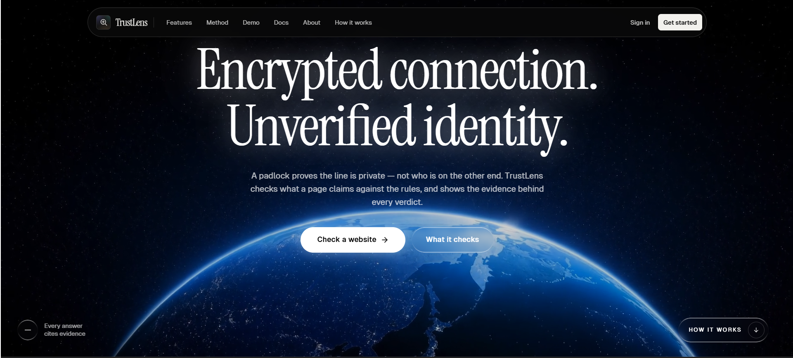 Landing | 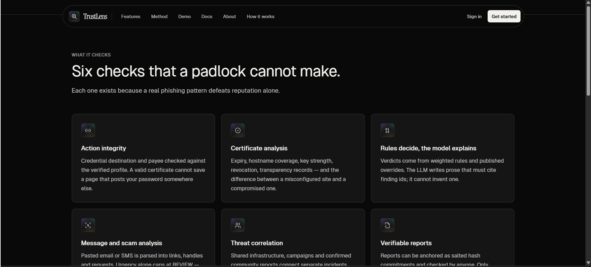 What it checks |
| 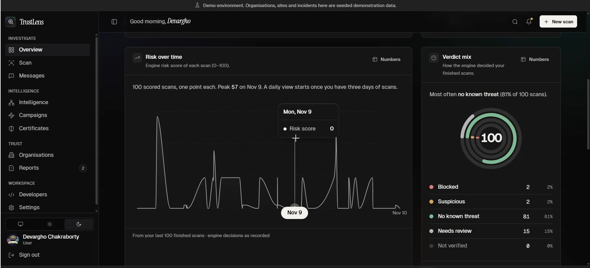 Dashboard overview | 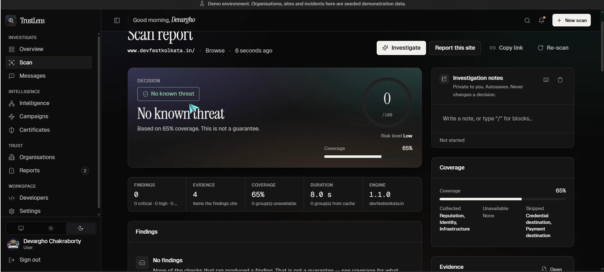 Scan report with coverage |
| 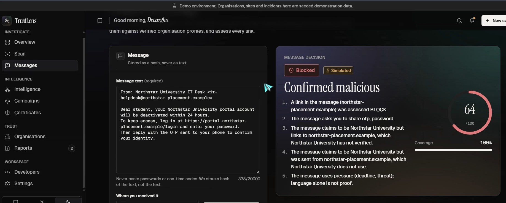 AI scam analysis (cited evidence) | 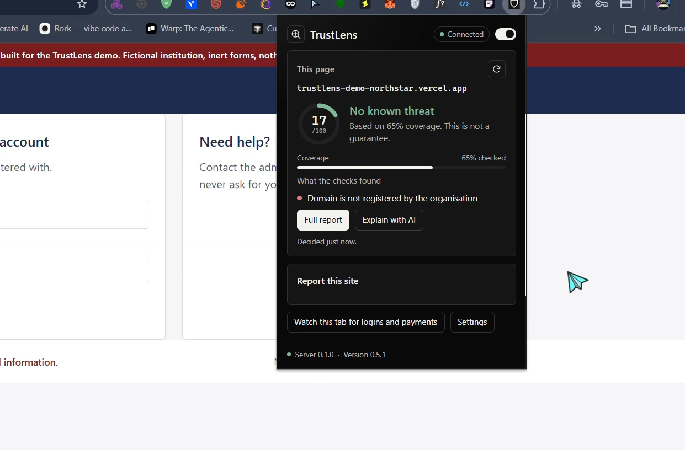 Extension popup |
| 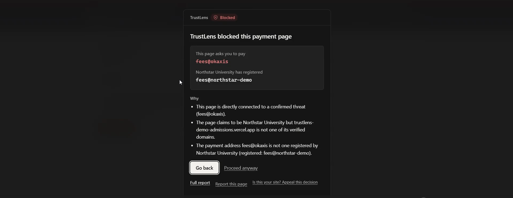 Payment page blocked (payee mismatch) | 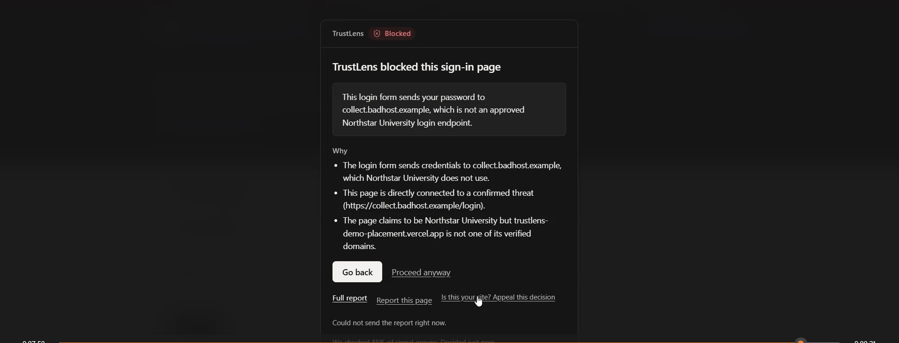 Sign-in page blocked (credential destination) |
| 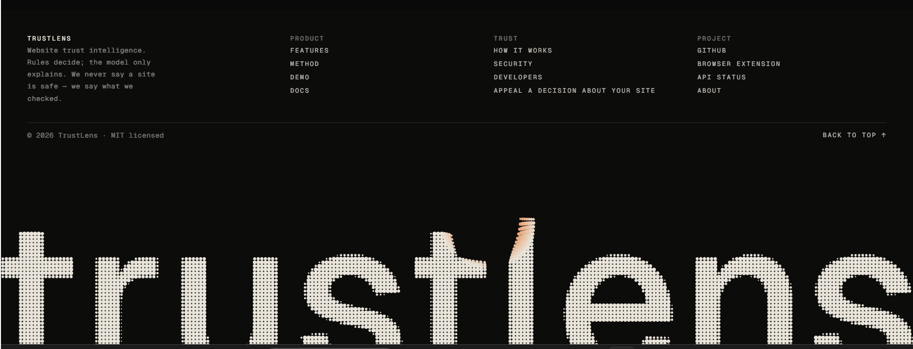 How it works | 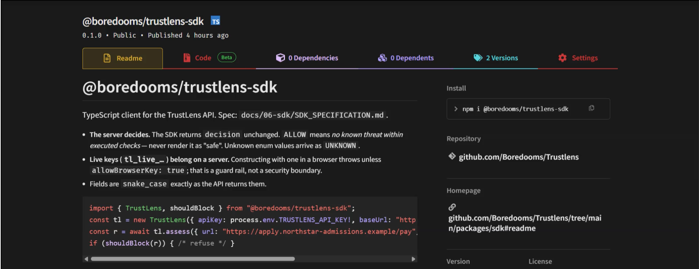 `@boredooms/trustlens-sdk` on npm |

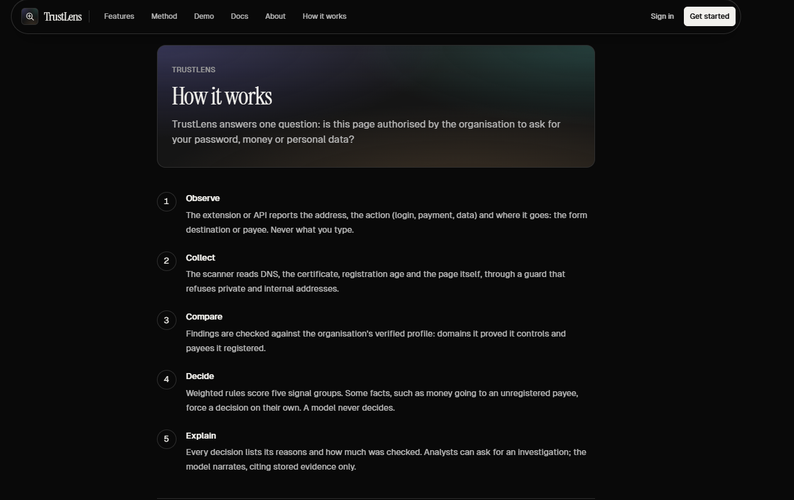
## Why this is different

Most tools ask *"is this URL known to be bad?"* TrustLens asks *"is this page allowed to ask for this?"*

It compares what a page **does** (where the login form posts, which UPI/bank payee it shows) with what the
organisation it claims to be has **registered**. A brand-new lookalike with no reputation history is still
caught, because its payee is not the one the real university registered.

- **Rules decide, the model narrates.** Verdicts come from a deterministic risk engine (`apps/api/app/risk`).
  The optional LLM writes prose that must cite existing finding ids; uncited claims are dropped.
- **`ALLOW` never means "safe".** It means "no known threat within the checks we ran". Coverage is always shown.
- **Unknown is not a pass.** A check that failed is `UNAVAILABLE`, never clean.
- **Language alone never condemns a message.** Urgency can reach `REVIEW`, never `BLOCK`, without corroboration (policy O-8/O-9).
- **Nothing personal goes on chain.** Only salted hash commitments.

## What is in the box

| Surface | What it does | Where |
| --- | --- | --- |
| **Dashboard** | Scan reports, message analysis, certificate posture, campaigns and entity graph, reports with on-chain anchors, analyst notes (block editor), scan assistant, developer keys, org verification | `apps/web` |
| **API** | The only verdict producer: scanner, risk engine, intel, messages, anchors, notes. OpenAPI is the contract | `apps/api` |
| **Browser extension** | Checks every page, holds a payment or login action until the server decides, shows *why* when it blocks. One-click pairing from the dashboard | `apps/extension` |
| **SDK** | Typed client for `assess`, `verifyIdentity`, scans and usage. Published: [`@boredooms/trustlens-sdk`](https://www.npmjs.com/package/@boredooms/trustlens-sdk) | `packages/sdk` |
| **Web3 registry** | `ThreatReportRegistry` contract. Anyone can verify a report without trusting TrustLens | `packages/contracts` |
| **Demo fixtures** | Inert genuine and lookalike sites, deployable as real public hosts | `apps/demo-sites` |

## Live demo sites (deployed)

Four labelled, inert test fixtures are deployed on Vercel so TrustLens can scan **real public hosts**.
Every page carries a "SIMULATED TEST FIXTURE" banner, `noindex` headers, a CSP with `form-action 'none'`, and
forms that cannot submit. Nothing is collected.

| Role | URL |
| --- | --- |
| Genuine Northstar University (home, `/login`, `/pay`) | https://trustlens-demo-northstar.vercel.app |
| Lookalike 1: admissions fee lure | https://trustlens-demo-admissions.vercel.app/pay |
| Lookalike 2: scholarship lure | https://trustlens-demo-scholarships.vercel.app/pay |
| Lookalike 3: placement credential sink | https://trustlens-demo-placement.vercel.app |

Observed against the running API (2026-11-09). Decisions come from the engine, not from this table:

| Page | Action context sent | Decision | Score | Key findings |
| --- | --- | --- | --- | --- |
| admissions `/pay` | payment, payee `fees@okaxis` | **BLOCK** | 51 | `PAYEE_NOT_IN_VERIFIED_PROFILE` (critical), `DOMAIN_NOT_REGISTERED_BY_BRAND`, `RELATED_THREAT_FOUND` |
| placement `/` | login form | **BLOCK** | 53 | `CREDENTIAL_DESTINATION_MISMATCH` (critical), `DOMAIN_NOT_REGISTERED_BY_BRAND` |
| any lookalike | plain browse | **WARN** | 35–36 | identity and infrastructure signals only |

A plain page view is a `WARN`; the `BLOCK` appears when the page asks for money or a password, because that is
the moment the action can be checked against the registered payee or login endpoint.

## How a threat is blocked end to end

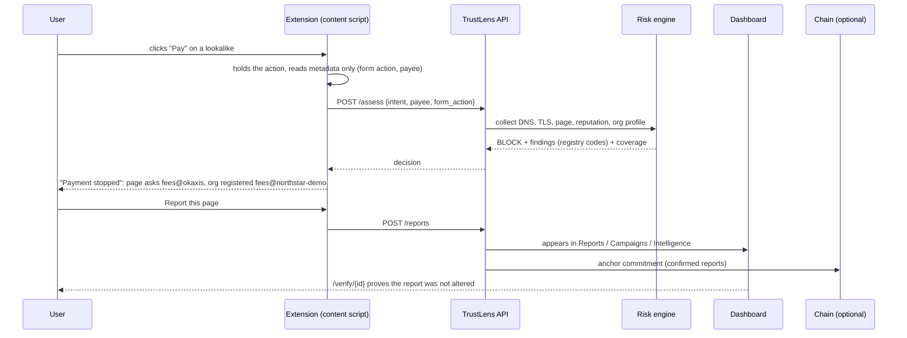

Verified in a real Chromium with the extension loaded against the **live Vercel hosts**: the Pay and Sign-in
actions on all three lookalikes are held, and the admissions page shows the block panel above.
The extension never reads what you type.

## Architecture

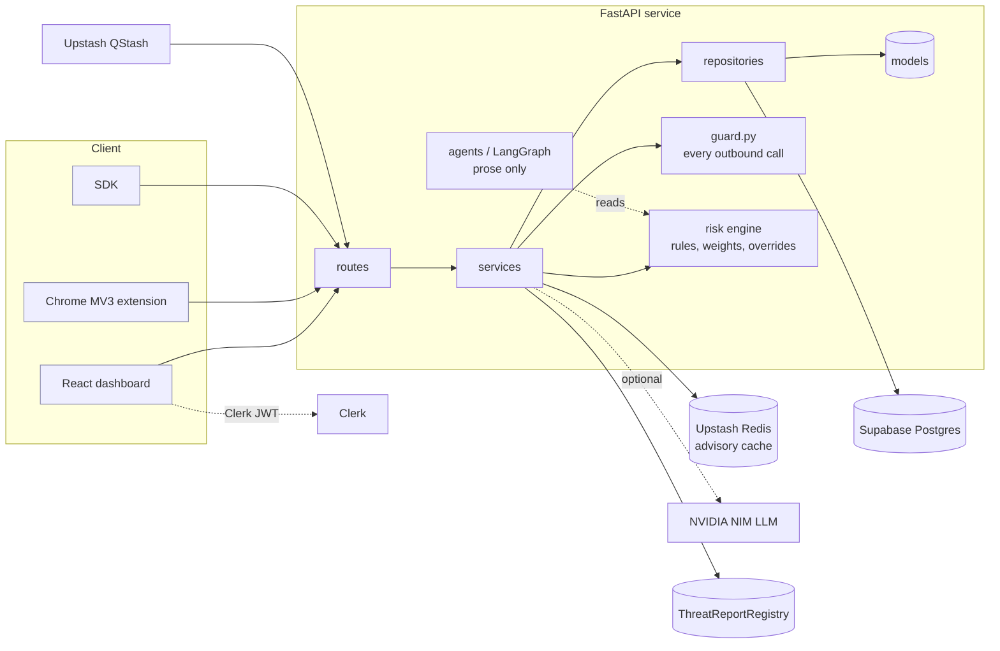

Signal weights: reputation 30 · identity 25 · credential 20 · payment 15 · infrastructure 10. Hard overrides
(O-1 to O-9) are documented in [`RISK_ENGINE.md`](docs/03-backend/RISK_ENGINE.md). Every network call, including each
redirect hop, goes through `services/guard.py` (SSRF-safe, DNS re-resolved).

## Run it

Prerequisites: **Node ≥ 20 + pnpm 9**, **Python 3.12**, and your own hosted services: **Supabase** (database only),
**Clerk**, **Upstash Redis + QStash**. Docker is needed only for the isolated test database.

```bash
pnpm install
cd apps/api
python -m venv .venv && . .venv/Scripts/activate        # macOS/Linux: . .venv/bin/activate
pip install -r requirements-dev.txt
cp .env.example .env                                    # fill the [required] hosted values; never commit it
python -m app.scripts.online_check                      # status of DB/Redis/QStash/Clerk/LLM, no secrets printed
alembic upgrade head
python -m app.scripts.seed_demo                         # Northstar University demo org (simulated, idempotent)
python -m app.serve                                     # API :8000
# new terminals, from the repo root:
pnpm --filter @trustlens/web dev                        # dashboard :5173
node apps/demo-sites/server.mjs                         # local demo sites :8081
```

Shortcut: `pwsh scripts/dev-up.ps1 -Migrate -Seed -WithChain` (Windows) or `bash scripts/dev-up.sh --migrate --seed --with-chain`.

### Load the extension

1. `pnpm --filter @trustlens/extension build` (or unzip [`releases/trustlens-extension-local.zip`](releases/); it targets `localhost:8000` and `localhost:5173`).
2. Chrome → `chrome://extensions` → Developer mode → **Load unpacked** → `apps/extension/dist`.
3. Sign in to the dashboard, open **Developers** and press **Connect extension**. Pairing is one click; the device token never reaches the page.

To target your own deployment, build with `VITE_API_BASE_URL`, `VITE_WEB_BASE_URL` and `VITE_DEMO_SITES_ORIGIN` set; host permissions are fixed at build time.

### Scan the live lookalikes

Open `https://trustlens-demo-admissions.vercel.app/pay` with the extension loaded and press **Pay**.

## Web3 proof

A deployed contract on a reproducible local chain, with a verification path that does not trust the API.

```bash
pnpm install
pnpm --filter @trustlens/contracts replay          # offline: deploy, register, verify true, tamper -> false
pnpm --filter @trustlens/contracts test            # 9 contract + cross-language commitment tests
pnpm --filter @trustlens/contracts verify-report -- --report <id>
```

Contract `0x5FbDB2315678afecb367f032d93F642f64180aa3` (chain 31337, deterministic), deploy and register
transactions are recorded in [`docs/evidence/web3/replay.json`](docs/evidence/web3/replay.json) and
[`chain.json`](docs/evidence/web3/chain.json). Anchors are stored in the hosted database (`report_anchors`) and shown
on each report; the public page `/verify/<report-id>` recomputes the commitment against the chain. The hosted API has
no chain configured (the local chain ID is refused in production by design), so live `/verify` answers
`CHAIN_UNAVAILABLE` rather than pretending; use the commands above for the reproducible proof. A public testnet is
**not** done (needs a funded wallet and a signing path); see [Limitations](#limitations-stated-not-hidden).

## Hackathon deliverables

| # | Deliverable | Status | Where |
| --- | --- | --- | --- |
| 1 | Working prototype with URL/domain investigation | **Live**: https://trustlens-web-three.vercel.app (Clerk sign-in → `/app`), API on Render | `/app/scan` |
| 2 | Public GitHub repository, source and setup | This repo | [Run it](#run-it) |
| 3 | AI demonstration, evidence-based explanation | Message analysis with cited evidence and the O-8 cap; investigation narratives cite finding ids | `/app/messages`, [`MESSAGE_ANALYSIS.md`](docs/03-backend/MESSAGE_ANALYSIS.md) |
| 4 | Cybersecurity demonstration with TLS analysis | Phishing lookalikes blocked; certificate misconfiguration separated from trust compromise | [`TESTING_REPORT.md`](docs/evidence/TESTING_REPORT.md) |
| 5 | Web3 demonstration | Solidity registry on a reproducible local chain | [Web3 proof](#web3-proof) |
| 6 | Verification evidence | Contract address, tx hashes, tamper test | [`docs/evidence/web3`](docs/evidence/web3/README.md) |
| 7 | Technical documentation | Architecture, pipeline, intel sources, security methodology | [`docs/INDEX.md`](docs/INDEX.md) |
| 8 | Testing report | 17 legitimate and suspicious cases with observed results | [`TESTING_REPORT.md`](docs/evidence/TESTING_REPORT.md) |
| 9 | Live demonstration | Live dashboard + live lookalikes: submit, investigate, assess, report | [`docs/evidence/demo.md`](docs/evidence/demo.md), [live demo sites](#live-demo-sites-deployed) |

## Problem statement → where it is

| Requirement | Implementation | Docs |
| --- | --- | --- |
| URL and domain analysis (normalise, typosquat, redirects, reputation, DNS, campaigns) | `apps/api/app/services/{guard,collectors}.py`, `app/risk/rules.py` | [`RISK_ENGINE.md`](docs/03-backend/RISK_ENGINE.md) |
| TLS certificate and web trust (expiry, SAN, chain, revocation, CT, weak crypto) | `app/services/certificates.py`, `app/risk/posture.py` | [`CERTIFICATE_ANALYSIS.md`](docs/03-backend/CERTIFICATE_ANALYSIS.md) |
| AI scam and message analysis | `app/services/message_analysis.py`, `/app/messages` | [`MESSAGE_ANALYSIS.md`](docs/03-backend/MESSAGE_ANALYSIS.md) |
| Threat correlation | graph, campaigns, LangGraph investigations | [`THREAT_GRAPH.md`](docs/07-ai-intelligence/THREAT_GRAPH.md) |
| Website security assessment (headers, cookies, mixed content) | `app/risk/posture.py`, reported but never scored | [`CERTIFICATE_ANALYSIS.md`](docs/03-backend/CERTIFICATE_ANALYSIS.md) §5 |
| Decentralised threat intelligence | `packages/contracts`, `app/services/{anchors,chain}.py`, `/verify/:id` | [`WEB3_REGISTRY.md`](docs/02-architecture/WEB3_REGISTRY.md) |
| External intelligence | URLhaus (abuse.ch): live with a key, labelled fixtures otherwise | [`THREAT_INTELLIGENCE_SOURCES.md`](docs/02-architecture/THREAT_INTELLIGENCE_SOURCES.md) |

## Quality gates

```bash
(cd apps/api && ruff check . && ruff format --check . && mypy app)
docker compose --profile test up -d test-db && pwsh scripts/test-api.ps1   # isolated DB, never the hosted one
pwsh scripts/secret-scan.ps1 -Staged
pnpm -r typecheck && pnpm -r lint && pnpm -r test && pnpm -r build
```

Last full run: API 410 passed, `mypy app` clean (104 files), web 106 tests, all typechecks and lints pass, extension
E2E in real Chromium 16/16 plus 10/10 against the live lookalikes. CI is in [`.github/workflows`](.github/workflows):
`ci.yml` runs on every pull request and push; `release.yml` is manual only (migrate, Render deploy hook, extension zip).

## Deployment (live)

| Piece | Where | Notes |
| --- | --- | --- |
| Dashboard | **https://trustlens-web-three.vercel.app** | Vercel project `trustlens-web`, root `apps/web`, deploys on push to `main`. SPA rewrites + security headers in [`apps/web/vercel.json`](apps/web/vercel.json) |
| API | **https://trustlens-api-m65a.onrender.com** | Render Docker web service (free, Singapore, next to Supabase), deploys on push to `main`. Blueprint: [`infrastructure/render.yaml`](infrastructure/render.yaml) |
| Health | [`/health`](https://trustlens-api-m65a.onrender.com/health) · [`/ready`](https://trustlens-api-m65a.onrender.com/ready) · [`/api/v1/health`](https://trustlens-api-m65a.onrender.com/api/v1/health) | Public, no auth, no values: liveness, then DB / scanner / LLM readiness |
| Database | Supabase Postgres | 34 tables, RLS audit clean, migrations at `c7a0note0001` |
| Cron | Upstash QStash → `/internal/jobs/*` | Signed; unsigned calls get 401 |
| Demo fixtures | 4 Vercel projects | See [Live demo sites](#live-demo-sites-deployed) |

CORS and the Clerk `azp` check accept the production origin plus this team's Vercel deployment URLs through an
anchored, team-scoped pattern (`ALLOWED_ORIGIN_REGEX`); other origins are refused. The free plan has 512 MB; the API
runs one worker (about 140 MB after hours of scans) with `SCAN_CONCURRENCY=2`. The first request after idle can take
about a minute while Render wakes the service. Variable names: [`ENVIRONMENT_CONFIGURATION.md`](docs/08-infrastructure/ENVIRONMENT_CONFIGURATION.md).
Never put a secret in a `VITE_*` variable or commit a `.env` file.

### Browser extension

[`releases/trustlens-extension-production.zip`](releases/) targets the live API and dashboard (unzip, then
**Load unpacked**). `trustlens-extension-local.zip` targets `localhost`. Verified in real Chromium against production:
one-click pairing on the live dashboard, and Pay / Sign-in held and blocked on all three live lookalikes (10/10).

Since v0.5.0 the extension also **guards pages before they can be used**: a page with a login form, a
payment or a personal-data form (v0.5.1) is covered as soon as it loads while the server checks that page's own form destination and
payee; a `BLOCK`/`WARN` keeps it covered (two clicks to override a block). A link to a host flagged in
the last 10 minutes is stopped before navigating, a click on an installer or archive is held while the
file's host is checked, and the popup shows the decision that was actually enforced on the page. Verified against production in real Chromium (13/13):
the live lookalike `/pay` is covered within 2 s with no click and stays blocked, a link to it from
another site is stopped, and the genuine Northstar pay page is checked and released.

### SDK

```bash
npm install @boredooms/trustlens-sdk   # published on npm, v0.1.0
```
## Repository layout

```text
apps/api            FastAPI: risk engine, scanner, intel, messages, anchors, notes
apps/web            React + Vite dashboard and public pages (/verify/:reportId)
apps/extension      Chrome MV3 extension
apps/demo-sites     Inert genuine + lookalike fixtures (local server and Vercel build)
packages/contracts  ThreatReportRegistry (Solidity 0.8.24, Hardhat)
packages/sdk        @boredooms/trustlens-sdk
packages/shared-types  generated from apps/api/openapi.json
docs/               specification, evidence, handover
releases/           packaged extension
```

## Limitations (stated, not hidden)

- The seeded `.example` hosts answer from recorded fixtures (`simulated: true`). The Vercel fixtures are scanned for real.
- The local chain is in-memory; restarting it erases the registry (older anchors then honestly fail `chain_commitment_matches`). Anchoring to a public testnet is not implemented.
- The Northstar organisation profile is a demo profile; lookalike detection on `*.vercel.app` hosts relies on brand tokens and the registered payee.
- Revocation is best-effort (OCSP, CRL fallback); a timeout is `unavailable`, never "good".
- Header posture is one unauthenticated response; it is reported, never scored.

## License

[MIT](LICENSE)
