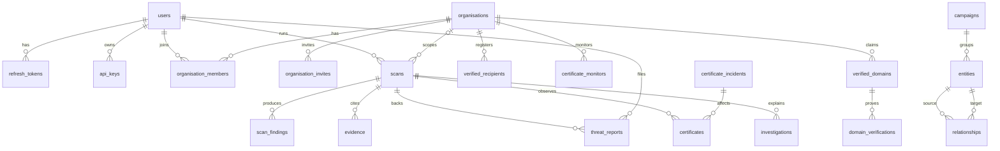

# DATABASE_DESIGN

> **Status:** DECIDED · **Group:** 02-architecture · **Version:** 1.0 · **Last updated:** 2026-11-07
> **Source of truth for:** tables, columns, keys, constraints, indexes, retention, ER model.
> **Related:** [`SYSTEM_ARCHITECTURE.md`](SYSTEM_ARCHITECTURE.md) · [`../03-backend/ORGANISATION_TRUST_PROFILES.md`](../03-backend/ORGANISATION_TRUST_PROFILES.md) · [`../07-ai-intelligence/THREAT_GRAPH.md`](../07-ai-intelligence/THREAT_GRAPH.md)

---

## 1. Principles

1. **Supabase Postgres 16** is the only *system of record*. Upstash Redis holds only disposable state
   (rate-limit counters, idempotency records, cache); losing it never loses a scan, report or profile.
   No Neo4j.
2. **ULIDs** (`CHAR(26)`) for all primary keys — sortable, non-enumerable.
3. **`TIMESTAMPTZ`** everywhere; application code writes UTC.
4. **`JSONB`** for evidence payloads and provider blobs; never for anything queried relationally
   except with explicit GIN indexes.
5. **Invariants live in the database** where they are cheap: unique constraints, check constraints,
   foreign keys with explicit `ON DELETE`.
6. **Append-only tables** (`audit_logs`, `evidence`) are never updated by application code.
7. **Tenant scoping** is enforced in queries *and* by requiring `organisation_id` on tenant tables.

25 tables in four groups: identity, trust, assessment, intelligence.

---

## 2. ER overview



---

## 3. Identity group

### 3.1 `users`

| Column | Type | Notes |
| --- | --- | --- |
| `id` | `CHAR(26)` PK | ULID |
| `clerk_user_id` | `TEXT` UNIQUE NOT NULL | Clerk user id (`user_2f…`); opaque, never parsed |
| `email` | `CITEXT` NOT NULL | denormalised copy, refreshed on login |
| `display_name` | `TEXT` NOT NULL | 2–80 chars |
| `role` | `TEXT` NOT NULL DEFAULT `'user'` | CHECK in (`user`,`analyst`,`operator`) |
| `is_active` | `BOOLEAN` NOT NULL DEFAULT true | deactivated on deletion request |
| `email_verified_at` | `TIMESTAMPTZ` NULL | MVP: set on registration when mail is unavailable |
| `last_login_at` | `TIMESTAMPTZ` NULL | |
| `created_at` / `updated_at` | `TIMESTAMPTZ` NOT NULL | |

Indexes: `UNIQUE(clerk_user_id)`, `(email)`, `(role)`.
**No password hash exists in this table** — passwords live in Clerk and never reach us.
Retention: deleted on account deletion after anonymising references.

### 3.2 `refresh_tokens` (legacy, unused in MVP)

> Retained as the documented fallback for self-hosted human auth (ADR-012). With Clerk this
table is empty; nothing in the MVP reads or writes it. Keep the migration, skip the code.

| Column | Type | Notes |
| --- | --- | --- |
| `id` | `CHAR(26)` PK | |
| `user_id` | `CHAR(26)` FK → users `ON DELETE CASCADE` | |
| `token_hash` | `CHAR(64)` NOT NULL UNIQUE | SHA-256 of the opaque token |
| `family_id` | `CHAR(26)` NOT NULL | rotation family for reuse detection |
| `user_agent_hash` | `CHAR(64)` NULL | coarse device binding |
| `expires_at` | `TIMESTAMPTZ` NOT NULL | |
| `revoked_at` | `TIMESTAMPTZ` NULL | |
| `created_at` | `TIMESTAMPTZ` NOT NULL | |

Indexes: `UNIQUE(token_hash)`, `(user_id, expires_at)`, `(family_id)`.
Retention: purge 30 days after `expires_at`.

### 3.3 `api_keys`

Serves both developer keys and extension device tokens (`kind` discriminates).

| Column | Type | Notes |
| --- | --- | --- |
| `id` | `CHAR(26)` PK | |
| `user_id` | `CHAR(26)` FK → users CASCADE | |
| `kind` | `TEXT` NOT NULL | `api_key` \| `extension_device` |
| `name` | `TEXT` NOT NULL | user label |
| `prefix` | `TEXT` NOT NULL | visible part, e.g. `tl_live_ab12` |
| `secret_hash` | `CHAR(64)` NOT NULL UNIQUE | SHA-256 of full secret |
| `scopes` | `TEXT[]` NOT NULL | allowlist; see AUTH §6 |
| `last_used_at` | `TIMESTAMPTZ` NULL | updated lazily (≤1/min) |
| `expires_at` | `TIMESTAMPTZ` NULL | extension devices: 180 days |
| `revoked_at` | `TIMESTAMPTZ` NULL | |
| `created_at` | `TIMESTAMPTZ` NOT NULL | |

Indexes: `UNIQUE(secret_hash)`, `(user_id, kind)`, `(prefix)`.

### 3.4 `pairing_codes`

| Column | Type | Notes |
| --- | --- | --- |
| `id` | `CHAR(26)` PK | |
| `user_id` | `CHAR(26)` FK CASCADE | |
| `code_hash` | `CHAR(64)` NOT NULL UNIQUE | 8-char code, hashed |
| `expires_at` | `TIMESTAMPTZ` NOT NULL | 10 minutes |
| `consumed_at` | `TIMESTAMPTZ` NULL | single use |
| `created_at` | `TIMESTAMPTZ` NOT NULL | |

Retention: purge after 24 h.

---

## 4. Trust group

### 4.1 `organisations`

| Column | Type | Notes |
| --- | --- | --- |
| `id` | `CHAR(26)` PK | |
| `name` | `TEXT` NOT NULL | 2–120 |
| `legal_name` | `TEXT` NULL | |
| `country` | `CHAR(2)` NULL | ISO 3166-1 alpha-2 |
| `sector` | `TEXT` NULL | `education`, `fintech`, `ecommerce`, `government`, `other` |
| `support_email` | `CITEXT` NULL | |
| `brand_tokens` | `TEXT[]` NOT NULL DEFAULT '{}' | names/aliases used for impersonation matching |
| `logo_phash` | `BIT(64)` NULL | perceptual hash of official logo |
| `status` | `TEXT` NOT NULL DEFAULT `'draft'` | `draft` \| `active` \| `suspended` |
| `login_hosts_mode` | `TEXT` NOT NULL DEFAULT `'domain_wildcard'` | `domain_wildcard` \| `explicit_only` (`ORGANISATION_TRUST_PROFILES.md` §4.3); migration `c1a0gov00001` |
| `created_by` | `CHAR(26)` FK users SET NULL | |
| `created_at` / `updated_at` | `TIMESTAMPTZ` NOT NULL | |

Indexes: `(status)`, `GIN(brand_tokens)`, `GIN(name gin_trgm_ops)` for search.

### 4.2 `organisation_members`

| Column | Type | Notes |
| --- | --- | --- |
| `id` | `CHAR(26)` PK | |
| `organisation_id` | `CHAR(26)` FK organisations CASCADE | |
| `user_id` | `CHAR(26)` FK users CASCADE | |
| `role` | `TEXT` NOT NULL | `org_admin` \| `org_member` |
| `created_at` | `TIMESTAMPTZ` NOT NULL | |

Constraint: `UNIQUE(organisation_id, user_id)`.
Application invariant: at least one `org_admin` (enforced in service, checked before removal).

### 4.3 `organisation_invites`

| Column | Type | Notes |
| --- | --- | --- |
| `id` | `CHAR(26)` PK | |
| `organisation_id` | `CHAR(26)` FK CASCADE | |
| `email` | `CITEXT` NOT NULL | |
| `role` | `TEXT` NOT NULL | |
| `token_hash` | `CHAR(64)` NOT NULL UNIQUE | |
| `invited_by` | `CHAR(26)` FK users SET NULL | |
| `expires_at` | `TIMESTAMPTZ` NOT NULL | 7 days |
| `accepted_at` | `TIMESTAMPTZ` NULL | |
| `created_at` | `TIMESTAMPTZ` NOT NULL | |

Constraint: `UNIQUE(organisation_id, email)` where `accepted_at IS NULL` (partial unique index).

### 4.4 `verified_domains`

| Column | Type | Notes |
| --- | --- | --- |
| `id` | `CHAR(26)` PK | |
| `organisation_id` | `CHAR(26)` FK CASCADE | |
| `domain` | `TEXT` NOT NULL | punycode, lowercase |
| `kind` | `TEXT` NOT NULL DEFAULT `'official'` | `official` \| `login` \| `application` \| `payment` |
| `status` | `TEXT` NOT NULL DEFAULT `'pending'` | `pending` \| `verified` \| `failed` \| `expired` \| `revoked` |
| `verification_method` | `TEXT` NULL | `dns_txt` \| `http_file` of the last successful challenge; NULL for seeded rows; migration `c1a0gov00001` |
| `verified_at` | `TIMESTAMPTZ` NULL | |
| `expires_at` | `TIMESTAMPTZ` NULL | re-verify after 180 days |
| `created_at` / `updated_at` | `TIMESTAMPTZ` NOT NULL | |

Constraint: `UNIQUE(domain)` — a domain can be authoritative for only one organisation.
Indexes: `(organisation_id, status)`, `(domain)`.

### 4.5 `domain_verifications`

| Column | Type | Notes |
| --- | --- | --- |
| `id` | `CHAR(26)` PK | |
| `verified_domain_id` | `CHAR(26)` FK CASCADE | |
| `method` | `TEXT` NOT NULL | `dns_txt` \| `http_file` |
| `token_hash` | `CHAR(64)` NOT NULL | never returned after creation |
| `status` | `TEXT` NOT NULL | `pending` \| `verified` \| `failed` \| `expired` |
| `observed_value` | `TEXT` NULL | truncated to 16 chars (the same value echoed in the error) |
| `attempts` | `INTEGER` NOT NULL DEFAULT 0 | |
| `expires_at` | `TIMESTAMPTZ` NOT NULL | 7 days |
| `verified_at` | `TIMESTAMPTZ` NULL | |
| `created_at` | `TIMESTAMPTZ` NOT NULL | |

### 4.6 `verified_recipients`

| Column | Type | Notes |
| --- | --- | --- |
| `id` | `CHAR(26)` PK | |
| `organisation_id` | `CHAR(26)` FK CASCADE | |
| `recipient_type` | `TEXT` NOT NULL | `upi_vpa` \| `iban` \| `bank_account` \| `wallet_address` \| `payment_link` |
| `value` | `TEXT` NOT NULL | as supplied |
| `normalised_value` | `TEXT` NOT NULL | lowercase/uppercased per type |
| `label` | `TEXT` NULL | e.g. "Admissions fee account" |
| `status` | `TEXT` NOT NULL DEFAULT `'pending_attestation'` | `pending_attestation` \| `verified` \| `rejected` \| `revoked` |
| `evidence_ref` | `TEXT` NULL | object key or analyst note reference |
| `verified_by` | `CHAR(26)` FK users SET NULL | |
| `verified_at` | `TIMESTAMPTZ` NULL | |
| `created_at` / `updated_at` | `TIMESTAMPTZ` NOT NULL | |

Constraint: `UNIQUE(organisation_id, recipient_type, normalised_value)`.
Indexes: `(normalised_value)` for reverse lookup, `(organisation_id, status)`.

---

## 5. Assessment group

### 5.1 `scans`

| Column | Type | Notes |
| --- | --- | --- |
| `id` | `CHAR(26)` PK | |
| `user_id` | `CHAR(26)` FK users SET NULL | null for anonymous |
| `organisation_id` | `CHAR(26)` FK organisations SET NULL | scope of the check |
| `url` | `TEXT` NOT NULL | as submitted |
| `normalised_url` | `TEXT` NOT NULL | |
| `registrable_domain` | `TEXT` NOT NULL | |
| `intent` | `TEXT` NOT NULL DEFAULT `'browse'` | enum |
| `deep` | `BOOLEAN` NOT NULL DEFAULT false | |
| `status` | `TEXT` NOT NULL DEFAULT `'queued'` | `queued` \| `running` \| `completed` \| `partial` \| `failed` |
| `decision` | `TEXT` NULL | enum; null until scored |
| `risk_level` | `TEXT` NULL | enum |
| `risk_score` | `SMALLINT` NULL | 0–100 |
| `coverage` | `JSONB` NOT NULL DEFAULT '{}' | `{percent, collected[], unavailable[], skipped[]}` |
| `reasons` | `JSONB` NOT NULL DEFAULT '[]' | ordered strings |
| `overrides` | `JSONB` NOT NULL DEFAULT '[]' | fired rule ids |
| `result` | `JSONB` NOT NULL DEFAULT '{}' | denormalised blocks: dns/rdap/tls/redirects/page/brand/action |
| `cached_groups` | `TEXT[]` NOT NULL DEFAULT '{}' | which blocks came from cache |
| `failure_code` | `TEXT` NULL | |
| `duration_ms` | `INTEGER` NULL | |
| `created_at` / `completed_at` | `TIMESTAMPTZ` | |

Indexes: `(user_id, created_at DESC)`, `(organisation_id, created_at DESC)`,
`(registrable_domain, created_at DESC)`, `(decision)`, `(status)` where status in
('queued','running') — partial index for the poller.

Retention: full `result` for 90 days, then keep decision + findings; raw page snapshot 30 days.

### 5.2 `scan_findings`

| Column | Type | Notes |
| --- | --- | --- |
| `id` | `CHAR(26)` PK | |
| `scan_id` | `CHAR(26)` FK scans CASCADE | |
| `code` | `TEXT` NOT NULL | registry in RISK_ENGINE §7 |
| `signal_group` | `TEXT` NOT NULL | enum |
| `severity` | `TEXT` NOT NULL | `critical`\|`high`\|`medium`\|`low`\|`info` |
| `confidence` | `NUMERIC(3,2)` NOT NULL | 0.00–1.00 |
| `title` | `TEXT` NOT NULL | short human label |
| `detail` | `TEXT` NULL | one sentence, safe to display |
| `observed` | `JSONB` NULL | e.g. `{"payee":"x@y"}` |
| `expected` | `JSONB` NULL | e.g. `{"payees":["fees@org"]}` |
| `evidence_ids` | `CHAR(26)[]` NOT NULL DEFAULT '{}' | |
| `rule_id` | `TEXT` NULL | `R-*` that produced it |
| `created_at` | `TIMESTAMPTZ` NOT NULL | |

Constraint: `CHECK (risk_score …)` n/a; `CHECK (confidence BETWEEN 0 AND 1)`.
Indexes: `(scan_id)`, `(code)`, `(signal_group, severity)`.

### 5.3 `evidence`

Append-only.

| Column | Type | Notes |
| --- | --- | --- |
| `id` | `CHAR(26)` PK | |
| `scan_id` | `CHAR(26)` FK scans CASCADE | nullable for org verification evidence |
| `source` | `TEXT` NOT NULL | `dns`\|`rdap`\|`tls`\|`http`\|`redirect_hop`\|`page`\|`dns_challenge`\|`http_file`\|`report`\|`manual` |
| `observed_at` | `TIMESTAMPTZ` NOT NULL | when the observation was made |
| `summary` | `TEXT` NOT NULL` | one line |
| `payload` | `JSONB` NOT NULL | redacted structured artefact |
| `payload_hash` | `CHAR(64)` NOT NULL | integrity check |
| `blob_ref` | `TEXT` NULL | object storage key for large artefacts |
| `created_at` | `TIMESTAMPTZ` NOT NULL | |

Indexes: `(scan_id, source)`, `(payload_hash)`.
Retention: 90 days for page/HTTP payloads; certificate/DNS summaries 1 year (needed for history).

---

## 6. Intelligence group

### 6.1 `entities`

| Column | Type | Notes |
| --- | --- | --- |
| `id` | `CHAR(26)` PK | |
| `type` | `TEXT` NOT NULL | 11 types (THREAT_GRAPH §3) |
| `key` | `TEXT` NOT NULL | canonical identity, e.g. `domain:foo.example` |
| `label` | `TEXT` NOT NULL | display name |
| `attributes` | `JSONB` NOT NULL DEFAULT '{}' | type-specific, e.g. `{age_days:4}` |
| `reputation_score` | `SMALLINT` NOT NULL DEFAULT 0 | −100…100 |
| `first_seen_at` / `last_seen_at` | `TIMESTAMPTZ` NOT NULL | |
| `created_at` / `updated_at` | `TIMESTAMPTZ` NOT NULL | |

Constraint: `UNIQUE(type, key)`.
Indexes: `(type, last_seen_at DESC)`, `GIN(key gin_trgm_ops)` for search.

### 6.2 `relationships`

| Column | Type | Notes |
| --- | --- | --- |
| `id` | `CHAR(26)` PK | |
| `source_entity_id` | `CHAR(26)` FK entities CASCADE | |
| `target_entity_id` | `CHAR(26)` FK entities CASCADE | |
| `type` | `TEXT` NOT NULL | 12 types (THREAT_GRAPH §4) |
| `confidence` | `NUMERIC(3,2)` NOT NULL | 0–1 |
| `evidence_ids` | `CHAR(26)[]` NOT NULL DEFAULT '{}' | |
| `first_seen_at` / `last_seen_at` | `TIMESTAMPTZ` NOT NULL | |
| `observed_count` | `INTEGER` NOT NULL DEFAULT 1 | reinforcement |
| `created_at` / `updated_at` | `TIMESTAMPTZ` NOT NULL | |

Constraint: `UNIQUE(source_entity_id, target_entity_id, type)`; `CHECK (source_entity_id <> target_entity_id)`.
Indexes: `(source_entity_id, type)`, `(target_entity_id, type)`, `(type, confidence DESC)`.

### 6.3 `threat_reports`

| Column | Type | Notes |
| --- | --- | --- |
| `id` | `CHAR(26)` PK | |
| `reporter_user_id` | `CHAR(26)` FK users SET NULL | null on anonymisation |
| `reporter_channel` | `TEXT` NOT NULL | `web`\|`extension`\|`sdk`\|`analyst` |
| `url` | `TEXT` NOT NULL | |
| `normalised_url` | `TEXT` NOT NULL` | |
| `entity_id` | `CHAR(26)` FK entities SET NULL | the reported domain/url entity |
| `scan_id` | `CHAR(26)` FK scans SET NULL | |
| `justification` | `TEXT` NOT NULL | 10–500 chars |
| `observed_payee` | `TEXT` NULL | masked in shared views |
| `status` | `TEXT` NOT NULL DEFAULT `'pending'` | `pending`\|`reviewing`\|`confirmed`\|`dismissed` |
| `reviewed_by` | `CHAR(26)` FK users SET NULL | |
| `reviewed_at` | `TIMESTAMPTZ` NULL | |
| `review_reason` | `TEXT` NULL | required on decision |
| `anonymised_at` | `TIMESTAMPTZ` NULL | |
| `created_at` / `updated_at` | `TIMESTAMPTZ` NOT NULL | |

Dedupe: partial unique index on `(reporter_user_id, normalised_url)` where
`created_at > now() - interval '24 hours'` is not possible in an index; implemented as a service
check plus a unique index on `(reporter_user_id, normalised_url, date_trunc('day', created_at))`
stored in a generated column `dedupe_day DATE`.

Indexes: `(status, created_at DESC)`, `(normalised_url)`, `(entity_id)`.

### 6.4 `campaigns`

| Column | Type | Notes |
| --- | --- | --- |
| `id` | `CHAR(26)` PK | |
| `name` | `TEXT` NOT NULL | generated label, e.g. "Northstar admissions cluster" |
| `confidence` | `NUMERIC(3,2)` NOT NULL | 0–1 |
| `member_count` | `INTEGER` NOT NULL DEFAULT 0` | |
| `summary` | `TEXT` NULL | analyst-editable |
| `first_seen_at` / `last_seen_at` | `TIMESTAMPTZ` NOT NULL | |
| `created_at` / `updated_at` | `TIMESTAMPTZ` NOT NULL | |

Campaign membership is a `relationships` row of type `MEMBER_OF_CAMPAIGN` — no join table.

### 6.5 `certificates`

| Column | Type | Notes |
| --- | --- | --- |
| `id` | `CHAR(26)` PK | |
| `fingerprint_sha256` | `CHAR(64)` NOT NULL UNIQUE | identity of the cert |
| `subject_cn` | `TEXT` NULL | |
| `issuer_cn` | `TEXT` NOT NULL | |
| `root_issuer_cn` | `TEXT` NULL | |
| `sans` | `TEXT[]` NOT NULL DEFAULT '{}' | |
| `not_before` / `not_after` | `TIMESTAMPTZ` NOT NULL | |
| `key_type` | `TEXT` NOT NULL | |
| `key_bits` | `INTEGER` NULL | |
| `signature_algorithm` | `TEXT` NOT NULL | |
| `is_self_signed` | `BOOLEAN` NOT NULL DEFAULT false | |
| `chain_length` | `SMALLINT` NULL | |
| `first_seen_at` / `last_seen_at` | `TIMESTAMPTZ` NOT NULL | |
| `last_scan_id` | `CHAR(26)` FK scans SET NULL | |

Indexes: `(issuer_cn)`, `(not_after)`, `(root_issuer_cn)`.

### 6.6 `certificate_monitors`

| Column | Type | Notes |
| --- | --- | --- |
| `id` | `CHAR(26)` PK | |
| `organisation_id` | `CHAR(26)` FK organisations CASCADE | |
| `domain` | `TEXT` NOT NULL | |
| `enabled` | `BOOLEAN` NOT NULL DEFAULT true | |
| `current_certificate_id` | `CHAR(26)` FK certificates SET NULL | |
| `last_checked_at` | `TIMESTAMPTZ` NULL | |
| `created_at` | `TIMESTAMPTZ` NOT NULL | |

Constraint: `UNIQUE(organisation_id, domain)`.

### 6.7 `certificate_incidents`

| Column | Type | Notes |
| --- | --- | --- |
| `id` | `CHAR(26)` PK | |
| `issuer_cn` | `TEXT` NOT NULL | affected issuer |
| `title` | `TEXT` NOT NULL | |
| `severity` | `TEXT` NOT NULL | |
| `description` | `TEXT` NOT NULL | |
| `source` | `TEXT` NOT NULL | advisory URL or `simulation` |
| `simulated` | `BOOLEAN` NOT NULL DEFAULT false | **required in UI** |
| `published_at` | `TIMESTAMPTZ` NOT NULL` | |
| `affected_domain_count` | `INTEGER` NOT NULL DEFAULT 0 | computed snapshot |
| `created_by` | `CHAR(26)` FK users SET NULL | |
| `created_at` | `TIMESTAMPTZ` NOT NULL | |

Indexes: `(issuer_cn)`, `(simulated, published_at DESC)`.

### 6.8 `investigations`

| Column | Type | Notes |
| --- | --- | --- |
| `id` | `CHAR(26)` PK | |
| `scan_id` | `CHAR(26)` FK scans CASCADE | |
| `user_id` | `CHAR(26)` FK users SET NULL | |
| `organisation_id` | `CHAR(26)` FK organisations SET NULL | |
| `status` | `TEXT` NOT NULL | `queued`\|`running`\|`completed`\|`partial`\|`failed` |
| `steps` | `JSONB` NOT NULL DEFAULT '[]' | ordered `{name,status,started_at,ended_at,error}` |
| `narrative` | `JSONB` NULL | `{sections:[{heading,claims:[{text,refs[]}]}]}` |
| `references` | `JSONB` NOT NULL DEFAULT '[]' | `{id,kind,label,finding_id|entity_id}` |
| `dropped_claims` | `JSONB` NOT NULL DEFAULT '[]' | claims removed by validation |
| `ai_meta` | `JSONB` NOT NULL DEFAULT '{}' | `{generated,model,prompt_version,tokens,latency_ms}` |
| `created_at` / `completed_at` | `TIMESTAMPTZ` | |

Indexes: `(scan_id)`, `(user_id, created_at DESC)`.

---

## 7. Operational group

### 7.1 `audit_logs` (append-only)

| Column | Type | Notes |
| --- | --- | --- |
| `id` | `CHAR(26)` PK | |
| `actor_user_id` | `CHAR(26)` FK users SET NULL | |
| `actor_kind` | `TEXT` NOT NULL | `user`\|`api_key`\|`extension`\|`system` |
| `action` | `TEXT` NOT NULL | e.g. `domain.verify`, `report.review`, `apikey.create` |
| `target_type` / `target_id` | `TEXT` / `TEXT` | |
| `organisation_id` | `CHAR(26)` NULL | |
| `before` / `after` | `JSONB` NULL | redacted |
| `ip_hash` | `CHAR(64)` NULL | salted hash, not the raw IP |
| `request_id` | `TEXT` NULL | |
| `created_at` | `TIMESTAMPTZ` NOT NULL | |

Indexes: `(created_at DESC)`, `(actor_user_id, created_at DESC)`, `(action, created_at DESC)`.
Retention: 1 year; never mutated.

### 7.2 `idempotency_keys`

`id`, `actor_id`, `key`, `body_hash`, `response_status`, `response_body JSONB`, `created_at`,
`expires_at`. `UNIQUE(actor_id, key)`. Purge after 24 h.

### 7.3 `usage_counters`

`id`, `actor_id`, `actor_kind`, `day DATE`, `endpoint_group TEXT`, `count INTEGER`.
`UNIQUE(actor_id, actor_kind, day, endpoint_group)`. 90-day retention.

### 7.4 `report_anchors` (Web3 registry, migration `c3a0web30001`)

One row per threat report holding its latest on-chain commitment: `report_id` (unique, FK
`threat_reports` CASCADE), `chain_id`, `contract`, `report_id_bytes32`, `payload JSONB` (privacy-safe
snapshot), `payload_hash`, `salt_ciphertext` (Fernet, never logged), `commitment`, `revision ≥ 1`,
`tx_hash`, `block_number`, `anchored_at`, `created_by`. CHECKs enforce `0x`+64-hex hashes. RLS on, no
policy. Owner and full column list: [`WEB3_REGISTRY.md`](WEB3_REGISTRY.md) §6.

### 7.5 `message_analyses` (message analysis, migration `c4a0msg00001`)

`id`, `user_id` (FK users SET NULL), `api_key_id` (FK api_keys SET NULL), `channel`
(`email|sms|dm|other`), `text_sha256 CHAR(64)` (normalised-text hash, indexed, exact-repeat
correlation), `char_count 1–20000`, `decision`, `risk_score`, `finding_codes TEXT[]`,
`link_domains TEXT[]`, `link_scan_ids CHAR(26)[]`, `engine_version`, `simulated`, `created_at`.
**No raw text, email, phone or payee is stored.** RLS: `user_id = current user`. Owner:
[`../03-backend/MESSAGE_ANALYSIS.md`](../03-backend/MESSAGE_ANALYSIS.md) §7.

### 7.6 `intel_observations` (external feed cache, migration `c5a0intel0001`)

`id`, `source`, `indicator_type`, `indicator_hash CHAR(64)` (sha256 of `host:<host>`), `status`
(`listed|not_listed` — failures are never cached), `listing_id`, `result JSONB` (attributed answer),
`queried_at`, `expires_at` (TTL 6 h), `created_at`. Index `(source, indicator_hash, expires_at)`.
RLS on, no policy. Owner: [`THREAT_INTELLIGENCE_SOURCES.md`](THREAT_INTELLIGENCE_SOURCES.md) §4.

---

### 7.7 `notes` (investigator notes, migration `c7a0note0001`)

`id`, `user_id` (FK users CASCADE), `subject_type` (`scan|campaign|investigation|report`, CHECK),
`subject_id CHAR(26)`, `blocks JSONB` (CHECK `jsonb_typeof = 'array'`), `created_at`, `updated_at`.
`UNIQUE(user_id, subject_type, subject_id)`. Row-level security: owner only. Revises `c6a0rls00001`.

### 7.8 `sim_registry_records`, `sim_registry_txs` (simulated registry, migration `c8a0simreg01`)

State of `ThreatReportRegistry` when `CHAIN_MODE=simulated` ([`WEB3_REGISTRY.md`](WEB3_REGISTRY.md) §7.1). Hashes only.

- `sim_registry_records`: `report_id_bytes32` (PK, `^0x[0-9a-f]{64}$`), `commitment`, `payload_hash`
  (same check), `reporter`, `registered_at BIGINT` (unix seconds), `revision BIGINT >= 0`,
  `status SMALLINT` 1 active · 2 disputed · 3 withdrawn, `updated_at`.
- `sim_registry_txs`: `tx_hash` (PK, hex32), `block_number BIGINT GENERATED ALWAYS AS IDENTITY UNIQUE`,
  `method` (`register|revise|dispute|withdraw`), `report_id_bytes32`, `sender`, `input` (calldata),
  `created_at`. A trigger refuses every `UPDATE`/`DELETE` (append-only, like a chain).

RLS on, no policies (system tables; the API connects as the owner), `anon`/`authenticated` revoked.
Revises `c7a0note0001`.

## 8. Representative DDL

```sql
CREATE TABLE scans (
    id                 CHAR(26) PRIMARY KEY,
    user_id            CHAR(26) REFERENCES users(id) ON DELETE SET NULL,
    organisation_id    CHAR(26) REFERENCES organisations(id) ON DELETE SET NULL,
    url                TEXT NOT NULL,
    normalised_url     TEXT NOT NULL,
    registrable_domain TEXT NOT NULL,
    intent             TEXT NOT NULL DEFAULT 'browse'
                       CHECK (intent IN ('browse','login','payment','download','data_submission')),
    deep               BOOLEAN NOT NULL DEFAULT false,
    status             TEXT NOT NULL DEFAULT 'queued'
                       CHECK (status IN ('queued','running','completed','partial','failed')),
    decision           TEXT CHECK (decision IN ('BLOCK','WARN','ALLOW','REVIEW','UNKNOWN')),
    risk_level         TEXT CHECK (risk_level IN ('CRITICAL','HIGH','MEDIUM','LOW','UNKNOWN')),
    risk_score         SMALLINT CHECK (risk_score BETWEEN 0 AND 100),
    coverage           JSONB NOT NULL DEFAULT '{}'::jsonb,
    reasons            JSONB NOT NULL DEFAULT '[]'::jsonb,
    overrides          JSONB NOT NULL DEFAULT '[]'::jsonb,
    result             JSONB NOT NULL DEFAULT '{}'::jsonb,
    cached_groups      TEXT[] NOT NULL DEFAULT '{}',
    failure_code       TEXT,
    duration_ms        INTEGER,
    created_at         TIMESTAMPTZ NOT NULL DEFAULT now(),
    completed_at       TIMESTAMPTZ
);

CREATE INDEX scans_user_recent ON scans (user_id, created_at DESC);
CREATE INDEX scans_domain_recent ON scans (registrable_domain, created_at DESC);
CREATE INDEX scans_pending ON scans (status) WHERE status IN ('queued','running');
```

```sql
CREATE TABLE relationships (
    id                CHAR(26) PRIMARY KEY,
    source_entity_id  CHAR(26) NOT NULL REFERENCES entities(id) ON DELETE CASCADE,
    target_entity_id  CHAR(26) NOT NULL REFERENCES entities(id) ON DELETE CASCADE,
    type              TEXT NOT NULL,
    confidence        NUMERIC(3,2) NOT NULL CHECK (confidence BETWEEN 0 AND 1),
    evidence_ids      CHAR(26)[] NOT NULL DEFAULT '{}',
    observed_count    INTEGER NOT NULL DEFAULT 1,
    first_seen_at     TIMESTAMPTZ NOT NULL,
    last_seen_at      TIMESTAMPTZ NOT NULL,
    created_at        TIMESTAMPTZ NOT NULL DEFAULT now(),
    updated_at        TIMESTAMPTZ NOT NULL DEFAULT now(),
    CONSTRAINT rel_no_self CHECK (source_entity_id <> target_entity_id),
    CONSTRAINT rel_unique UNIQUE (source_entity_id, target_entity_id, type)
);
```

```sql
-- Graph traversal, depth-capped in the service layer
WITH RECURSIVE walk AS (
  SELECT e.id, e.type, e.key, 0 AS depth
  FROM entities e WHERE e.id = :root
  UNION
  SELECT e2.id, e2.type, e2.key, w.depth + 1
  FROM walk w
  JOIN relationships r ON r.source_entity_id = w.id
  JOIN entities e2 ON e2.id = r.target_entity_id
  WHERE w.depth < :max_depth AND r.confidence >= :min_confidence
)
SELECT DISTINCT * FROM walk LIMIT :node_cap;
```

---

## 8.1 Supabase specifics

> Supabase is used **only** for Postgres and object Storage. Identity is Clerk (ADR-012). Supabase
> Auth, Realtime and Edge Functions are not enabled, so `auth.uid()` is never populated and **no RLS
> policy may depend on it** — policies key off the `app.current_user_id` setting that the API sets per
> transaction, and the API remains the only policy point.

| Concern | Decision |
| --- | --- |
| Connection | Transaction-mode pooler, port 6543, `statement_cache_size=0` (see `TECH_STACK.md` §4.3) |
| Roles | App uses a dedicated role with `SELECT/INSERT/UPDATE/DELETE` on the app schema only. The `service_role` key is **never** shipped to the API or the browser |
| Migrations | Alembic from CI/dev, using the direct (non-pooled) connection string `DIRECT_DATABASE_URL` |
| Backups | Supabase daily backups on the free tier; a weekly `pg_dump` to a local artefact is the belt-and-braces step in `DEMO_RUNBOOK.md` §4 |
| Row-level security | Enabled on tenant tables as defence in depth. Our API connects with a role that bypasses RLS (it enforces tenancy itself); the browser never talks to Postgres |
| Realtime | Not used. Polling endpoints are the contract |
| Storage | `evidence` bucket, private, signed URLs only; object keys are ULIDs; 30-day lifecycle rule for page snapshots |
| Pause behaviour | Free projects pause after ~7 days of inactivity; a QStash weekly `SELECT 1` keeps it awake (ADR-011) |

**Why RLS if the API bypasses it?** Two reasons: it prevents an accidental future Supabase-client
integration from leaking cross-tenant rows, and it documents the tenancy predicate next to the table
instead of only in Python. RLS policies are written in the migration that creates the table.

## 9. Migrations

- Alembic against `DIRECT_DATABASE_URL` (port 5432), never the pooler; the pooler cannot run
  multi-statement DDL reliably in transaction mode.
- One revision per logical change, descriptive slug
  (`2026_11_07_add_certificate_incidents`).
- Every migration must be reversible or explicitly marked irreversible with a rationale.
- Data migrations are separate from schema migrations.
- Deploy order: migrate → start new code. Startup does **not** auto-migrate in production.
- Destructive changes (drop column) go through two releases: stop writing, then drop.

---

## 10. Index and query review

| Query | Index used | Notes |
| --- | --- | --- |
| Recent scans for a user | `scans_user_recent` | Dashboard |
| Latest scan for a domain | `scans_domain_recent` | Cache reuse |
| Pending scans for poller | `scans_pending` | Partial index |
| Findings by scan | `scan_findings(scan_id)` | Report render |
| Graph neighbours | `relationships(source_entity_id,type)` + reverse | Both directions queried |
| Reports queue | `threat_reports(status, created_at DESC)` | Analyst view |
| Recipient lookup | `verified_recipients(normalised_value)` | Payee verification |
| Certificate by issuer | `certificates(issuer_cn)` | Incident impact |
| Entity search | `GIN(key gin_trgm_ops)` | `q` param |

Rules: any query over 50 ms in development gets an `EXPLAIN` review and, if needed, an index or a
rewrite. No `SELECT *` in list endpoints.

---

## 11. Retention summary

| Table | Retention |
| --- | --- |
| `scans.result` (page/html refs) | 30 days |
| `evidence` (page/http payloads) | 90 days |
| `evidence` (dns/tls summaries) | 1 year |
| `scan_findings` | 1 year |
| `threat_reports` | 2 years (anonymised after account deletion) |
| `audit_logs` | 1 year |
| `refresh_tokens` | +30 days past expiry |
| `pairing_codes` | 24 h |
| `idempotency_keys` | 24 h |
| `usage_counters` | 90 days |
| `certificates` | indefinite (history matters) |
| `investigations` | 1 year |

---

## 12. Privacy notes

- No table stores passwords in plaintext, OTPs, card numbers, cookies or form values.
- `evidence.payload` is redacted by `security/redaction.py` before insert; the redactor has unit
  tests for bearer tokens, cookies, `password=`, and card-like digit sequences.
- Reporter identity is a nullable FK so anonymisation does not break aggregates.
- Raw IPs are stored only as salted hashes (`audit_logs.ip_hash`, `users` never stores IP).

---

## 13. Schema completion audit

Status of the schema specified in this document. "Decided" means the shape is settled and migratable;
it does **not** mean a migration file exists yet.

| Area | Tables | Status |
| --- | --- | --- |
| Identity | `users`, `refresh_tokens` (legacy), `api_keys`, `device_tokens` | DECIDED |
| Organisations | `organisations`, `organisation_members`, `invitations` | DECIDED |
| Trust | `domains`, `domain_verifications`, `recipients`, `findings`, `signals` | DECIDED |
| Assessment | `scans`, `scan_signals`, `verdicts`, `verdict_reasons`, `appeals` | DECIDED |
| Intelligence | `threat_entities`, `threat_edges`, `certificates`, `incidents`, `investigations`, `investigation_steps` | DECIDED |
| Operational | `reports`, `audit_logs`, `usage_counters`, `webhook_endpoints`, `webhook_deliveries` | DECIDED |
| Deferred | `notifications`, `saved_views`, `bulk_import_jobs` | FUTURE / OPTIONAL |

25 tables are specified in §3–§7. The three deferred ones are explicitly outside the MVP and must not
be migrated "just in case" — an empty table is a decision to maintain it.

### 13.0 Reconciliation note (implementation, 2026-11-08)

§3–§7 carry the column-level specification and are what the migration implements; the table names in
the audit table above are an earlier summary and are superseded by §3–§7. The baseline migration
creates **24 application tables** (§3–§7), plus the 4 tables the LangGraph `AsyncPostgresSaver` creates
on startup (`checkpoints`, `checkpoint_blobs`, `checkpoint_writes`, `checkpoint_migrations`; ADR-014).
One baseline revision replaces the §13.1 chain for the MVP; later changes get one revision each.

Columns added during implementation (all additive):

| Table | Column | Why |
| --- | --- | --- |
| `organisations`, `scans`, `scan_findings`, `evidence`, `entities`, `threat_reports`, `campaigns`, `certificates` | `simulated BOOLEAN NOT NULL DEFAULT false` | ADR-010: seeded data must be labelled on every surface, so the flag lives on the row |
| `scans` | `engine_version TEXT` | RISK_ENGINE §13 stores the engine version per scan |
| `pairing_codes` | `device_name TEXT` | AUTH §7 binds the device token to a device name |
| `threat_reports` | `intent TEXT` | `POST /reports` accepts `intent` (API_ENDPOINTS §11) |

Constraints added: `scans.decision IS NULL OR coverage ? 'percent'` (a verdict without coverage is
invalid) and `certificate_incidents.simulated OR source <> 'simulation'`.

Revision `c2a0plat0001` (platform): `appeals` table; RLS enabled on every application table with a
`tenant_isolation` policy keyed on `current_setting('app.current_user_id', true)` (org tables via the
SECURITY DEFINER `app_member_org_ids()`), deny-all for global intelligence tables; the API connects as
the table owner and bypasses RLS (it does not set the GUC). On Supabase, `anon`/`authenticated` lose
all table/sequence grants (now and by default). `audit_logs` is append-only by trigger (works even for
a superuser): DELETE only inside a transaction with `SET LOCAL app.audit_retention = 'on'` (the
retention job), UPDATE only for the `ON DELETE SET NULL` of `actor_user_id`.

Revision `c6a0rls00001` (security, revises `c5a0intel0001`): enables RLS on `alembic_version`,
the one table `python -m app.scripts.rls_audit` flagged on the hosted Supabase project (it had no
`anon`/`authenticated` grants, but RLS was off). No schema change. After it, `rls_audit` reports
33 tables, 0 problems.

### 13.1 Migration order (Alembic)

`create_all` cannot infer a safe order, so the revision chain is explicit:

1. extensions (`citext`, `pgcrypto`) and the `updated_at` trigger function
2. `users` (no foreign keys)
3. `organisations`, `organisation_members`, `invitations`
4. `api_keys`, `device_tokens`
5. `domains`, `domain_verifications`
6. `recipients`
7. `scans`, `scan_signals`, `signals`, `findings`
8. `verdicts`, `verdict_reasons`
9. `threat_entities`, `threat_edges`
10. `certificates`, `incidents`, `investigations`, `investigation_steps`
11. `reports`, `appeals`
12. `audit_logs`, `usage_counters`
13. `webhook_endpoints`, `webhook_deliveries`
14. indexes and partial unique constraints (§10)

Rules: one logical change per revision; no data backfill inside a schema revision; every revision
downgrades to the previous state or the revision says in its docstring why it cannot.

### 13.2 Invariants the API must not be able to violate

Enforced in the database rather than only in Python, because a bug should not be able to write a lie:

- `verdicts.decision` is constrained to the five-value enum.
- `verdicts.scan_id` is unique — one verdict per scan; re-scoring replaces reasons, never appends.
- `verdict_reasons.signal_code` must exist in the code registry; unknown codes fail the insert.
- `organisation_members` is unique on `(organisation_id, user_id)`.
- FKs to `users` are `ON DELETE SET NULL` where the row is evidence and `RESTRICT` where it is
  ownership; deleting a user never cascade-deletes verdicts.
- `audit_logs` is append-only: the application role has no `UPDATE` or `DELETE` grant.
- `usage_counters` is written with `INSERT … ON CONFLICT DO UPDATE` only; there is no
  read-modify-write path, so concurrent increments cannot lose counts.

### 13.3 RLS posture with Clerk

Supabase RLS is enabled as a second wall, never as the first. Because Supabase Auth is not used,
`auth.uid()` is empty. Policies read `current_setting('app.current_user_id', true)`, a value the API
sets inside each transaction:

```sql
SET LOCAL app.current_user_id = $1;
```

A connection that forgets the setting therefore sees nothing — it fails closed. The pooler must scope
that `SET LOCAL` to the transaction, and the integration test in
`../09-testing-security/TESTING_STRATEGY.md` asserts a missing setting returns zero rows rather than
all rows.

### 13.4 Restore drill

Quarterly, and before the demo:

1. `pg_dump --no-owner --no-privileges "$DIRECT_DATABASE_URL" > backup.sql` (direct port 5432, never
   the pooler).
2. Restore into a scratch database and run `alembic upgrade head`; it must be a no-op.
3. Compare row counts for the eight largest tables, plus `SELECT count(*) FROM verdicts WHERE
   decision = 'ALLOW'`; the numbers must match.
4. Replay the worked example from `../01-product/FEATURE_SPECIFICATIONS.md`. A restored database that
   cannot reproduce 62/HIGH with `O-2` forcing `BLOCK` is not a valid backup.

### 13.5 Known gaps (deliberate, not contradictions)

| Gap | Why it is acceptable now |
| --- | --- |
| No partitioning on `audit_logs` / `scans` | The free tier is 500 MB; the retention job bounds growth, and partitioning arrives with volume |
| No read replica | One API instance; the pooler is the concurrency control |
| `refresh_tokens` unused | Deliberate fallback (ADR-012); an empty table costs nothing |
| No full-text index | `ILIKE` on `domains.name` is enough below ~100k rows; revisit with `pg_trgm` |
| Retention is a QStash cron, not a DB job | Keeps schedulers we cannot observe out of the database |
