# DATA_FLOW

> **Status:** DECIDED · **Group:** 02-architecture · **Version:** 1.0 · **Last updated:** 2026-11-07
> **Source of truth for:** end-to-end flows and their sequence diagrams.
> **Related:** [`SYSTEM_ARCHITECTURE.md`](SYSTEM_ARCHITECTURE.md) · [`DATABASE_DESIGN.md`](DATABASE_DESIGN.md) · [`../03-backend/RISK_ENGINE.md`](../03-backend/RISK_ENGINE.md)

---

## 1. Reading guide

Each flow names: trigger, participants, ordered steps, data written, and failure behaviour. The
sequence diagrams are normative for ordering; the tables are normative for what is persisted.

Notation: `B` = backend service, `G` = guard, `P` = probe, `R` = risk engine, `I` = intelligence,
`DB` = Postgres, `X` = external dependency, `C` = client.

---

## 2. FLOW-01 — URL assessment (end to end)

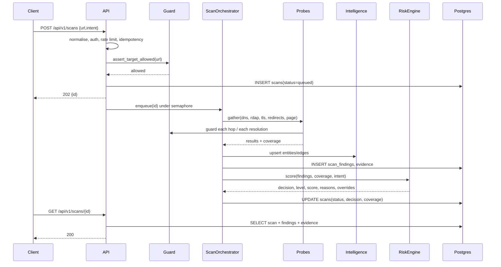

**Written:** `scans`, `scan_findings`, `evidence`, `entities`, `relationships`, `certificates` (if
HTTPS), `usage_counters`.

**Failure.** Probe error → `scan_findings` unchanged, coverage entry `unavailable`; task crash →
`scans.status = failed` with `failure_code`. Never leaves `queued`.

---

## 3. FLOW-02 — DNS and registration

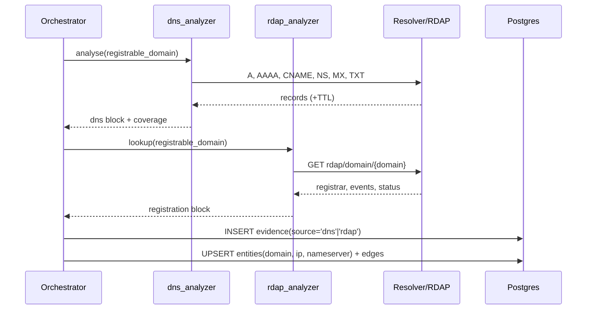

**Transform.** IP list → `RESOLVES_TO` edges; NS set → `MANAGED_BY` edges; MX host → `MAIL_ROUTED_BY`.
Domain age computed from RDAP `registration` event only.

**Failure.** NXDOMAIN → finding `DOMAIN_NXDOMAIN`, coverage stays `collected` (we did resolve the
question). RDAP 404/5xx → `registration=null`, coverage `unavailable`.

---

## 4. FLOW-03 — TLS inspection

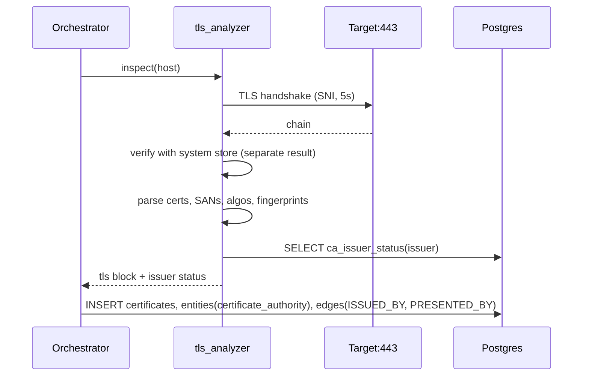

**Transform.** Leaf fingerprint → `certificates.fingerprint_sha256`; issuer DN → normalised CA name →
`ca_issuer_status` lookup. `days_to_expiry` from `not_after` minus now.

**Failure.** Handshake error → `tls.presented=false`, finding `TLS_HANDSHAKE_FAILED` for
login/payment intents; coverage `collected` (we learned the answer).

---

## 5. FLOW-04 — Redirect chain

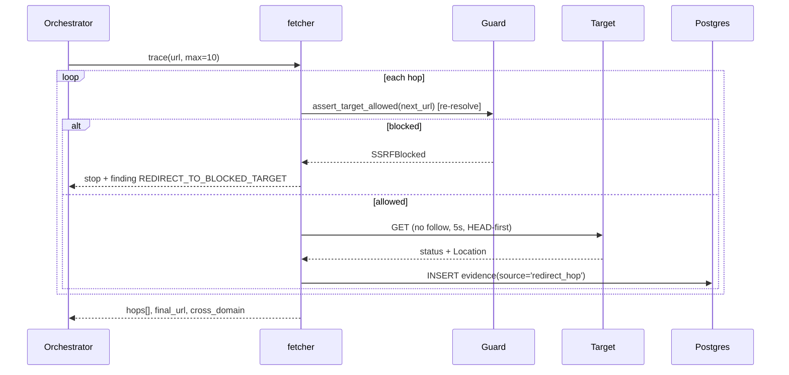

**Transform.** Hop list collapses into a `REDIRECTS_TO` chain of `url` entities. Cross-registrable-
domain hops flagged. Client-side redirects (meta refresh, JS) recorded separately.

**Failure.** Loop → stop with `loop_detected=true`; >10 hops → `REDIRECT_CHAIN_TOO_LONG`.

---

## 6. FLOW-05 — Page, form and action-destination analysis

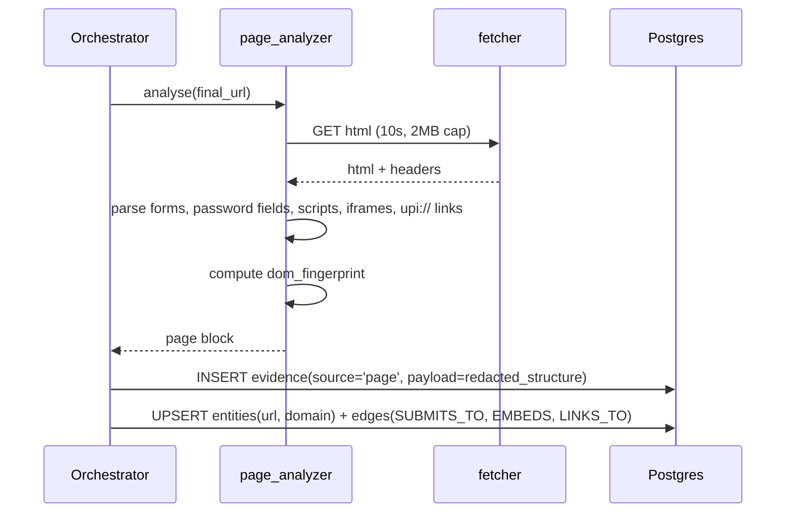

**Transform.** A form with `action=""` → `submits_to = final_url`; a form posting cross-origin →
`SUBMITS_TO` edge to the action origin; `upi://pay?pa=...` → `payment_recipients` candidate.

**Redaction before storage.** Input *values* are never read. Hidden-field names are kept; values are
dropped. Any string matching a token/secret pattern is replaced with `[redacted]`.

**Failure.** 403/challenge → `PAGE_FETCH_BLOCKED`; oversize → truncated flag; renderer disabled →
`dom_source=static`.

---

## 7. FLOW-06 — Organisation and domain verification

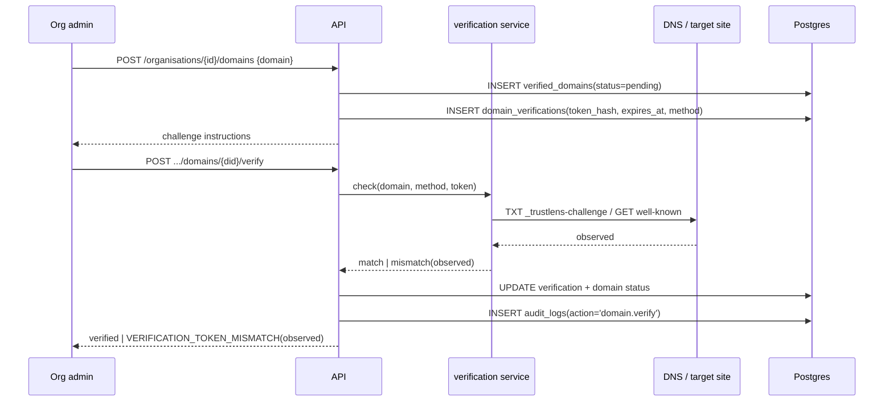

**Rule.** `verified_domains.status='verified'` is the only state consulted by identity rules.

---

## 8. FLOW-07 — Payment verification

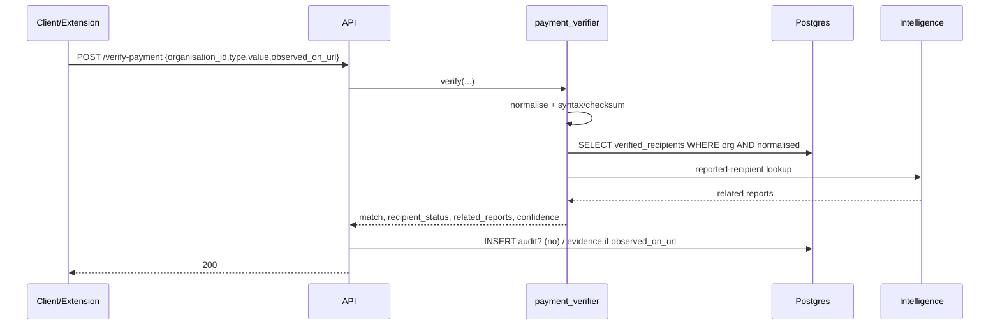

**Decision coupling.** `match=none` with at least one `verified` recipient on the org →
`PAYEE_NOT_IN_VERIFIED_PROFILE` (hard override for `payment`). `match=unverifiable` (org has none) →
`PAYEE_UNVERIFIABLE` (warn only).

---

## 9. FLOW-08 — Action integrity (login intent)

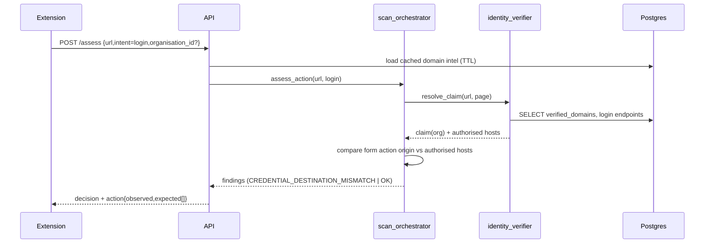

---

## 10. FLOW-09 — Threat report and review

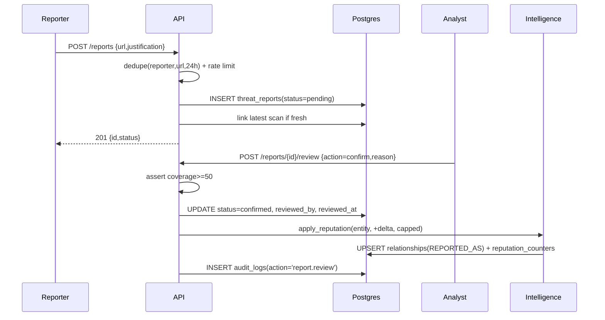

---

## 11. FLOW-10 — Campaign correlation

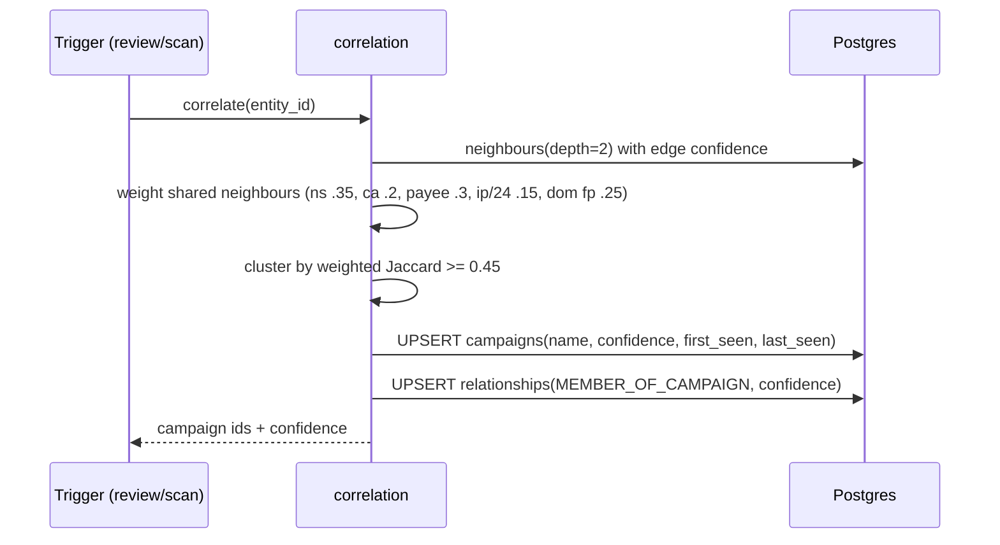

Full weighting rationale: `../07-ai-intelligence/THREAT_GRAPH.md` §6.

---

## 12. FLOW-11 — AI investigation

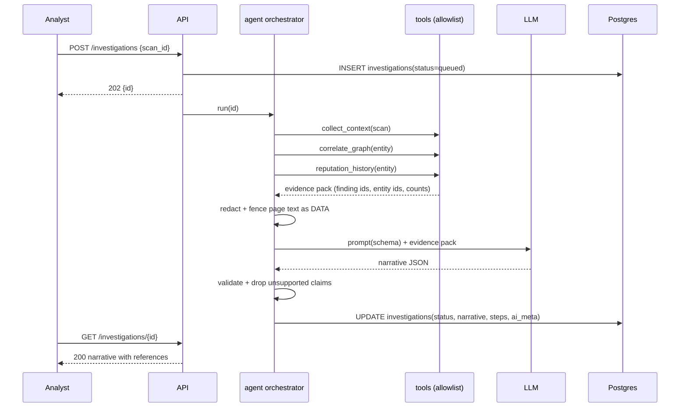

**Failure.** No key/timeout/schema failure → template narrative with `ai.generated=false`.

---

## 13. FLOW-12 — Extension check and interception

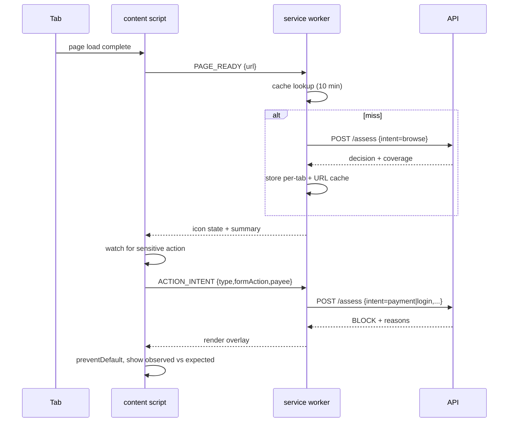

---

## 14. FLOW-13 — Certificate monitoring and simulated incident

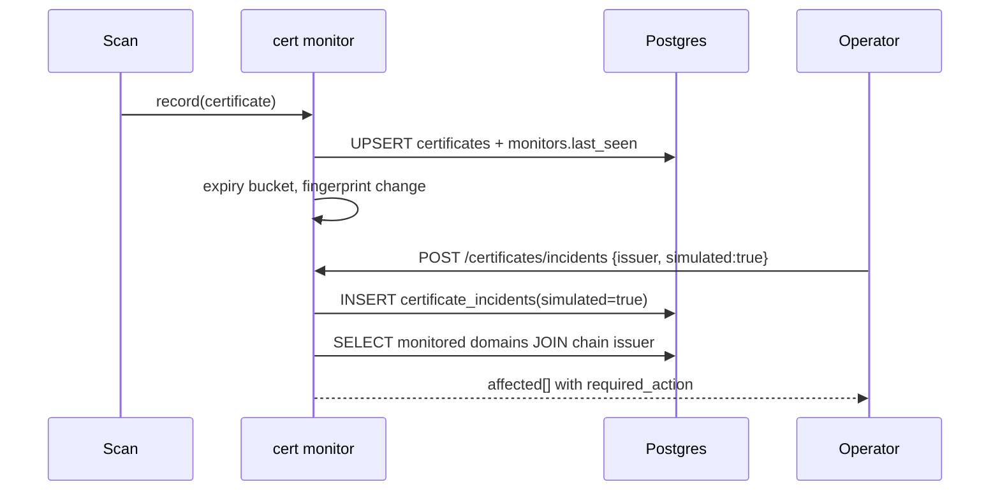

**Gate.** `DEMO_MODE=1` + `operator` role required; production returns `403 DEMO_MODE_REQUIRED`.

---

## 15. Data transformation summary

| Raw input | Normalised form | Stored as |
| --- | --- | --- |
| URL | lowercase host, punycode, no fragment, sorted query? **No** — query order preserved | `scans.normalised_url` |
| Domain | eTLD+1, lowercase, no trailing dot | `entities.key` (`domain:northstar-demo.example`) |
| IP | canonical text form (IPv6 compressed) | `entities.key` (`ip:203.0.113.10`) |
| Certificate | SHA-256 fingerprint hex lowercase | `certificates.fingerprint_sha256` |
| UPI VPA | lowercase localpart and handle | `verified_recipients.normalised_value` |
| IBAN | uppercase, no spaces | `verified_recipients.normalised_value` |
| Nameserver | lowercase, trailing dot stripped | `entities.key` |
| Finding | code + severity + group + evidence ids | `scan_findings` |

---

## 16. Flow-level performance budgets

| Flow | Budget |
| --- | --- |
| FLOW-01 total | 60 s hard, 20 s p50 |
| FLOW-02 | 4 s |
| FLOW-03 | 6 s |
| FLOW-04 | 8 s (10 hops × 5 s worst case, but aborted by global budget) |
| FLOW-05 | 12 s |
| FLOW-07 | 300 ms |
| FLOW-09 | 200 ms |
| FLOW-10 | 2 s |
| FLOW-11 | 50 s |
| FLOW-12 cold check | 1.2 s p95 (assess on cached domain) |
