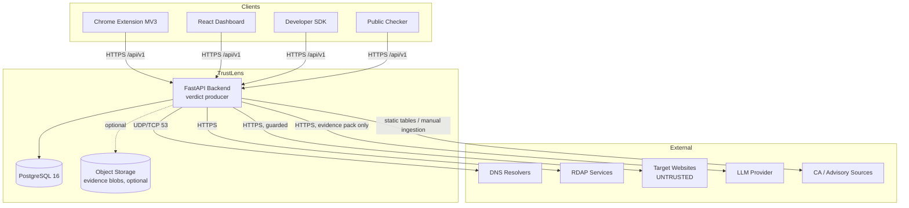
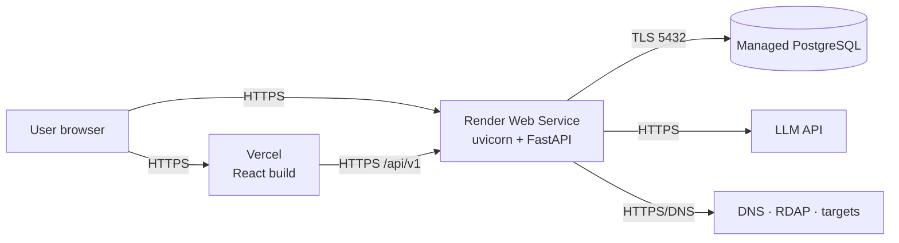
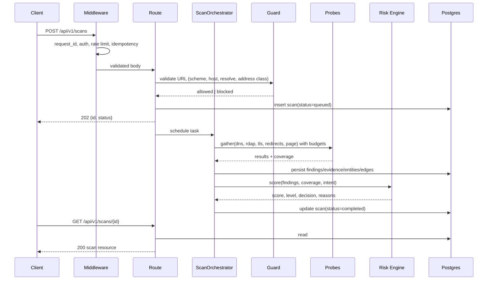
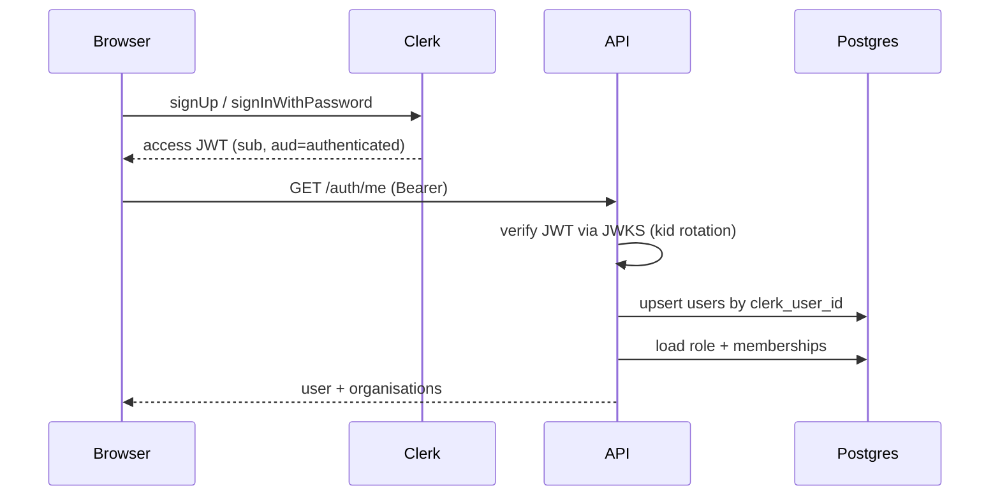

# SYSTEM_ARCHITECTURE

> **Status:** DECIDED · **Group:** 02-architecture · **Version:** 1.0 · **Last updated:** 2026-11-07
> **Source of truth for:** component boundaries, request lifecycle, trust boundaries, ADRs.
> **Related:** [`DATA_FLOW.md`](DATA_FLOW.md) · [`API_CONTRACTS.md`](API_CONTRACTS.md) · [`../08-infrastructure/DEPLOYMENT_ARCHITECTURE.md`](../08-infrastructure/DEPLOYMENT_ARCHITECTURE.md)

---

## 1. Architectural principles

1. **One verdict producer.** All decisions are computed by the FastAPI backend. Clients render and
   enforce; they never decide. (ADR-001)
2. **Deterministic core, generative shell.** Rules score and decide; the LLM narrates. (ADR-002)
3. **Evidence before assertion.** Every finding cites stored evidence with a source and timestamp.
4. **Coverage is part of the answer.** A verdict without coverage is invalid.
5. **Untrusted by default.** URLs, page content, report text and prompt text are hostile input.
6. **One deployable backend, one database.** Modular monolith. (ADR-003)
7. **Contracts are generated.** OpenAPI → TypeScript types. No hand-written response models.
8. **Degrade, don't lie.** Missing data is `UNAVAILABLE`/`SKIPPED`, never a pass.
9. **Bounded work.** Every network call, graph query and scan has a hard budget.

---

## 2. Context diagram



Everything to the right of the API is **untrusted or unreliable**. The API is the only component
that talks to the open internet on a user's behalf.

---

## 3. Component responsibilities

| Component | Owns | Must not |
| --- | --- | --- |
| `apps/web` | Rendering, routing, form validation, caching of API reads, client-side enforcement of a returned decision | Compute a score, infer a verdict, hold a service secret |
| `apps/extension` | Page observation, cache, overlay UX, request initiation | Hold a user password, store an API key, decide `BLOCK` locally |
| `packages/sdk` | Typed transport, retries, error mapping | Add business logic, cache verdicts beyond the documented TTL |
| `apps/api` | Auth, authorisation, SSRF enforcement, probing, scoring, persistence, graph, investigations | Trust client-supplied verdicts, scores or organisation claims |
| PostgreSQL | Durable state, invariants, graph edges | Hold secrets in plaintext, hold raw credentials |
| Object storage | Large evidence artefacts (page snapshot, logo image) | Be required for a scan to succeed |

### 3.1 Backend internal modules

```text
apps/api/app/
├── main.py                 app factory, lifespan, middleware
├── config.py               pydantic-settings
├── api/
│   ├── deps.py             auth, db session, rate limit, idempotency
│   └── routes/             health, auth, scans, assess, organisations,
│                           reports, intelligence, certificates,
│                           investigations, api_keys, usage
├── schemas/                Pydantic request/response models
├── models/                 SQLAlchemy mapped classes
├── repositories/           query objects; no business logic
├── services/
│   ├── guard.py            SSRF policy (the choke point)
│   ├── fetcher.py          bounded async HTTP with per-hop validation
│   ├── dns_analyzer.py
│   ├── rdap_analyzer.py
│   ├── tls_analyzer.py
│   ├── redirect_analyzer.py
│   ├── page_analyzer.py
│   ├── brand_analyzer.py
│   ├── identity_verifier.py
│   ├── payment_verifier.py
│   ├── verification.py     DNS TXT / file challenge
│   ├── reputation.py
│   └── scan_orchestrator.py
├── risk/
│   ├── signals.py          finding → signal group mapping
│   ├── rules.py            R-* rule definitions
│   ├── scoring.py          weights, caps, coverage
│   └── policy.py           decision table, overrides
├── intelligence/
│   ├── graph.py            traversal, upserts
│   ├── correlation.py      overlap scoring
│   └── campaigns.py        clustering
├── agents/
│   ├── orchestrator.py     step sequencing
│   ├── tools.py            allowlisted evidence tools
│   ├── prompts.py          versioned templates
│   └── report_generator.py schema validation + template fallback
├── security/
│   ├── ssrf.py             address classification
│   ├── redaction.py        secret/PII scrubbing
│   └── ratelimit.py        token bucket
├── db/                     session factory, migrations hook
└── utils/                  ulid, time, hashing
```

Module rule: `routes → services → repositories → models`. A service may call another service;
a repository never calls a service; nothing outside `agents/` may import the LLM client.

---

## 4. Deployment topology



| Concern | Decision |
| --- | --- |
| Frontend | Static build on a CDN; no server runtime; `VITE_API_BASE_URL` baked at build |
| Backend | Single container, single instance, `$PORT`, `uvicorn` with 2 workers max |
| Database | Managed Postgres, external provider, not Render's expiring free DB |
| Sessions | Clerk-issued session JWT verified via JWKS; Redis holds only cache and rate-limit state |
| Caching | **Upstash Redis** for shared verdict/domain cache + rate-limit counters; in-process dict as a per-worker L1; correctness never depends on either |
| Background work | `asyncio.create_task` under a semaphore for scans/investigations; **Upstash QStash** for scheduled jobs (cert sweep, decay, reconciliation) |
| Human auth | **Clerk** issues the JWT; we verify via JWKS and keep our own API keys and device tokens |
| Secrets | Host environment variables only; see `ENVIRONMENT_CONFIGURATION.md` |

Two workers means two caches. Therefore **any cache is advisory**; the DB is the source of truth for
scan status and verdicts. Never store authoritative state in process memory.

---

## 5. Trust boundaries

| Boundary | Crossing | Control |
| --- | --- | --- |
| B1 Browser → API | JSON over HTTPS | Session/JWT/API key auth, CSRF for cookie flows, schema validation, rate limits |
| B2 API → target site | HTTP(S) to arbitrary hosts | SSRF guard, per-hop validation, size/time caps, no script execution in static mode |
| B3 API → LLM | Evidence pack | Redaction, prompt fencing, tool allowlist, output schema validation |
| B4 API → DB | SQL | Parameterised queries, least-privilege role, no dynamic table names |
| B5 Extension → API | JSON | Device token, scope limited to assess/report, no profile write |
| B6 Operator → simulated data | Operator endpoints | `operator` role + `DEMO_MODE=1`, audited, labelled |

Any new code path crossing B1–B6 must state which control applies. A path that crosses B2 without
calling `services/guard.py` is a defect, regardless of tests.

---

## 6. Request lifecycle (assessment)



Key invariants:

- The scan row exists **before** any probe runs (so a crash leaves a visible `failed` scan, not a
  phantom).
- The client never waits on probes; it polls.
- A probe exception is caught per-probe and recorded; it never aborts the scan.
- The decision is written in the same transaction as the findings it derives from.

---

## 7. Authentication flow (summary)



Machine clients (`tl_live_…`) and the extension (`tl_ext_…`) bypass Clerk entirely and are
resolved from `api_keys`. Clerk JWTs carry no authorisation claims we trust — `users.role` and
membership always come from our database.

Machine clients use `Authorization: Bearer tl_live_…`; the extension uses `tl_ext_…`. Full detail:
`../03-backend/AUTHENTICATION_AUTHORIZATION.md`.

---

## 8. Failure handling strategy

| Class | Example | Handling |
| --- | --- | --- |
| Input error | Malformed URL, bad enum | `4xx` with a stable code and field-level `details` |
| Policy block | Private IP target | `422 TARGET_NOT_ALLOWED`, never retried |
| Dependency failure | RDAP 503, LLM timeout | Degrade that signal, mark `UNAVAILABLE`, continue |
| Partial failure | 3 of 5 probes succeed | `scan.status = partial`, decision computed from coverage |
| Internal error | Bug, DB blip | `500` with `requestId`; no stack traces to clients |
| Saturation | Too many scans | `429` with `Retry-After`; queue depth surfaced in `/ready` |

Circuit-breaking: a probe that fails 5 times in 60 s is short-circuited for 120 s, reported as
`UNAVAILABLE`, and logged once per window (avoids log floods).

---

## 9. Scaling strategy (and why we are not scaling yet)

| Dimension | Today | Next step if needed |
| --- | --- | --- |
| API | 1 instance, 2 workers | Add instances; move cache to shared store; move scans to a queue |
| Scans | In-process, semaphore 4 | Dedicated worker service consuming a table-backed queue |
| DB | Single instance, pool 10 | Read replica for graph/list queries |
| Graph | CTE depth ≤ 3 | Materialised edge summaries, then a graph DB |
| LLM | One call per investigation | Batch + cache by evidence hash |

We deliberately do not build for scale we cannot demonstrate. ADR-006 records this.

---

## 10. Data ownership

| Data | Owner module | Readable by |
| --- | --- | --- |
| Users, sessions, API keys | `auth`, `api_keys` | Auth/admin only |
| Organisations, members | `organisations` | Members of that org; analyst read |
| Trust profile public projection | `organisations` | Anyone |
| Scans, findings, evidence | `scans` | Scan owner; org members if org-scoped; analysts |
| Entities, relationships, campaigns | `intelligence` | Analysts, org members for their entities |
| Reports | `reports` | Reporter (pseudonymised in aggregates), analysts |
| Certificates, incidents | `certificates` | Org members for monitored domains; analysts |
| Investigations | `agents` | Scan owner, org members |
| Audit logs | `audit` | Operators only |

---

## 11. Architecture decision records

### ADR-001 — Single FastAPI backend instead of Node + Python services
**Context.** Scanning needs Python (TLS, DNS, HTML, hashing); the team knows Node too.
**Decision.** One FastAPI service hosting all logic; React/TS for clients.
**Consequences.** One deploy and one contract; Python owns HTTP surface; CPU work must be offloaded
to threads. Revisit only if a scanner worker must scale independently.

### ADR-002 — Deterministic verdict, AI narrative
**Context.** LLMs hallucinate; a wrong block is a trust-destroying event.
**Decision.** Rules decide; the model explains using only supplied finding IDs.
**Consequences.** Verdicts are testable and reproducible; the AI cannot "save" a bad rule set; we
must maintain a template fallback.

### ADR-003 — Modular monolith, in-process tasks, hosted cron
**Context.** Free tier, four engineers, days of runway. A message broker would add a service to
operate for a workload that is bursty but small.
**Decision.** Bounded in-process async tasks with state in Postgres and a Redis-backed advisory
cache; **Upstash QStash** for cron-triggered maintenance (certificate sweep, decay, stale-scan
reconciliation). No Celery, no BullMQ, no worker dyno.
**Consequences.** No retry queue (one attempt per scan, user re-submits); a crash loses in-flight
scans (visible as `failed`); cron is HTTP-triggered and must be idempotent and cheap.

### ADR-004 — Relational graph instead of Neo4j
**Context.** Campaign discovery needs multi-hop traversal, but shallow.
**Decision.** `entities` + `relationships` tables with recursive CTEs, caps, and confidence.
**Consequences.** Depth limited to 3; SQL is less expressive; no extra service to pay for or operate.

### ADR-005 — `ALLOW` is not "safe"
**Context.** Any scanner that says "safe" will eventually be wrong publicly.
**Decision.** Five-value decision enum with mandatory coverage; UI copy forbids "safe".
**Consequences.** More copy and education; honest product; judges must be told explicitly.

### ADR-006 — No premature scaling work
**Context.** Hackathon; unknown demand.
**Decision.** Optimise for clarity and a working demo; document scale-out paths.
**Consequences.** Some queries will not survive 100× load; that is accepted and recorded.

### ADR-007 — snake_case JSON everywhere
**Context.** Three clients, two languages.
**Decision.** JSON fields keep Python/Postgres snake_case; TS types use the same names.
**Consequences.** One spelling per field; slightly unidiomatic TS; no mapping layer to desynchronise.

### ADR-008 — Extension observes, server decides
**Context.** Client-side logic is inspectable and tamperable.
**Decision.** Thresholds, weights and verdicts live server-side; the extension only sends signals
and renders responses.
**Consequences.** Network dependency (with documented fail-open); no offline verdicts beyond cache.

### ADR-009 — ULID primary keys
**Context.** Sequential IDs leak volume and are guessable.
**Decision.** 26-char ULIDs in `CHAR(26)` columns, generated in Python.
**Consequences.** Sortable, non-enumerable; slightly larger indexes; no DB sequence dependency.

### ADR-010 — Demo data is seeded, labelled and isolated
**Context.** The CA incident and lookalikes are simulated.
**Decision.** `simulated` flags on incident rows, `DEMO_MODE` gate on triggers, seed refuses to run
in production unless forced.
**Consequences.** Judges see honesty; no risk of simulated data polluting real reputation.

### ADR-011 — Hosted services instead of self-operated infrastructure
**Context.** No ops capacity, no budget, no desire to run Postgres/Redis/S3 ourselves.
**Decision.** Supabase (Postgres, Storage, Auth), Upstash (Redis, QStash), Vercel (web), Render
(API), Resend (email). Every one is behind an interface so it can be swapped.
**Consequences.** Free-tier limits become product constraints (pause, connection caps, request
quotas); vendor outage = feature degradation, documented per service in `HOSTED_SERVICES.md`.
Migrating to paid tiers is a config change, not a rewrite.

### ADR-012 — Clerk for humans, our own keys for machines

**Alternatives.** Auth0 (same shape, heavier configuration for a single SPA), NextAuth/Auth.js
(requires Next.js route handlers; our web app is Vite and our API is FastAPI), Supabase Auth (would
couple identity to the database vendor), and hand-rolled auth (rejected: password reset, MFA and
session revocation are exactly the things not worth rebuilding under time pressure).
**Context.** Building email verification, password reset and secure session handling is days of
work we would do badly; issuing machine credentials is something we must control precisely.
**Decision.** Human identity (signup, login, reset, email verification) is Clerk. The API
verifies the Clerk session JWT via JWKS and maps `sub` to a local `users` row. API keys and extension
device tokens remain ours (`api_keys` table, SHA-256, scopes).
**Consequences.** No password hashes in our database; no refresh-rotation code; but we must keep the
local user row in sync with Clerk on first login, and we cannot use Supabase RLS as the sole
authorisation mechanism for our API (the API is the policy point).

### ADR-013 — Upstash Redis is advisory, Postgres is authoritative
**Context.** Two API workers cannot share an in-process rate-limit counter; a free Redis is
available with REST semantics and ~10 ms added latency.
**Decision.** Redis stores rate-limit buckets, idempotency keys and the domain/verdict cache. If
Redis is unreachable, the API falls back to per-worker counters and skips the shared cache.
**Consequences.** Rate limits become approximate during a Redis outage (documented, accepted);
scan status and verdicts never depend on Redis being up.

### ADR-014 — LangGraph for the investigation workflow
**Context.** The investigation is a fixed sequence of deterministic tools followed by one narration
call, with resumability and per-step visibility.
**Decision.** Implement it as a LangGraph `StateGraph` with typed state, explicit nodes
(`load_scan`, `collect_context`, `correlate_graph`, `reputation_history`, `build_pack`,
`narrate`, `validate`), a checkpointer, and a conditional edge to the template fallback.
**Consequences.** Steps are inspectable and resumable; we inherit LangGraph's dependency surface;
**the graph must not contain model-chosen tools** — nodes are fixed, so the decision path stays
testable (ADR-002 still holds).

### ADR-015 — Vercel for the SPA, Render for the API
**Context.** The web build is static; the API needs Python and a long-lived process (within free
limits).
**Decision.** Vercel hosts the SPA (preview per PR, instant rollback); Render hosts the API.
**Consequences.** Two dashboards to check; CORS allowlist must include both preview and production
origins; the API is still the single origin for data.

### ADR-016 — Recorded collector fixtures for the RFC 2606 demo hosts
**Context.** The canonical demo domains live under `.example`, which is reserved (RFC 2606) and never
resolves. A live probe cannot observe them, and a localhost stand-in would rightly be rejected by the
SSRF guard. The docs did not say how the scanner reaches them.
**Decision.** When `DEMO_MODE` is on, and only for the seeded demo registrable domains, collectors return
recorded observations (`app/services/demo_fixtures.py`) instead of making any network request — the same
"intercept at the collector boundary" pattern the tests use (BACKEND_OVERVIEW §12). Rules, scoring,
overrides, persistence and the graph run unchanged. Every scan, finding and evidence row produced this
way carries `simulated: true`. The browser-facing pages are served by `apps/demo-sites`.
**Consequences.** The demo is reproducible offline; real URLs always take the live path; a `.example`
host can never collide with a real organisation's domain.

### ADR-017 — Development sign-in stand-in for Clerk
**Context.** Clerk is the identity provider (ADR-012), but local development and rehearsal must work
before Clerk keys exist.
**Decision.** With `DEV_AUTH_ENABLED=true` (development/test only), the API accepts
`Authorization: Bearer dev:<email>:<role>` and upserts a local user. Startup aborts if the flag is set
with `ENVIRONMENT=production`. Clerk JWT verification (JWKS, RS256/ES256, `iss` + `azp`) is the only
human path in production.
**Consequences.** Rehearsals and the automated demo check (`app.scripts.demo_check`) run without
third-party accounts; the flag is a documented, startup-enforced development affordance.

### ADR-018 — On-chain integrity commitments for threat reports

**Context.** The problem statement (Module 6) requires tamper-evident, independently verifiable threat
reporting with no sensitive data on chain. `PROJECT_OVERVIEW.md` had rejected "blockchain-based
reporting" as cost without benefit, which held for a chain as the *source of truth*.
**Decision.** A minimal, ownerless `ThreatReportRegistry` contract (`packages/contracts`) stores a
salted keccak commitment to a privacy-safe projection of each report, with revisions and public
disputes. Postgres stays authoritative. The API anchors post-hoc through JSON-RPC with
`eth_sendTransaction` from a node-unlocked account (no key in the API); the reproducible target is a
local Hardhat chain (`chainId 31337`). Full design: `WEB3_REGISTRY.md`.
**Consequences.** Four endpoints (#68–#71), one table (`report_anchors`), four error codes (§7.6),
`CHAIN_*` settings. No dependency added to the API (selectors pinned, commitment computed by the
contract's `commitmentOf`). Verdicts, scans and reports never depend on chain availability. Public
testnet anchoring through the API is not implemented (needs a signing node or proxy).

---

## 12. Module interaction matrix

`R` = reads, `W` = writes, `—` = none.

| | auth | orgs | scans | risk | intel | agents | certs |
| --- | --- | --- | --- | --- | --- | --- | --- |
| auth | R/W | — | — | — | — | — | — |
| orgs | R | R/W | R | — | R | — | R |
| scans | R | R | R/W | R | W | — | W |
| risk | — | R | R | — | R | — | — |
| intel | — | R | R | R | R/W | R | R |
| agents | — | — | R | R | R | R/W | — |
| certs | — | R | R | — | W | — | R/W |

Cycles are forbidden: `risk` may not call `agents`; `agents` may not call `risk` for scoring.

---

## 13. Open questions

| ID | Question | Impact |
| --- | --- | --- |
| AQ-1 | Do we need a read-only "public profile" CDN cache? | Reduces DB load during demo; adds invalidation complexity |
| AQ-2 | Should evidence blobs go to object storage from day one? | Storage cost vs 30-day retention requirement |
| AQ-3 | Two uvicorn workers or one? | Cache coherence vs cold-start concurrency |
