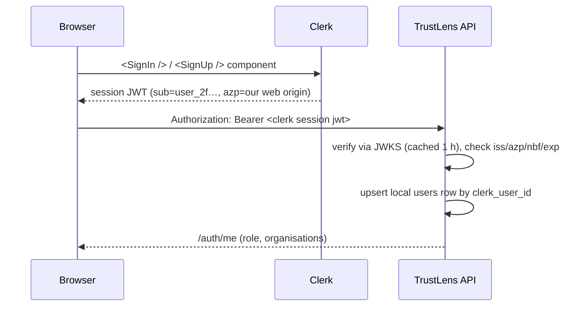
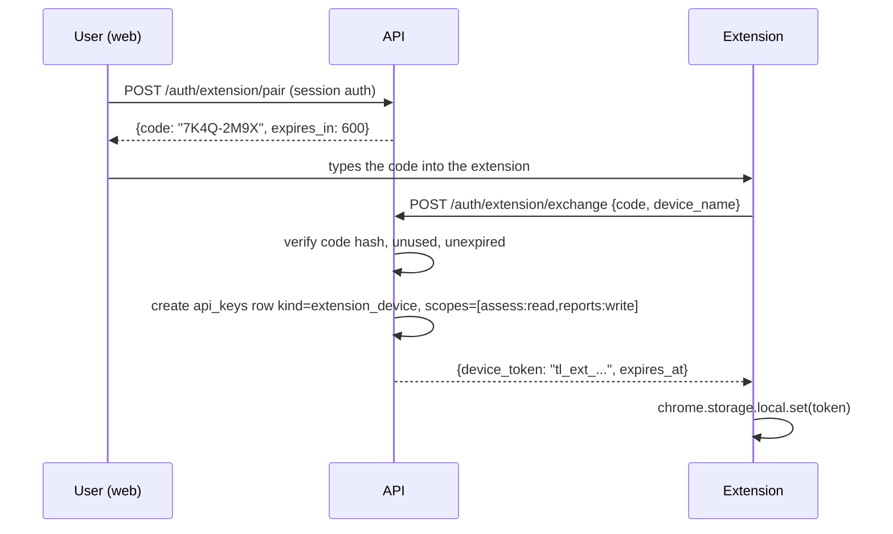

# AUTHENTICATION_AUTHORIZATION

> **Status:** DECIDED · **Group:** 03-backend · **Version:** 1.0 · **Last updated:** 2026-11-07
> **Source of truth for:** sessions, tokens, API keys, device pairing, roles, permissions, scopes, audit of auth events.
> **Related:** [`BACKEND_OVERVIEW.md`](BACKEND_OVERVIEW.md) · [`API_ENDPOINTS.md`](API_ENDPOINTS.md) · [`../09-testing-security/SECURITY_THREAT_MODEL.md`](../09-testing-security/SECURITY_THREAT_MODEL.md)

---

## 1. Model overview

| Principal | Credential | Lifetime | Storage |
| --- | --- | --- | --- |
| Human (web) | **Clerk session JWT** (verified via JWKS) | 60 s session token, minted on demand by the Clerk SDK | Clerk session in the client; API verifies signature only |
| Developer integration | API key `tl_live_…` | No expiry (revocable) | Hash in DB; plaintext shown once |
| Browser extension | Device token `tl_ext_…` | 180 days | Hash in DB; `chrome.storage.local` |
| Anonymous | none | n/a | n/a |

**DECIDED (ADR-012).** Human identity is delegated to **Clerk**: signup, email verification,
password reset, MFA, session refresh and social/OAuth are theirs. We do not store password hashes
or MFA secrets.

What stays ours: the `users` row (profile + role), API keys, extension device tokens, organisation
membership, and every authorisation decision.

Flow:



Rules:

- Signature verified against the project JWKS (`CLERK_JWKS_URL`), cached with `kid` rotation.
- `iss` must equal the project URL, `aud` must be `authenticated`, `exp` enforced with 30 s leeway.
- `sub` is the join key; email is treated as mutable and never used for authorisation.
- Local `users.role` (`user`/`analyst`/`operator`) is **ours**; a Clerk user cannot grant it.
- Deactivating a user locally blocks the API even while their Clerk JWT is still valid (checked
  per request).
- No SSO/SAML in the MVP. Email code and magic-link sign-in come free from Clerk's components.

---

## 2. Registration and login (delegated to Clerk)

The API has **no** `/auth/register`, `/auth/login` or `/auth/refresh` route. The browser renders
Clerk's `<SignIn />` / `<SignUp />` components; Clerk owns password hashing, email verification,
password reset, MFA, session refresh, bot protection and its own rate limits.

What the API does on every authenticated request:

1. Verify the session JWT against Clerk's JWKS (`kid`-aware; cache 1 h, refetch on an unknown `kid`).
2. Enforce `iss`, `azp` (must equal our web origin), `nbf`, `exp` (± 30 s), and an RS256/ES256
   algorithm allowlist. Any other algorithm is rejected before a claim is read.
3. Upsert the local `users` row keyed by `clerk_user_id` (unique), copying email and display name.
4. Reject if the local row is inactive (`is_active = false`), even though the JWT is still valid.

Why delegated: email verification, reset tokens, MFA and password storage are easy to get subtly wrong
and slow to build. Clerk gives a hosted, accessible sign-in UI plus a JWKS we verify offline. What we
keep is exactly where our product's authorisation lives — roles, membership, API keys, device tokens.

**Provider choice (ADR-012).** Clerk, because the web app is a Vite SPA: Clerk ships React components
and a JWKS-verifiable session token with no server of ours in the loop. Auth0 was the runner-up (same
shape, heavier configuration for this size). NextAuth/Auth.js was rejected because it needs Next.js
route handlers, and our stack is Vite + FastAPI. Supabase Auth was rejected to keep identity
independent of the database vendor.

Consequences we accept:

- Email change is a Clerk concern; our `users.email` is a denormalised copy refreshed on each login.
- Clerk's rate limits and bot protection apply to auth; we do not add a second layer.
- No password and no MFA secret ever reaches our API, logs or database.
- Revocation is two-sided: `users.is_active = false` blocks us immediately; revoking in Clerk stops
  new tokens at the source.

---

## 3. Session verification

`GET /api/v1/auth/me` is the only auth-shaped endpoint that remains, plus the extension pairing pair.

```http
GET /api/v1/auth/me
Authorization: Bearer <clerk session token>
```

```json
{
  "id": "01JCM4Z9K8Q2R7T3V5W6X7Y8Z9",
  "clerk_user_id": "user_2f3k9cQ8mN1pR4sT6vW8xY0z",
  "email": "aisha@example.com",
  "display_name": "Aisha",
  "role": "user",
  "is_active": true,
  "organisations": [{ "id": "01J...", "name": "Northstar University", "role": "org_admin" }],
  "last_login_at": "2026-11-07T09:14:22Z"
}
```

If `CLERK_JWKS_URL` is unreachable and the cache has expired, authenticated routes return
`503 NOT_READY` (fail closed for identity) while `/health` stays `200`.

---

## 4. Tokens

### 4.1 Human access JWT (Clerk-issued)

```json
{
  "sub": "user_2f3k9cQ8mN1pR4sT6vW8xY0z",
  "sid": "sess_2f3kA1bC2dE3fG4hI5jK6lM7n",
  "azp": "https://app.trustlens.example",
  "iat": 1762500000,
  "nbf": 1762499995,
  "exp": 1762500060,
  "iss": "https://trustlens.clerk.accounts.dev"
}
```

- Signed by Clerk (RS256/ES256); verified locally via JWKS. **`JWT_SECRET` is not used for human
tokens**, and `alg: none` or an algorithm outside the allowlist is rejected before parsing.
- `sub` is the only identity claim we act on. It is opaque and never parsed.
- `azp` must equal `CLERK_AUTHORIZED_PARTY`. A token minted for another origin — an attacker's Clerk
  instance, a stale preview domain — is rejected even though its signature is valid.
- `sid` correlates a token with a Clerk session for revocation and audit; authorisation still comes
  from our database, never from the token.
- No email, role or organisation claims are trusted. `users.role` (`user`/`analyst`/`operator`) and
  membership are read per request from `organisation_members`.

### 4.2 Refresh, logout and revocation

- Refresh is entirely Clerk's: `clerk.session.getToken()` mints a fresh short-lived token while the
  session lives. The API never sees a refresh token and stores none.
- Logout is `signOut()` in the client plus `POST /auth/logout` to clear server-side caches and write
  the audit row.
- Revoking access is two-sided: set `users.is_active = false` (blocks immediately) **and** revoke the
  Clerk session/user so no new token can be minted. A valid JWT alone is not sufficient to act.

> The `refresh_tokens` table remains in the schema but is **unused in the MVP**; it is the documented
> fallback if we ever self-host human auth. See `DATABASE_DESIGN.md` §3.2.

---

## 5. Roles and permissions

### 5.1 Global roles (`users.role`)

| Role | Capabilities |
| --- | --- |
| `user` | Own scans, own reports, own API keys, own org memberships |
| `analyst` | Everything a user can do, plus: read all scans/reports, confirm/dismiss reports, edit campaign summary, view all certificate incidents |
| `operator` | Everything an analyst can do, plus: run demo seed, create simulated incidents, view audit logs |

`operator` is not a separate table; it is `role='operator'` plus normal membership.

### 5.2 Organisation roles (`organisation_members.role`)

| Role | Capabilities |
| --- | --- |
| `org_admin` | Manage profile, domains, recipients, members, monitors; transfer ownership |
| `org_member` | Read profile, domains, recipients, monitors, org-scoped scans |

### 5.3 Permission matrix

`✔` allowed · `—` denied · `own` only for the actor's own resources.

| Action | anonymous | user | analyst | operator | org_member | org_admin |
| --- | --- | --- | --- | --- | --- | --- |
| Public scan (quota) | ✔ | ✔ | ✔ | ✔ | ✔ | ✔ |
| Read own scan | — | own | ✔ | ✔ | own/org | own/org |
| Create organisation | — | ✔ | ✔ | ✔ | — | — |
| Read organisation | — | member | ✔ | ✔ | ✔ | ✔ |
| Update organisation | — | — | — | ✔ | — | ✔ |
| Add/verify domain | — | — | — | ✔ | — | ✔ |
| Add/verify recipient | — | — | attests | ✔ | — | ✔ |
| Read public profile | ✔ | ✔ | ✔ | ✔ | ✔ | ✔ |
| Submit report | ✔ (limited) | ✔ | ✔ | ✔ | ✔ | ✔ |
| Review report | — | — | ✔ | ✔ | — | — |
| Read graph | — | own scans | ✔ | ✔ | org entities | org entities |
| Create investigation | — | own scans | ✔ | ✔ | own/org | own/org |
| Manage API keys | — | own | own | own | own | own |
| Create simulated incident | — | — | — | ✔ | — | — |
| View audit logs | — | — | — | ✔ | — | — |

`analyst` attesting a recipient is allowed only with `verified_by` recorded; the role matrix is
enforced in the service, not the route, when it depends on resource state.

### 5.4 Enforcement pattern

```python
async def require_org_member(org_id: str, user: User, db, min_role: str | None = None) -> Organisation:
    org = await repo.get_org(db, org_id)
    if org is None:
        raise NotFound()                     # 404, hides existence
    member = await repo.get_member(db, org_id, user.id)
    if member is None and user.role not in ("analyst", "operator"):
        raise NotFound()
    if min_role == "org_admin":
        if user.role == "operator":
            return org
        if member is None or member.role != "org_admin":
            raise Forbidden()
    return org
```

Cross-tenant reads return **404**, never 403, so a tenant cannot probe for existence.

---

## 6. API keys

### 6.1 Format

```text
tl_live_<8 char prefix>_<43 char base62 secret>
```

- Prefix is stored in plaintext for display (`tl_live_ab12cd34`).
- Secret is hashed with SHA-256 and unique-indexed.
- Verification: constant-time compare of the hash; then load the key and update `last_used_at`
  at most once per minute per key.

### 6.2 Scopes

| Scope | Grants |
| --- | --- |
| `assess:read` | `POST /assess`, `GET /scans/{id}`, `GET /scans` (own) |
| `scan:write` | `POST /scans` |
| `reports:write` | `POST /reports` |
| `identity:read` | `POST /verify-identity`, `GET /organisations/{id}/public-profile` |
| `payments:read` | `POST /verify-payment` |
| `investigations:read` | `GET /investigations/{id}` |
| `investigations:write` | `POST /investigations` |

Default new key: `assess:read`, `scan:write`. The UI preselects the narrowest set for the chosen use
case. Write scopes never imply read scopes; there is no wildcard.

### 6.3 Lifecycle

- Created via `POST /api/v1/api-keys`; the full secret appears once in the `201` body.
- Listed with prefix, name, scopes, `last_used_at`, `revoked_at`.
- Revoked via `DELETE`; revocation is immediate (checked on every request; no cached allow).
- Maximum 10 active keys per user.
- Keys cannot manage keys, users, organisations or reports review — ever.

---

## 7. Extension device pairing

Extensions must not hold a user password or a long-lived API key created by hand.



Properties:

- Code is 8 chars from an unambiguous alphabet, displayed grouped; single use; 10-minute expiry.
- The device token is bound to a `device_name` (user agent summary) and shows in the dashboard so a
  user can revoke a lost laptop.
- Device tokens cannot read scans history, cannot touch organisations, cannot create API keys.
- Revoking a device takes effect on the next request.

---

## 8. CSRF and CORS

- Cookie is `SameSite=Lax`, so cross-site `POST` does not send it — the primary defence.
- Additional check: for cookie-authenticated mutations, `Origin` must be in `ALLOWED_ORIGINS`.
  Missing `Origin` on a mutation is rejected (`403 CSRF_ORIGIN_MISMATCH`).
- Bearer-authenticated requests are not CSRF-prone and skip the Origin check.
- CORS: explicit origins only, no wildcard with credentials.

---

## 9. Authorisation edge cases

| Case | Behaviour |
| --- | --- |
| User removed from org while a request is in flight | Next request fails 404 (membership re-checked) |
| API key revoked mid-scan | The scan already scheduled continues; new requests 401 |
| Access token valid but user deactivated | 401 `INVALID_TOKEN` (user re-checked) |
| `orgs` claim stale | Ignored; DB is authoritative |
| Analyst acting on own report | Allowed, but the audit row records `self_review: true` and it is surfaced in the UI |
| Operator in production | Allowed to read audit logs; simulated endpoints still require `DEMO_MODE=1` |
| Last admin tries to leave | `409 LAST_ADMIN_REMOVAL` |
| Transfer ownership | `PATCH /organisations/{id}/members/{userId}` to `org_admin`, then demote self |

---

## 10. Auth audit events

Every one of these writes an `audit_logs` row (actor, action, target, ip_hash, request_id):

`auth.register`, `auth.login.success`, `auth.login.failure`, `auth.logout`, `auth.refresh.reuse_detected`,
`apikey.create`, `apikey.revoke`, `device.pair`, `device.revoke`, `org.create`, `org.update`,
`org.member.invite`, `org.member.remove`, `domain.verify`, `recipient.verify`, `report.review`,
`investigation.create`, `incident.create.simulated`, `demo.seed`.

Failed logins record the attempted email hash, not the email.

---

## 11. Secret handling

| Secret | Storage | Rotation |
| --- | --- | --- |
| `JWT_SECRET` | host env | Restart with new value; old tokens expire in 15 min |
| API keys | SHA-256 hash | User revokes and recreates |
| Device tokens | SHA-256 hash | Re-pair |
| DB password | host env | Provider-managed rotation; restart |
| LLM key | host env | Provider rotation; restart |
| Verification tokens | SHA-256 hash | Regenerated per attempt |

No secret is ever logged, returned after creation, or included in an error message. The redactor
(`security/redaction.py`) also scrubs `tl_live_`, `tl_ext_`, `Bearer ` and cookie patterns from any
text that could reach logs or evidence payloads.

---

## 12. Clerk specifics

| Concern | Decision |
| --- | --- |
| JWT verification | Clerk JWKS, cached 1 h; no shared secret in the API. Unknown `kid` forces a refetch |
| Algorithm | Allowlist RS256/ES256 only; `alg: none` and HS256 are rejected outright |
| Origin binding | `azp` must equal `CLERK_AUTHORIZED_PARTY`; blocks tokens minted for another origin |
| User provisioning | Lazy upsert on first authenticated request (`clerk_user_id` unique, `TEXT`) |
| Email verification | Required by Clerk config before the first successful API call |
| MFA | TOTP/backup codes enabled in Clerk; we never see or store a second factor |
| Password policy | Clerk-managed (min length, leaked-password rejection, breach notifications) |
| Password reset | Clerk-hosted flow; our API never sees a password |
| Session lifetime | Clerk session (long) + 60 s token; the API issues no human tokens at all |
| Session revocation | Local `is_active` check per request + Clerk session revocation for the source |
| Account deletion | API calls Clerk Backend API delete + anonymises local rows (J-11) |
| Webhooks (optional) | `POST /webhooks/clerk`: `user.created`/`user.updated`/`user.deleted` sync via Svix signature (`CLERK_WEBHOOK_SECRET`), verified before parsing; lazy upsert remains the fallback if a webhook is missed |
| Account deletion re-verification | Enforced by the API from the Clerk session claim `fva` (factor verification age, minutes; `-1` = never): `DELETE /auth/me` requires `0 ≤ fva[0] ≤ 10`, else `403 REVERIFICATION_REQUIRED` with Clerk's reverification hint (`clerk_error: {type: "forbidden", reason: "reverification-error", metadata.reverification: {level: "first_factor", afterMinutes: 10}}`) at the top level of the body. The web wraps the call in Clerk's `useReverification`, which opens Clerk's verify-it's-you modal and retries. A token without `fva` (old session-token version) is treated as not recent. `iat` is not used: Clerk re-mints session JWTs every ~60 s. Dev sign-in (development only) skips the check. The typed account email is still required |
| Admin key | `CLERK_SECRET_KEY` used **only** by deletion/revocation; never in a request path, never in the web bundle |
| RLS | Enabled on Supabase as defence in depth; not relied on, and no policy depends on `auth.uid()` because Supabase Auth is not used |
| Failure mode | JWKS unreachable for > 10 min → cached keys keep working until expiry, then `503 NOT_READY` for authenticated routes (fail closed, unlike taste checks) |

## 13. Threat notes

| Threat | Mitigation |
| --- | --- |
| Credential stuffing | Clerk bot protection + per-IP rate limits; MFA available; no login endpoint of ours to hammer |
| Token theft via XSS | Clerk client session with 60 s tokens; strict CSP, no raw HTML, no token in `localStorage` by us |
| Token minted for another origin | `azp` check against `CLERK_AUTHORIZED_PARTY`; a valid signature is not enough |
| Stale token after removal | Per-request `users.is_active` check plus Clerk session revocation |
| Refresh replay | Session rotation handled by Clerk; local API keys unaffected |
| Key leakage in a client bundle | Keys are server-side only; extension uses a scoped device token |
| Enumeration | Login generic error; org resources 404 |
| Privilege escalation via `orgs` claim | Ignored for authorisation |
| Cross-tenant data access | Membership re-check per request; tenant filter in every query |
| Pairing code brute force | 8 chars from 32-char alphabet, 10-min expiry, rate limited, single use |
