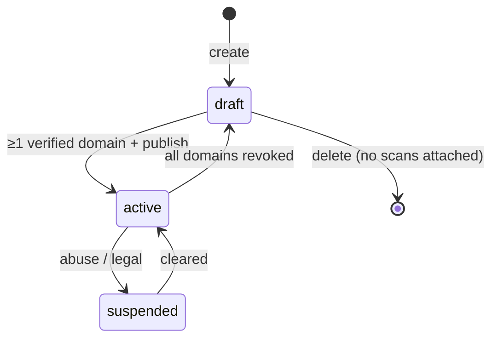

# ORGANISATION_TRUST PROFILES

> **Status:** DECIDED · **Group:** 03-backend · **Version:** 1.0 · **Last updated:** 2026-11-07
> **Source of truth for:** onboarding, verification lifecycle, recipient attestation, profile public projection, revocation, audit.
> **Related:** [`../02-architecture/DATABASE_DESIGN.md`](../02-architecture/DATABASE_DESIGN.md) · [`RISK_ENGINE.md`](RISK_ENGINE.md) · [`../01-product/USER_JOURNEYS.md`](../01-product/USER_JOURNEYS.md)

---

## 1. Why this exists

A Trust Profile is the **authority** that makes Action Integrity Verification possible. Without it,
the best we can say is "this looks like X". With it, we can say "this is not X's domain, and this is
not X's payee" — which is decisive, explainable and demo-able.

The registry of verified organisations, domains and payees is also the long-term moat
(`PROJECT_OVERVIEW.md` §10).

---

## 2. Profile anatomy

| Element | Verified required? | Used by |
| --- | --- | --- |
| Legal name, display name | No (self-declared) | Display only |
| Country, sector | No | Grouping, reporting |
| Brand tokens (names/aliases) | No (analyst-reviewed when abused) | Impersonation matching (`R-ID-02`) |
| Logo (pHash) | No | `R-ID-04` |
| Official domains | **Yes** | `R-ID-01`, `R-ID-06`, all identity rules |
| Login endpoints | Inherited from verified domain, or explicit | `R-CRED-01/05` |
| Payment hosts | Explicit | `R-PAY-05` |
| Payment recipients | **Yes** (attestation) | `R-PAY-01/03` |
| Support email domain | No | Copy only |

Rule of thumb: **self-declared data is evidence; verified data is authority.**

---

## 3. Lifecycle



- `draft`: exists, not usable for verification. Scans can reference it internally but identity rules
  treat it as "no authoritative profile".
- `active`: at least one verified domain. Public projection available.
- `suspended`: excluded from public projection; existing scans unaffected; new identity checks treat it
  as unverifiable.

Publishing requires `org_admin` and at least one verified domain; otherwise
`409 NO_VERIFIED_DOMAIN` (registered in `API_CONTRACTS.md` §7.3).

---

## 4. Domain verification

### 4.1 Challenge generation

On `POST /organisations/{orgId}/domains`:

1. Normalise the domain (punycode, lowercase, no scheme, no wildcard, must contain a dot).
2. Reject if `UNIQUE(domain)` is already taken by another organisation → `409 DOMAIN_ALREADY_CLAIMED`.
3. Generate a 32-byte random token, base32-encoded (no padding, uppercase).
4. Store `domain_verifications` with `token_hash`, `method`, `expires_at = now + 7 days`.
5. Return the **instructions**, not the token hash:

```json
{
  "domain": "northstar-demo.example",
  "status": "pending",
  "challenges": [
    {
      "method": "dns_txt",
      "record_name": "_trustlens-challenge.northstar-demo.example",
      "record_type": "TXT",
      "record_value": "tl-verify=JBSWY3DPEHPK3PXPJBSWY3DPEHPK3PXP",
      "expires_at": "2026-11-14T09:14:22Z"
    },
    {
      "method": "http_file",
      "url": "https://northstar-demo.example/.well-known/trustlens-verify.txt",
      "file_content": "tl-verify=JBSWY3DPEHPK3PXPJBSWY3DPEHPK3PXP",
      "expires_at": "2026-11-14T09:14:22Z"
    }
  ]
}
```

The raw token is returned once at creation. Re-fetching the challenge (posting the same domain
again) returns the record name and URL with a newly generated token, invalidating the old one.

Claim conflicts: if another organisation holds the domain **verified** (and unexpired) or has an
**open, unexpired challenge** for it → `409 DOMAIN_ALREADY_CLAIMED`. A lapsed claim (challenge
expired, never verified, or revoked) does not block the real owner: the new claim replaces it and
still has to pass the challenge.

### 4.2 Verification check

`POST /organisations/{orgId}/domains/{domainId}/verify` with `{method}`.

| Method | Check |
| --- | --- |
| `dns_txt` | Resolve `TXT _trustlens-challenge.<domain>`; look for a record equal to `tl-verify=<token>`; exact match after whitespace trim |
| `http_file` | `GET https://<domain>/.well-known/trustlens-verify.txt` through the SSRF guard; 4 kB cap; 5 s timeout; body trim equals `tl-verify=<token>`; **must** be HTTPS with a verified chain; redirects are **not** followed (a redirect would let another host answer) and count as not found |

Outcomes:

| Result | Status | Response |
| --- | --- | --- |
| Match | `verified` | `200` with `verified_at`, evidence id |
| Record present, wrong value | `failed` | `422 VERIFICATION_TOKEN_MISMATCH`, `observed_value` truncated to 16 chars |
| Nothing found | `failed` | `422 VERIFICATION_NOT_FOUND` |
| Fetch/network error (DNS timeout after one retry, TLS failure, 5xx, guard refusal) | `pending` | `502 VERIFICATION_FETCH_FAILED` (attempt counted) |
| Challenge older than 7 days | `failed` | `410 VERIFICATION_EXPIRED` |
| > 5 attempts in an hour | — | `429 RATE_LIMITED` |

Attempts increment on every call, including failures; a success stores an `evidence` row with
`source = dns_challenge | http_file`, the observed value hash, and `observed_at`.

### 4.3 Inherited login endpoints

If `northstar-demo.example` is verified with `kind = login`, then every `*.northstar-demo.example`
host is treated as an approved credential destination **unless** the organisation explicitly narrows
the list. Narrowing is a profile setting `login_hosts_mode`:

| Mode | Behaviour |
| --- | --- |
| `domain_wildcard` (default) | Any subdomain of a verified domain is acceptable |
| `explicit_only` | Only hosts listed in `verified_domains` with `kind = login` are acceptable |

Why default to wildcard: universities legitimately use many subdomains, and a false `BLOCK` on a
real login page is worse than a missed subdomain. Organisations with strict requirements can tighten
it. The chosen mode is returned in the public projection so clients can explain a mismatch.
Enforced by the credential-destination rule: under `explicit_only` only exact `kind = login` hosts
are approved (subdomains are not inherited and `official` domains do not count); the public
projection's `login_hosts` follows the same rule.

**Logo.** There is no upload endpoint: the dashboard computes the 64-bit pHash of the official logo
in the browser and sends `logo_phash` (16 hex) on `PATCH /organisations/{id}`. `R-ID-04`
(`LOGO_NEAR_DUPLICATE`) compares it with the page's logo hash; with no stored hash the rule is
skipped.

### 4.4 Expiry and re-verification

- Verification is valid for 180 days (`expires_at`).
- A nightly job (and a lazy check at scan time) flips expired domains to `expired`; identity rules
  then treat them as unverified but *do not* emit `DOMAIN_NOT_REGISTERED_BY_BRAND` — they emit
  `IDENTITY_CLAIM_UNVERIFIABLE`, which is milder. This avoids penalising a real organisation that
  forgot to re-verify.
- Registrar change detection is FUTURE (requires registrar monitoring).

---

## 5. Payment recipients

### 5.1 Types and normalisation

| Type | Normalisation | Validation |
| --- | --- | --- |
| `upi_vpa` | lowercase localpart and handle | `^[a-zA-Z0-9.\-_]{2,64}@[a-zA-Z]{2,32}$` |
| `iban` | uppercase, strip spaces | length 15–34, `mod-97 == 1` |
| `bank_account` | digits only | 8–18 digits + IFSC-like branch code when country is IN |
| `wallet_address` | lowercase | `^0x[a-f0-9]{40}$` or base58 length 32–44 |
| `payment_link` | lowercase host + path | absolute https URL ≤ 2048 |

Normalisation failures return `422 INVALID_RECIPIENT` with
`details: [{field: "value", issue: "iban_checksum_failed"}]`.

### 5.2 Attestation

A recipient is **not** authoritative on creation.

1. `org_admin` creates it → `pending_attestation`.
2. Provides an evidence reference: an uploaded artefact (bank letter, statement header) stored via
   object storage, or an explicit analyst note for the demo.
3. An `analyst` or `operator` calls
   `POST /organisations/{orgId}/recipients/{recipientId}/verify` with
   `{action: "verify" | "reject", reason}`.
4. `verified` records `verified_by`, `verified_at`; audit row written.

Demo note: the seed script marks Northstar's fee account `verified` with
`evidence_ref = "demo-attestation"` and an audit row `recipient.verify` with a `seed` marker, so the
demo never pretends a human reviewed it.

### 5.3 Why attestation, not automation

We cannot call a bank or PSP to confirm ownership (no partnership). Claiming otherwise would be
dishonest. Attestation by a reviewer — even a light one — is the truthful version, and the
`pending_attestation` state exists so the product can say "registered but not yet verified" instead
of collapsing two different meanings into "unknown".

### 5.4 Revocation

Revoking (`DELETE` or status change) makes the recipient non-authoritative immediately. Effects:

- New `verify-payment` calls return `match = none` (if other verified recipients exist) or
  `unverifiable` (if none do).
- Existing scans keep their historical findings; the UI notes "profile changed since this scan".
- Audit row records who revoked and why.

---

## 6. Public projection

`GET /api/v1/organisations/{orgId}/public-profile` — cacheable, no auth.

```json
{
  "organisation_id": "01JCM5AA...",
  "name": "Northstar University",
  "country": "IN",
  "sector": "education",
  "status": "active",
  "login_hosts_mode": "domain_wildcard",
  "verified_domains": [
    { "domain": "northstar-demo.example", "kind": "official", "verified_at": "2026-11-01T10:00:00Z" },
    { "domain": "login.northstar-demo.example", "kind": "login", "verified_at": "2026-11-01T10:00:00Z" }
  ],
  "verified_recipients": [
    { "type": "upi_vpa", "handle": "fees@northstar-demo", "label": "Admissions fee account",
      "verified_at": "2026-11-01T10:05:00Z" }
  ],
  "updated_at": "2026-11-05T12:00:00Z"
}
```

Never included: member emails, unverified domains, `pending_attestation` recipients, evidence
artefacts, internal notes, audit history, support email (unless the org opts in — not in MVP).

Consumers: the dashboard, the extension (cached 24 h), the SDK's `verifyIdentity`, and the AI
investigator's evidence pack (identifiers only).

---

## 7. Change management and audit

Every mutation writes `audit_logs` with `before`/`after` (redacted) and, where relevant, the actor's
membership role at the time.

| Action | Audit `action` |
| --- | --- |
| Create org | `org.create` |
| Update fields | `org.update` |
| Invite/remove member | `org.member.invite` / `.remove` |
| Add domain | `domain.add` |
| Verify domain | `domain.verify` |
| Revoke domain | `domain.revoke` |
| Add recipient | `recipient.add` |
| Verify/reject recipient | `recipient.verify` / `.reject` |
| Revoke recipient | `recipient.revoke` |
| Publish/suspend | `org.publish` / `org.suspend` |
| Unpublish (back to draft) | `org.unpublish` |
| Re-issue a domain challenge | `domain.challenge` |
| Every verification attempt (incl. failures) | `domain.verify` with `after.outcome` — also the counter for the 5/hour limit |
| Change member role / accept invite / revoke invite | `org.member.role` / `org.member.join` / `org.member.invite.revoke` |

The audit row is written in the **same transaction** as the state change, so an audit trail without a
change (or vice versa) is impossible.

---

## 8. Abuse and disputes

| Scenario | Handling |
| --- | --- |
| Org claims a domain it does not own | Cannot pass the challenge; nothing to dispute |
| Two orgs claim the same domain | Second gets `409 DOMAIN_ALREADY_CLAIMED`; can open a dispute (manual, operator) |
| Org verifies a domain then loses it | Revocation by operator on evidence; audit recorded |
| Impersonator creates a profile for a real bank and verifies a lookalike domain | Domain verification proves *control of that domain*, not *legal identity*. Legal-identity checks are FUTURE. Until then, only domains that match public records are surfaced as "official" in the UI, and `sector = fintech` profiles require operator review before `active` |
| Bogus recipient added to authorise a scam payee | Attestation step + audit identity; an analyst can revoke immediately |

The legal-identity gap is real and documented here rather than hidden: **verification proves control
of a domain, not that the organisation is who it says it is.** This is why the profile carries a
`sector` risk tier and why fintech profiles need operator review in the MVP.

---

## 9. API surface

| Method | Path | Purpose |
| --- | --- | --- |
| `GET` | `/organisations` | List orgs the caller belongs to (analyst: all) |
| `POST` | `/organisations` | Create (`draft`) |
| `GET` | `/organisations/{orgId}` | Full profile (members only) |
| `PATCH` | `/organisations/{orgId}` | Update fields, publish/suspend |
| `GET` | `/organisations/{orgId}/public-profile` | Public projection |
| `GET`/`POST` | `/organisations/{orgId}/domains` | List / add |
| `POST` | `/organisations/{orgId}/domains/{domainId}/verify` | Run challenge |
| `DELETE` | `/organisations/{orgId}/domains/{domainId}` | Revoke |
| `GET`/`POST` | `/organisations/{orgId}/recipients` | List / add |
| `POST` | `/organisations/{orgId}/recipients/{recipientId}/verify` | Attest/reject |
| `DELETE` | `/organisations/{orgId}/recipients/{recipientId}` | Revoke |
| `GET`/`POST` | `/organisations/{orgId}/members` | List / invite |
| `PATCH`/`DELETE` | `/organisations/{orgId}/members/{userId}` | Change role / remove (or leave) |
| `DELETE` | `/organisations/{orgId}/invites/{inviteId}` | Revoke an open invite |
| `POST` | `/invites/{token}/accept` | Accept an invite (email must match) |

Schemas: `API_ENDPOINTS.md` §8–§12.

---

## 10. Acceptance criteria

1. A domain cannot become authoritative without a completed challenge, and the challenge cannot be
   satisfied by a lookalike domain (the record is checked at the exact host).
2. A `pending_attestation` recipient never yields `match = exact`.
3. Public projection exposes no member or evidence data (asserted by a response-shape test).
4. Revocation takes effect for new assessments immediately (no cache longer than 60 s server-side,
   24 h in the extension — and the extension re-checks on a payment action regardless).
5. Every mutation produces exactly one audit row in the same transaction.
6. Cross-tenant access returns 404, not 403.
