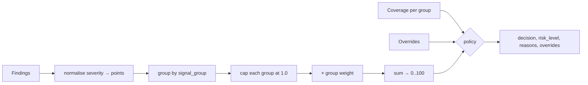

# RISK_ENGINE

> **Status:** DECIDED · **Group:** 03-backend · **Version:** 1.0 · **Last updated:** 2026-11-07
> **Source of truth for:** signal groups, weights, rule IDs (`R-*`), finding codes, coverage semantics, decision policy, overrides, explainability.
> **Related:** [`FEATURE_SPECIFICATIONS.md`](../01-product/FEATURE_SPECIFICATIONS.md) · [`API_CONTRACTS.md`](../02-architecture/API_CONTRACTS.md) · [`AI_INVESTIGATION_ENGINE.md`](../07-ai-intelligence/AI_INVESTIGATION_ENGINE.md)

---

## 1. Purpose and boundaries

The risk engine converts **structured findings + coverage** into a score, a risk level and a
decision. It is:

- **deterministic** — same inputs, same output, no randomness, no model;
- **explainable** — every point traces to a finding code and rule ID;
- **coverage-aware** — missing data never helps the site;
- **intent-aware** — a payee mismatch matters for `payment`, not for `browse`;
- **testable** — each rule has fixtures.

It is **not** a probability model. Score 87 does not mean "87% malicious". It means "this many
weighted signals fired". Any UI or doc that implies a probability is wrong.

---

## 2. Non-negotiable rules

1. The model never sets, adjusts or overrides a decision.
2. A failed check is `UNAVAILABLE`, never a pass.
3. `ALLOW` requires coverage ≥ 50% and no hard override.
4. A verified authorisation mismatch is decisive regardless of other signals.
5. Every decision includes its coverage.
6. Unknown input values are rejected, not defaulted.

---

## 3. Pipeline



Order matters: overrides are evaluated **after** scoring but **before** band assignment, and can
raise the decision but never lower it below the coverage gate.

---

## 4. Signal groups

| Group | Weight | Question it answers |
| --- | --- | --- |
| `reputation` | 30 | Do we or the community already know this is malicious? |
| `identity` | 25 | Is this site authorised to claim this organisation? |
| `credential_destination` | 20 | Where do the credentials actually go? |
| `payment_destination` | 15 | Is the payee actually the organisation's? |
| `infrastructure` | 10 | Does the surrounding infrastructure and crypto look sound? |

Weights sum to 100, so a group's maximum contribution is its weight. The ranking encodes product
judgement: reputation and identity dominate, and a *verified* destination mismatch is handled by
overrides rather than by weight (a 15-weight group could otherwise be outvoted).

These are **engineering weights**, not validated statistics. They are tunable only via a PR that
updates this table, the tests, and the demo expectations together.

---

## 5. Scoring

### 5.1 Severity → points

| Severity | Points |
| --- | --- |
| `critical` | 1.00 |
| `high` | 0.70 |
| `medium` | 0.40 |
| `low` | 0.15 |
| `info` | 0.00 |

Points are multiplied by finding confidence, then summed **per group**:

```
group_raw = min(1.0, Σ(points_i × confidence_i))
contribution = round(group_weight × group_raw)
```

`round` is half-up to an integer. Score:

```
risk_score = min(100, Σ contribution)
```

Consequences worth knowing:

- One critical finding in `reputation` gives 30 points.
- Two high findings in `identity` give 25 (0.7 + 0.7 → capped at 1.0).
- An `info` finding never moves the score; it exists for explanations.

### 5.2 Worked example — the demo lookalike

| Finding | Group | Sev | Conf | Points |
| --- | --- | --- | --- | --- |
| `DOMAIN_NOT_REGISTERED_BY_BRAND` | identity | high | 0.95 | 0.665 |
| `LOGO_NEAR_DUPLICATE` | identity | medium | 0.80 | 0.320 |
| `CREDENTIAL_DESTINATION_MISMATCH` | credential_destination | critical | 0.90 | 0.900 |
| `PAYEE_NOT_IN_VERIFIED_PROFILE` | payment_destination | critical | 1.00 | 1.000 |
| `SHARES_INFRA_WITH_REPORTED_THREAT` | infrastructure | medium | 0.70 | 0.280 |
| `DOMAIN_RECENTLY_REGISTERED` | infrastructure | low | 1.00 | 0.150 |

Group raw: identity `min(1, 0.665+0.320)=0.985` → 25; credential `0.900` → 18; payment `1.000` → 15;
infrastructure `min(1, 0.28+0.15)=0.43` → 4; reputation 0 → 0.
**Score = 62 → HIGH.** Band would say `WARN` for `browse`, `BLOCK` for `payment`. Override O-2
(`PAYEE_NOT_IN_VERIFIED_PROFILE`) forces `BLOCK` regardless. That is exactly the behaviour the demo
needs: the score alone is not what stops the payment; the verified mismatch is.

---

## 6. Coverage

### 6.1 States

| State | Meaning |
| --- | --- |
| `collected` | The check ran and produced a definite answer (including a negative answer) |
| `unavailable` | The check was attempted and failed (timeout, 5xx, blocked) |
| `skipped` | The check was intentionally not run (disabled feature, not applicable to intent) |

Coverage is computed per group from the collector results, not from findings. A group with zero
findings but successful collection **counts as collected** — absence of a signal is information.

```
coverage_percent = Σ weight(group) for group in collected_groups
```

### 6.2 Group collection rules

| Group | `collected` when | `unavailable` when | `skipped` when |
| --- | --- | --- | --- |
| `reputation` | Reputation lookup returned a result (even "unknown") | Lookup errored | Never (always attempted) |
| `identity` | No claim detected, or claim resolved against a profile | Profile lookup failed | No organisation context **and** no brand claim detected → `skipped` |
| `credential_destination` | No login form, or form resolved | Page fetch failed | Intent is `browse`/`download` **and** no password field present |
| `payment_destination` | No payee candidates, or all resolved | Page fetch failed | Intent is not `payment`/`data_submission` and no payee candidate seen |
| `infrastructure` | DNS + TLS completed | DNS or TLS failed | Never for HTTPS/HTTP targets |

### 6.3 Gates

| Coverage | Effect |
| --- | --- |
| ≥ 50% | Normal banding |
| 25–49% | `ALLOW` forbidden → min decision `REVIEW` (or higher if score ≥ 25 → `WARN`) |
| < 25% | decision `UNKNOWN`, risk level `UNKNOWN`, score still reported for transparency |

---

## 7. Rules and finding codes

Each rule is `R-<GROUP>-<nn>` and emits exactly one finding code. Severity and confidence defaults
live here; collectors may lower confidence with a documented reason.

### 7.1 Reputation (`reputation`, 30)

| Rule | Code | Sev | Trigger |
| --- | --- | --- | --- |
| `R-REP-01` | `KNOWN_MALICIOUS_REPUTATION` | critical | Entity reputation ≤ −60 from confirmed reports/analyst action |
| `R-REP-02` | `RELATED_THREAT_FOUND` | high | Entity within 1 hop of a confirmed threat (≥ 0.7 confidence) |
| `R-REP-03` | `REPORTED_BY_COMMUNITY` | medium | ≥ 2 pending reports from distinct reporters in 7 days |
| `R-REP-04` | `DOMAIN_ON_ANALYST_BLOCKLIST` | critical | Analyst manual block, audited |
| `R-REP-05` | `BRAND_UNDER_ACTIVE_ATTACK` | medium | Organisation has ≥ 5 confirmed lookalikes in 30 days (contextual) |

### 7.2 Identity (`identity`, 25)

| Rule | Code | Sev | Trigger |
| --- | --- | --- | --- |
| `R-ID-01` | `DOMAIN_NOT_REGISTERED_BY_BRAND` | high | Claimed org exists; domain not in its verified set |
| `R-ID-02` | `BRAND_CLAIM_ON_UNVERIFIED_DOMAIN` | high | Brand tokens match; no matching org profile at all |
| `R-ID-03` | `IDENTITY_CLAIM_UNVERIFIABLE` | medium | Claim asserted, no profile available to check |
| `R-ID-04` | `LOGO_NEAR_DUPLICATE` | medium | pHash distance ≤ 8/64 against an org logo |
| `R-ID-05` | `TYPOSQUATTING_PATTERN` | low | Label within edit distance 1–2 of a verified domain, or brand + lure keyword |
| `R-ID-06` | `SUBDOMAIN_IMPERSONATION` | high | Subdomain contains brand but parent domain is not verified |
| `R-ID-07` | `IDENTITY_MATCH_CONFIRMED` | info | Domain verified and login hosts match (positive evidence, 0 points) |

### 7.3 Credential destination (`credential_destination`, 20)

| Rule | Code | Sev | Trigger |
| --- | --- | --- | --- |
| `R-CRED-01` | `CREDENTIAL_DESTINATION_MISMATCH` | critical | Form action origin ≠ any approved login endpoint of the claimed org |
| `R-CRED-02` | `CREDENTIALS_POSTED_TO_THIRD_PARTY` | high | Action origin's registrable domain ≠ page's, and not approved |
| `R-CRED-03` | `CREDENTIALS_POSTED_OVER_HTTP` | critical | Action scheme is `http` while page is `https`/login intent |
| `R-CRED-04` | `PASSWORD_FIELD_ON_UNVERIFIED_DOMAIN` | high | Password field present, claim exists, domain unverified |
| `R-CRED-05` | `LOGIN_ENDPOINT_NOT_AUTHORISED` | high | Claimed org lists login endpoints and this host is not one |
| `R-CRED-06` | `ACTION_NOT_OBSERVABLE` | low | Form target cannot be determined (JS-only/iframe) |
| `R-CRED-07` | `LOGIN_ON_VERIFIED_ENDPOINT` | info | Action matches an approved endpoint (positive evidence) |

### 7.4 Payment destination (`payment_destination`, 15)

| Rule | Code | Sev | Trigger |
| --- | --- | --- | --- |
| `R-PAY-01` | `PAYEE_NOT_IN_VERIFIED_PROFILE` | critical | Org has ≥ 1 verified recipient; observed payee matches none |
| `R-PAY-02` | `PAYEE_UNVERIFIABLE` | medium | Org has no verified recipients (cannot verify) |
| `R-PAY-03` | `PAYEE_NOT_VERIFIED` | medium | Payee exists in profile but is `pending_attestation` |
| `R-PAY-04` | `PAYEE_LINKED_TO_REPORTED_SCAM` | critical | Payee entity has ≥ 2 confirmed reports |
| `R-PAY-05` | `PAYMENT_HOST_MISMATCH` | high | Payment page host not approved and payee not in profile |
| `R-PAY-06` | `PAYEE_MATCH_CONFIRMED` | info | Payee verified (positive evidence) |

### 7.5 Infrastructure (`infrastructure`, 10)

| Rule | Code | Sev | Trigger |
| --- | --- | --- | --- |
| `R-INF-01` | `DOMAIN_RECENTLY_REGISTERED` | low | Age < 30 days (medium if < 7 days and a claim exists) |
| `R-INF-02` | `DOMAIN_NXDOMAIN` | high | Does not resolve |
| `R-INF-03` | `TLS_HANDSHAKE_FAILED` | high | Handshake fails for `login`/`payment`; medium otherwise |
| `R-INF-04` | `CERT_EXPIRED` | high | `not_after` in the past |
| `R-INF-05` | `CERT_HOSTNAME_MISMATCH` | high | SANs do not cover the host |
| `R-INF-06` | `CERT_CHAIN_UNVERIFIED` | high | Verification failed (unknown/expired root, missing intermediate) |
| `R-INF-07` | `CERT_WEAK_KEY` | medium | RSA < 2048 or EC < 224 bits |
| `R-INF-08` | `CERT_WEAK_SIGNATURE` | high | MD5/SHA-1 signature |
| `R-INF-09` | `CERT_ISSUER_AFFECTED_BY_INCIDENT` | high | Chain includes an issuer named in an active incident (simulated ⇒ `info` + labelled) |
| `R-INF-10` | `SHARES_INFRA_WITH_REPORTED_THREAT` | medium | Shared nameserver, issuer or /24 with a confirmed threat (confidence-scaled) |
| `R-INF-11` | `REDIRECT_CHAIN_TOO_LONG` | low | > 10 hops |
| `R-INF-12` | `REDIRECT_TO_BLOCKED_TARGET` | high | A hop resolved into a blocked range |
| `R-INF-13` | `PAGE_FETCH_BLOCKED` | low | Target refused/blocked content fetch |
| `R-INF-14` | `DOM_FINGERPRINT_MATCH` | medium | Structure hash matches a confirmed phishing kit |
| `R-INF-15` | `ALL_CHECKS_UNAVAILABLE` | high | No collector succeeded |

### 7.6a Subsumption (one fact is never counted twice in a group)

When a specific rule fires, the generic rule it refines for the same fact is not emitted:

| Specific (emitted) | Suppressed generic |
| --- | --- |
| `R-ID-01` `DOMAIN_NOT_REGISTERED_BY_BRAND` | `R-ID-02`, `R-ID-05`, `R-ID-06` |
| `R-CRED-01` `CREDENTIAL_DESTINATION_MISMATCH` | `R-CRED-02`, `R-CRED-04`, `R-CRED-05` |
| `R-PAY-01` `PAYEE_NOT_IN_VERIFIED_PROFILE` | `R-PAY-05` |

Without this the worked example (§5.2) would score 64, not 62: `CREDENTIALS_POSTED_TO_THIRD_PARTY`
describes the same form action as `CREDENTIAL_DESTINATION_MISMATCH`.

### 7.7 Message codes (owner: [`MESSAGE_ANALYSIS.md`](MESSAGE_ANALYSIS.md) §4)

Emitted only by message analysis (`POST /messages/analyse`); never by a URL scan.

| Rule | Code | Group | Sev | Trigger |
| --- | --- | --- | --- | --- |
| `R-MSG-01` | `MESSAGE_CREDENTIAL_REQUEST` | credential_destination | high | Asks for OTP, PIN, password, CVV, KYC, seed phrase or remote access (negated sentences skipped) |
| `R-MSG-02` | `MESSAGE_PAYMENT_DEMAND` | payment_destination | high | Asks for a transfer or fee (confirmations and negations skipped) |
| `R-MSG-03` | `MESSAGE_IMPERSONATES_ORGANISATION` | identity | medium | Claims X; `From:` domain is not verified by X |
| `R-MSG-04` | `MESSAGE_LINK_TO_UNVERIFIED_CLAIM` | identity | medium | Claims X; links to a domain X has not verified |
| `R-MSG-05` | `MESSAGE_URGENCY_PRESSURE` | identity | low | Urgency lexicon (language-only) |
| `R-MSG-06` | `MESSAGE_CONTACT_CHANNEL_MISMATCH` | identity | low | Free-mail sender for an organisation claim, or off-channel contact (language-only) |
| `R-MSG-07` | `MESSAGE_LINK_BLOCKED` | reputation | critical | A link's own scan decided `BLOCK` |
| `R-MSG-08` | `MESSAGE_LINK_WARNED` | reputation | medium | A link's own scan decided `WARN` |
| `R-MSG-09` | `MESSAGE_NO_MALICIOUS_INDICATOR` | identity | info | Nothing else fired |

### 7.6 Cross-cutting codes (not scored)

| Code | Purpose |
| --- | --- |
| `TARGET_UNREACHABLE` | Scan could not reach the host → `UNKNOWN` |
| `TARGET_NOT_ALLOWED` | SSRF policy → request rejected with 422, never a verdict |
| `DOMAIN_VERIFIED` | Positive identity evidence for the report's coverage section |
| `NO_KNOWN_THREAT_IN_COVERAGE` | Emitted as `info` when coverage ≥ 50 and score < 25 |

---

## 8. Decision policy

### 8.1 Hard overrides (evaluated in order, highest wins)

| ID | Condition | Decision |
| --- | --- | --- |
| `O-1` | `DOMAIN_ON_ANALYST_BLOCKLIST` | `BLOCK` |
| `O-2` | `PAYEE_NOT_IN_VERIFIED_PROFILE` **with** `match=none` and ≥ 1 verified recipient, intent `payment` | `BLOCK` |
| `O-3` | `PAYEE_LINKED_TO_REPORTED_SCAM`, intent `payment` | `BLOCK` |
| `O-4` | `CREDENTIAL_DESTINATION_MISMATCH` **or** `CREDENTIALS_POSTED_OVER_HTTP`, intent `login` | `BLOCK` |
| `O-5` | `CREDENTIALS_POSTED_TO_THIRD_PARTY` with action origin cross-registrable-domain, intent `login` | `BLOCK` |
| `O-6` | `KNOWN_MALICIOUS_REPUTATION` | `BLOCK` |
| `O-7` | `TARGET_UNREACHABLE` and no other findings | `UNKNOWN` |

Overrides are additive and recorded in `overrides[]` with their ID. An override can only raise the
decision; it never lowers it.

### 8.1a Message policy (messages only; owner: `MESSAGE_ANALYSIS.md` §5)

Applied by `decide_message` after `decide`. These are the only rules allowed to **lower** a decision,
and only for messages, because the problem statement forbids condemning a message on language alone.

| ID | Condition | Effect |
| --- | --- | --- |
| `O-10` | `MESSAGE_LINK_BLOCKED` | `BLOCK` |
| `O-8` | Only language-only findings (`MESSAGE_URGENCY_PRESSURE`, `MESSAGE_CONTACT_CHANNEL_MISMATCH`) | exactly `REVIEW` |
| `O-9` | Non-info findings, none corroborating, sender not verified | clamp to `REVIEW`…`WARN` |
| — | Any corroborating finding | floor `WARN` |

Corroborating codes: `PAYEE_NOT_IN_VERIFIED_PROFILE`, `PAYEE_LINKED_TO_REPORTED_SCAM`,
`KNOWN_MALICIOUS_REPUTATION`, `MESSAGE_IMPERSONATES_ORGANISATION`, `MESSAGE_LINK_TO_UNVERIFIED_CLAIM`,
`MESSAGE_LINK_BLOCKED`, `MESSAGE_LINK_WARNED`.

### 8.2 Band table (no override applies)

| Score | Level | `browse` | `login` | `payment` | `download` | `data_submission` |
| --- | --- | --- | --- | --- | --- | --- |
| 75–100 | CRITICAL | BLOCK | BLOCK | BLOCK | BLOCK | BLOCK |
| 50–74 | HIGH | WARN | BLOCK | BLOCK | WARN | BLOCK |
| 25–49 | MEDIUM | WARN | WARN | WARN | WARN | WARN |
| 0–24 | LOW | ALLOW | ALLOW | ALLOW | ALLOW | ALLOW |

### 8.3 Coverage gate (applied after banding)

| Coverage | Adjustment |
| --- | --- |
| ≥ 50% | none |
| 25–49% | `ALLOW` → `REVIEW`; `WARN` stays `WARN`; `BLOCK` stays |
| < 25% | decision → `UNKNOWN`, level → `UNKNOWN` (unless an override produced `BLOCK`, which stands) |

Rationale: a block on decisive evidence is safe even when coverage is low. A pass is never safe
when we barely looked.

### 8.4 Conflict handling

Signals can conflict: verified identity but payee mismatch, or a clean identity with a malicious
reputation. Rules:

1. Any `BLOCK` override wins over positive `info` findings.
2. Positive findings (`IDENTITY_MATCH_CONFIRMED`, `PAYEE_MATCH_CONFIRMED`,
   `LOGIN_ON_VERIFIED_ENDPOINT`) never subtract points; the engine has no negative weights. They
   exist to explain *why* a decision is `ALLOW` and to prevent an analyst from misreading silence.
3. If two identity claims conflict (page claims two organisations), emit `IDENTITY_CLAIM_UNVERIFIABLE`
   and cap the decision at `WARN`.

### 8.5 Critical floor

`ALLOW` is unreachable while any `critical` finding is present: the decision is raised to at least
`WARN`. Without it, a critical finding in a ≤ 20-weight group (e.g. `CREDENTIALS_POSTED_OVER_HTTP` on a
payment page) could score `LOW` and band to `ALLOW`. Overrides still decide `BLOCK` where they apply.

### 8.6 Notes on §6.2 as implemented

- `identity` is `collected` when a claim was resolved against a profile **or** the page was analysed
  and no claim was found (absence is information); `unavailable` when the page could not be fetched
  and there was no organisation context.
- Where §6.2 and §12 differ for `credential_destination` under `browse`, §12 (intent gating) wins: the
  group is `skipped`.
- Overrides change the decision, never the band: the worked example is `BLOCK` with `risk_level: HIGH`.

---

### 8.7 Problem-statement risk classes (derived, never stored)

`app/risk/classes.py` is the single mapping; read models (scans, assessments, messages) expose it as
`risk_class`. Clients never map it themselves.

| `Decision` | `risk_class` | Problem statement | Meaning here |
| --- | --- | --- | --- |
| `BLOCK` | `confirmed_malicious` | Confirmed Malicious | Authoritative intelligence or a forced override says stop |
| `WARN` | `high` | High Risk | Multiple significant indicators |
| `REVIEW` | `suspicious` | Suspicious | One or more indicators need investigation |
| `ALLOW` | `low` | Low Risk | No known threat **within executed checks** — never "safe" |
| `UNKNOWN` | `inconclusive` | Inconclusive | Insufficient data or unavailable sources |

`low` and `inconclusive` always carry: "Absence of evidence is not evidence of safety."

## 9. Reasons and explainability

`reasons[]` is generated deterministically from the top findings, ordered by
`(group_weight × points) desc, code asc`, limited to 5. Each reason is a template keyed by finding
code with slots filled from `observed`/`expected`:

```text
"PAYEE_NOT_IN_VERIFIED_PROFILE" →
"The payment address {observed.payee} is not one registered by {org.name}."
```

Templates live in `app/risk/reasons.py` and are unit-tested for: no unfilled slots, no raw enum
leakage, no "safe" wording.

The API also returns structured `findings[]` so a client can render its own copy without parsing
prose. The extension uses structured data, not `reasons[]`.

---

## 10. Certificate incidents (TL-020 coupling)

`R-INF-09` is special: an incident can be `simulated`. Rules:

- Real advisory → `severity: high`, contributes normally.
- Simulated → `severity: info` (0 points) but still appears in findings and the UI with a
  `simulated: true` badge. This prevents demo data from changing real verdicts while still
  demonstrating the workflow.
- The platform never asserts a CA is distrusted; the finding text says "chain depends on issuer named
  in incident {title}".

---

## 11. False positives and negatives

| Situation | Handling |
| --- | --- |
| Org has no profile | `IDENTITY_CLAIM_UNVERIFIABLE` (medium), never a block |
| Org has no verified recipients | `PAYEE_UNVERIFIABLE` (medium), never a block |
| Legit site uses a third-party payment host | Positive only if the host is in the org's approved payment hosts; otherwise `PAYMENT_HOST_MISMATCH` (high, not blocking alone) |
| Legit site behind a WAF blocking our fetch | `PAGE_FETCH_BLOCKED` (low) + coverage `unavailable`; decision capped at `WARN` at worst |
| New domain, no other signals | `DOMAIN_RECENTLY_REGISTERED` alone = 1.5 points → `ALLOW`. Deliberate: age alone is weak |
| Analyst block applied by mistake | Reversible via analyst action; audit trail preserved |

False-negative posture: the engine prefers `REVIEW`/`UNKNOWN` over a confident pass. We accept more
`WARN`s than a commercial blocklist would.

---

## 12. Intent gating matrix

Which rules can fire per intent (`✔` = evaluated, `—` = not evaluated):

| Rule group | browse | login | payment | download | data_submission |
| --- | --- | --- | --- | --- | --- |
| Reputation | ✔ | ✔ | ✔ | ✔ | ✔ |
| Identity | ✔ | ✔ | ✔ | ✔ | ✔ |
| Credential destination | — | ✔ | ✔ | — | ✔ |
| Payment destination | — | — | ✔ | — | ✔ |
| Infrastructure | ✔ | ✔ | ✔ | ✔ | ✔ |

Not evaluating a group is not the same as passing it: the group is `skipped`, which reduces coverage
and therefore forbids `ALLOW` when it drops below 50%.

---

## 13. Versioning the engine

- `RISK_ENGINE_VERSION` is stored on every scan (`result.engine_version`).
- Any weight, threshold or rule change bumps the version and requires: updated tests, updated demo
  expectations, an entry in `SYSTEM_ARCHITECTURE.md` §13 if it changes an anchor.
- Historical scans keep the version they were scored with; the UI shows it in the evidence panel.

---

## 14. Testing requirements

| Test | Assertion |
| --- | --- |
| Rule coverage | Every `R-*` has a positive and negative fixture |
| Determinism | Same fixture twice → identical score and reasons |
| Caps | 3 critical findings in one group still cap at the group weight |
| Coverage gates | 30% coverage with score 10 → `REVIEW`; 20% → `UNKNOWN` |
| Overrides | O-2 forces `BLOCK` even with score 20 |
| Override ordering | O-1 beats O-2 when both fire |
| No negative weights | A positive finding cannot lower a score |
| Copy | Every reason template renders with no placeholder left |
| AI isolation | An investigation on a `WARN` scan never yields a `BLOCK` decision change |
