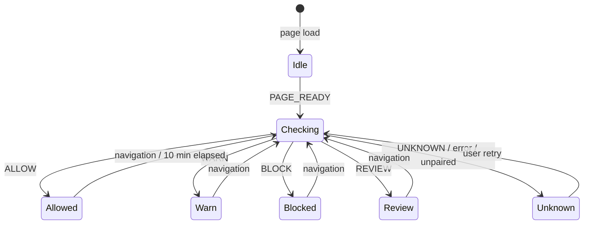

# BROWSER_PROTECTION_LOGIC

> **Status:** DECIDED · **Group:** 05-browser-extension · **Version:** 1.0 · **Last updated:** 2026-11-07
> **Source of truth for:** warning thresholds, action interception, fail modes, user overrides, observation limits.
> **Related:** [`EXTENSION_ARCHITECTURE.md`](EXTENSION_ARCHITECTURE.md) · [`EXTENSION_API_INTEGRATION.md`](EXTENSION_API_INTEGRATION.md) · [`../03-backend/RISK_ENGINE.md`](../03-backend/RISK_ENGINE.md)

---

## 1. Division of labour

The extension **observes and enforces**. The server **decides**. There are no thresholds, weights or
verdict logic in the extension — if Chrome's storage were fully readable by an attacker, they would
learn nothing that lets them forge a verdict, only how to disable their own protection.

| Extension does | Extension does not |
| --- | --- |
| Detect page load and sensitive actions | Score findings |
| Extract metadata (form action, payee strings) | Read field values |
| Call `/assess` with an intent | Cache a verdict beyond TTL |
| Render decision + reasons | Invent a reason |
| Enforce `BLOCK` locally | Decide that a site is "safe" |

---

## 2. Site status flow



Icon mapping (toolbar):

| Decision | Icon suffix | Badge text | Badge colour |
| --- | --- | --- | --- |
| `BLOCK` | red shield-x | `!` | danger |
| `WARN` | amber shield-alert | `!` | warning |
| `ALLOW` | neutral shield-check | none | none |
| `REVIEW` | grey search | `?` | unknown |
| `UNKNOWN` | grey shield-question | `?` | unknown |

Badges are supplementary; the popup always states the decision in words.

---

## 3. Thresholds (server-owned, mirrored for UX only)

The extension reads `decision` and never recomputes it. It does apply three local UX rules:

| Rule | Behaviour |
| --- | --- |
| Cache TTL 10 min | Cached verdict older than 10 min is rendered as `UNKNOWN` ("re-checking…") and triggers a refresh |
| Debounce 400 ms | Rapid navigation produces one check |
| Cache key | Normalised URL without fragment |

Why 10 minutes: long enough to avoid hammering the API while browsing, short enough that a domain
that becomes malicious is not trusted for an hour.

---

## 4. What can actually be observed

| Surface | Observable? | Notes |
| --- | --- | --- |
| Top-level document forms | Yes | `form[action]`, method, input types/names |
| Password field presence | Yes | `input[type=password]`, `autocomplete=current-password` |
| JS-driven submit (fetch/XHR) | Partially | We can observe the click/submit event and any `action`; we cannot reliably read the request URL without `webRequest` |
| Cross-origin iframes | **No** | Content scripts cannot read them |
| Closed shadow DOM | **No** | `shadowRoot` is null |
| Native payment sheets, UPI app handoff | **No** | We see the click and the `upi://` URI before handoff |
| Values typed into fields | **Not read, by policy** | We never access `.value` on password/payment inputs |
| Page HTML | Not transmitted | Only derived metadata |
| Other tabs | No | No `tabs` permission |

These limits are surfaced in the popup as a coverage note: "Payment inside a third-party frame —
cannot inspect." Never as a silent pass.

---

## 5. Action interception

### 5.1 Detection

```ts
// content/forms.ts — metadata only
function describeForm(form: HTMLFormElement) {
  const passwordField = form.querySelector<HTMLInputElement>('input[type="password"]');
  return {
    action: form.getAttribute("action") ?? "",
    method: (form.getAttribute("method") ?? "get").toLowerCase(),
    hasPassword: Boolean(passwordField),
    fieldTypes: [...form.querySelectorAll("input")].map(i => i.type),
    payees: extractPayees(form.ownerDocument),   // upi:// links, text patterns
  };
}
```

Payee extraction patterns (regex, no network):

- `upi://pay?...&pa=<vpa>`
- visible text matching `\b[\w.\-]{2,64}@[a-zA-Z]{2,32}\b` near payment words
- `data-payee`, `name="vpa"`, `name="upi_id"` field values **only for non-password fields**

### 5.2 Interception rules

| Intent | Trigger | Intercept? |
| --- | --- | --- |
| `login` | Submit on a form containing a password field | Yes, if decision is `BLOCK` |
| `payment` | Click on an element whose href/text indicates payment (upi, pay, checkout, donate) | Yes for `BLOCK`; confirm for `WARN` |
| `data_submission` (P2) | Submit of a form with ≥ 3 personal fields | Confirm for `WARN` |
| `download` (P3) | Click on a file link | Warn only |

Interception uses `preventDefault()` + `stopImmediatePropagation()` in the capture phase. If the page
has already attached a competing handler, we still stop the event; if navigation is triggered
programmatically, we cannot always stop it — in that case the overlay appears immediately after and
offers "Go back".

### 5.3 Overlay

```
┌──────────────────────────────────────────────┐
│  Payment stopped                             │
│                                              │
│  This page asks you to pay                   │
│    fees@okaxis                               │
│  Northstar University has registered         │
│    fees@northstar-demo                       │
│                                              │
│  [ Go back ]        Proceed anyway (unsafe)  │
│  Report this page                            │
└──────────────────────────────────────────────┘
```

Requirements:

- Rendered in a shadow root with `all: initial` isolation and a high `z-index`.
- Keyboard: focus moves to "Go back"; `Esc` = go back.
- "Proceed anyway" requires a second click ("I understand the risk").
- Shows coverage and scan age in a footer line.
- Names the mismatch in ≤ 15 words.

### 5.4 Non-blocking warning (superseded by §5.5 for page-level verdicts)

Originally: for `WARN`, a top-right banner, 44 px tall, one line + "Details", dismissible for the
session per domain. Since v0.5.0 a page-level `WARN` is a covering interstitial (§5.5); the banner
component remains for future non-blocking notices.

### 5.5 Page guard (v0.5.0)

The content script runs at `document_start`. Three cases hold a page **before it can be used**; all
use an opaque, blurred shield in the closed shadow root, take focus, and trap Tab.

| Trigger | What happens | Override |
| --- | --- | --- |
| The page contains a login form or a payment (same detection as §5.1, metadata only) | Covered as soon as the DOM exists ("Checking this payment/sign-in page before you use it…"); the server is asked with the page's own `intent`, `form_action` and displayed `payee`. `BLOCK`/`WARN`/`REVIEW` keep it covered; `ALLOW` releases it with the coverage toast | `BLOCK`: two clicks · `WARN`/`REVIEW`: one |
| The page's own browse verdict is `BLOCK` or `WARN` (a fresh cached verdict answers before paint) | Covering interstitial; skipped if the page guard already decided (the action-level answer is more specific) | same |
| A click on a link to a host the server answered `BLOCK`/`WARN` for in the last 10 minutes | Navigation is stopped; "TrustLens stopped this link" names the destination host | same, then navigates as the link would have |

Rules:

- The decision is always the server's. The guard enforces it; it never scores.
- **Fail open with disclosure (§6)**: a failed or timed-out check releases the page with "could not
  check this page" (never a pass); the submit is still checked at §5.2.
- Overrides are per host for the browser session, kept in `chrome.storage.session` by the service
  worker (`SET_PAGE_OVERRIDE` is accepted only for the sender's own host). Flagged hosts for the link
  pre-check live there too. A page cannot read or seed either.
- An action released at the guard is not asked about again on submit (same intent, destination and
  payee). Action results are cached for 10 minutes under the full request identity, so the submit
  reuses the guard's answer instead of a second wait.
- "Go back" returns to the previous page; with no history the page stays covered.
- A login/payment form rendered by script up to 8 s after load is still guarded.
- Cost: a first visit to a login or payment page is held for the server round trip (≈ 10–30 s on a
  cold scan; immediate on a repeat within 10 minutes).

---

## 6. Fail-open vs fail-closed

**DECIDED (Q-2 default): fail open with explicit disclosure.**

| Failure | Behaviour | Rationale |
| --- | --- | --- |
| No network / API down | `UNKNOWN`, allow navigation, show "not checked" badge | Failing closed on every network blip would make the browser unusable and users would uninstall |
| 401 / revoked device | Allow + "Reconnect to protect" | Protection is recoverable; blocking the web is not |
| Timeout | Allow + badge `?` | Same |
| Cache present but stale | Allow with `UNKNOWN` rendering, refresh in background | Prevents stale trust |

Never: render a stale `ALLOW` as if fresh; show a green icon on a failed check; silently swallow an
error.

Overriding a `BLOCK` is always possible with two clicks, and the override is counted locally
(`overrides_shown`, `overrides_taken`) so we can see in testing whether the warning is too aggressive.

---

## 7. Decision rendering matrix

| Decision | Icon | Banner | Overlay | Popup headline |
| --- | --- | --- | --- | --- |
| `BLOCK` | red | no | page covered (§5.5) + on action; links to the host stopped | "Blocked: {top reason}" |
| `WARN` | amber | no (page interstitial, §5.5) | page covered, one click to continue; links stopped | "Suspicious: {top reason}" |
| `ALLOW` | neutral | no | no | "No known threat ({coverage}% checked)" |
| `REVIEW` | grey | no | guarded login/payment page covered + confirm on action | "Needs review: not enough evidence" |
| `UNKNOWN` | grey | no | no | "Not verified: {reason}" |

The word "Safe" must not appear anywhere in the extension bundle. CI greps for it.

---

## 8. User controls

| Control | Default | Effect |
| --- | --- | --- |
| Protection on/off | on | Off → no checks, grey icon, explicit "protection paused" |
| Warn before payment | on | If off, `WARN` becomes informational only (not `BLOCK`) |
| Block on verified mismatch | **always on, not configurable** | The core safety guarantee; cannot be disabled |
| Show badge | on | Hides the toolbar badge only |
| Report prompts | on | Offers a report after an override |
| Clear local data | — | Removes token, cache, settings |

Non-negotiable: the user cannot turn off blocking for **verified payee/credential mismatches**. They
can override per action, with friction, but not disable the class of protection. This is a product
decision: a protection that the attacker can talk the user out of disabling is not protection.

---

## 9. Reporting flow

1. User clicks "Report this page" (overlay, popup, or banner).
2. Pre-filled: URL, finding codes shown, optional text (10–500 chars).
3. No HTML, no screenshot, no field values.
4. Queued if offline (max 20), retried once per hour.
5. Confirmation: "Report sent. You'll see updates in the dashboard."

---

## 10. Performance

| Concern | Target | How |
| --- | --- | --- |
| Page-load impact | ≤ 50 ms warm, ≤ 400 ms cold check | Cache, debounce, no synchronous work in content script |
| Memory | ≤ 20 MB | No DOM snapshots, no HTML retained |
| Network | ≤ 1 request per navigation + 1 per action | Cache + action checks only when a sensitive intent is detected |
| Worker wake cost | ≤ 100 ms | Small bundle, no heavy imports in the worker |

The content script never observes every mutation globally; it listens for `submit` (capture), clicks
on a bounded selector set, and a single debounced `MutationObserver` limited to form insertion.

---

## 11. Failure-mode tests

| Test | Expected |
| --- | --- |
| API returns 500 | Icon `?`, action allowed, one retry after 2 s |
| Token revoked | "Reconnect" state, no crash, cached verdicts ignored |
| Cache entry corrupt | Treated as miss, refetched |
| Overlay on a page with CSP `style-src 'none'` | Shadow-root styles still apply (constructed stylesheet) |
| Form inside cross-origin iframe | Popup shows coverage gap; no false `ALLOW` claim |
| Rapid navigation (5 pages in 2 s) | ≤ 2 API calls |
| Payment click with no payee text | `WARN` with "could not identify payee", not `BLOCK` |
| User overrides twice | Counted, still allowed, no nag loop beyond one report prompt |
