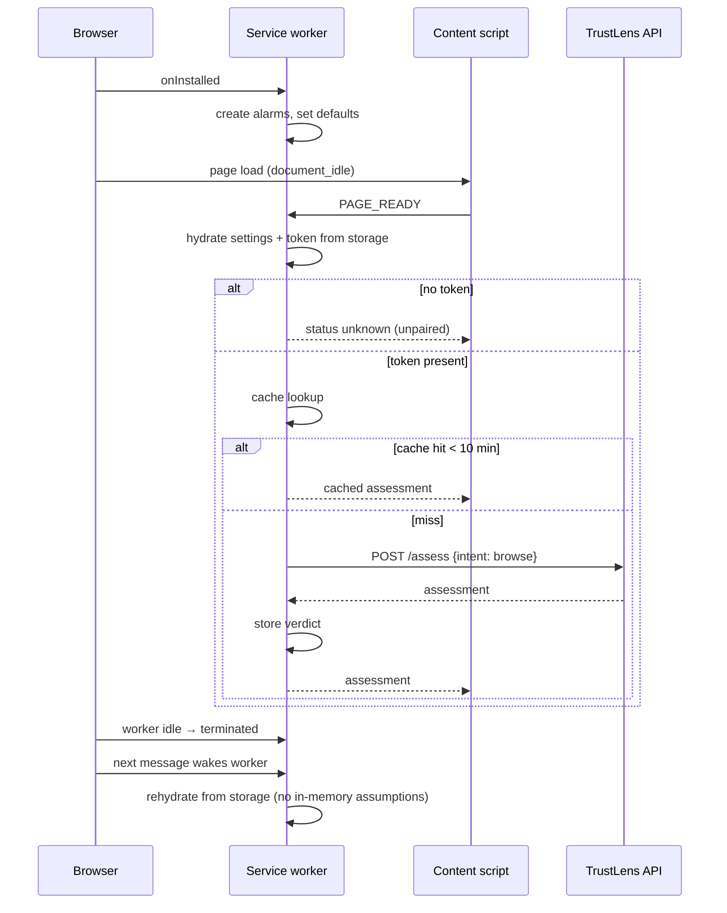

# EXTENSION_ARCHITECTURE

> **Status:** DECIDED · **Group:** 05-browser-extension · **Version:** 1.0 · **Last updated:** 2026-11-07
> **Source of truth for:** MV3 module structure, permissions, messaging, storage, pairing, update and error behaviour.
> **Related:** [`BROWSER_PROTECTION_LOGIC.md`](BROWSER_PROTECTION_LOGIC.md) · [`EXTENSION_API_INTEGRATION.md`](EXTENSION_API_INTEGRATION.md)

---

## 1. Constraints of Manifest V3

| Constraint | Consequence for the design |
| --- | --- |
| Service worker is terminated after ~30 s idle | No in-memory state that matters; all state in `chrome.storage`; rehydrate on wake |
| No remote code | All logic ships in the bundle; no `eval`, no CDN scripts |
| Declarative permissions | Minimal set; optional host permissions for broad coverage |
| Content scripts run in an isolated world | Use `chrome.runtime` messaging; never patch page globals |
| Async message passing | Every handler returns `true` for async responses; errors are values, not throws |
| CSP for extension pages | No inline scripts; no `unsafe-eval` |

---

## 2. Modules

```text
apps/extension/
├── manifest.json
├── src/
│   ├── background/
│   │   ├── service-worker.ts     message router, lifecycle
│   │   ├── verdict-cache.ts      TTL cache in storage.session/local
│   │   ├── api.ts                typed calls to the TrustLens API
│   │   └── tabs.ts               per-tab state, navigation cleanup
│   ├── content/
│   │   ├── observer.ts           page ready, DOM mutation debounce
│   │   ├── forms.ts              form/password/payee extraction (metadata only)
│   │   ├── overlay.ts            shadow-DOM overlay UI
│   │   └── report.ts             report flow
│   ├── popup/
│   │   ├── popup.tsx             360×420 status UI
│   │   └── components/
│   ├── options/
│   │   └── options.tsx           pairing, toggles, privacy, clear data
│   ├── shared/
│   │   ├── messages.ts           discriminated union of message types
│   │   ├── types.ts              decision, finding, assessment (mirrors API)
│   │   ├── copy.ts               user-facing strings (mirrors web `lib/copy.ts`)
│   │   └── tokens.ts             design tokens for the overlay/popup
│   └── lib/                      small utilities
├── public/icons/
└── vite.config.ts                @crxjs/vite-plugin
```

---

## 3. Permissions

```json
{
  "manifest_version": 3,
  "name": "TrustLens",
  "version": "0.4.1",
  "permissions": ["storage", "activeTab", "scripting", "alarms"],
  "host_permissions": ["https://api.trustlens.example/*"],
  "optional_host_permissions": ["http://*/*", "https://*/*"],
  "background": { "service_worker": "src/background/service-worker.ts", "type": "module" },
  "action": { "default_popup": "src/popup/index.html" },
  "options_page": "src/options/index.html",
  "content_scripts": [
    {
      "matches": ["http://*/*", "https://*/*"],
      "js": ["src/content/observer.ts"],
      "run_at": "document_idle"
    }
  ]
}
```

Rationale per permission:

| Permission | Why | Why not more |
| --- | --- | --- |
| `storage` | Cache verdicts, device token, settings | No `unlimitedStorage` |
| `activeTab` | Read the current URL and inject the overlay on demand | Avoids `<all_urls>` at install |
| `scripting` | Inject the overlay/report UI when needed | No `tabs` permission (we do not read other tabs' URLs) |
| `alarms` | Periodic cache eviction and token refresh check | No `webRequest` (not needed, and it is invasive) |
| Host (API) | Speak to the backend | — |
| Optional hosts | Broad protection after the user opts in | Requested at first run with an explanation |

We deliberately do **not** request: `webRequest`/`webRequestBlocking`, `history`, `cookies`,
`bookmarks`, `downloads`, `management`, `nativeMessaging`, `<all_urls>` at install.

Note: the content script declares broad matches because observation must work on any page the user
visits; the *install-time permission prompt* is limited by `activeTab`, and the broader host access is
granted through the optional permission flow. The manifest is the truthful declaration; the review
copy explains it in one sentence.

---

## 4. Messaging

Single discriminated union, defined once in `shared/messages.ts`:

```ts
export type Msg =
  | { type: "PAGE_READY"; url: string }
  | { type: "GET_STATUS"; url: string }
  | { type: "ACTION_INTENT"; url: string; intent: "login" | "payment"; formAction?: string;
      payee?: string; destinationHost?: string }
  | { type: "SHOW_OVERLAY"; assessment: Assessment }
  | { type: "REPORT"; url: string; codes: string[]; justification?: string }
  | { type: "PAIR"; code: string; deviceName: string }
  | { type: "GET_SETTINGS" }
  | { type: "SET_SETTINGS"; patch: Partial<Settings> };
```

Rules:

- Every response is `{ ok: true, data }` or `{ ok: false, error: { code, message } }`. Never throw
  across the boundary.
- Background handlers validate the sender (`sender.tab?.id` present for content messages).
- Content → background only; background → content only via `chrome.tabs.sendMessage` to a known tab.
- No message carries a password, OTP, cookie, card number or full page HTML.

---

## 5. Storage

| Key | Area | Contents | TTL |
| --- | --- | --- | --- |
| `device_token` | `local` | `tl_ext_…` | 180 days (server-enforced) |
| `settings` | `local` | `{enabled, showBadge, reportPrompt, theme}` | — |
| `verdict:<urlHash>` | `session` | `{assessment, cachedAt}` | 10 min |
| `profile:<orgId>` | `local` | Public profile projection | 24 h |
| `tab:<tabId>` | `session` | `{url, decision}` | until navigation |
| `pending_reports` | `local` | Offline queue (max 20) | 24 h |

`storage.session` survives worker restarts but not browser restarts — correct for verdict cache.
Verdict cache keys use a SHA-256 of the normalised URL, not the raw URL (privacy in storage).

---

## 6. Lifecycle



---

## 7. Pairing and auth

- The user opens the dashboard → "Connect extension" → gets an 8-char code (10 min, single use).
- The extension options page accepts the code and calls `/auth/extension/exchange`.
- The returned `tl_ext_` token is stored in `chrome.storage.local` only.
- Token expiry (180 days) is checked on wake: `/auth/me` returns 401 → the extension clears the token
  and shows "Reconnect" in the popup.
- Revoking the device in the dashboard invalidates the token on the next request.
- No password, no cookie, no OAuth redirect in the extension.

---

## 8. Error handling

| Situation | Behaviour |
| --- | --- |
| API unreachable | Show `UNKNOWN` ("not checked"), allow the action, log locally (no retry storm) |
| 401 | Clear token, show "Reconnect", keep protecting with cached verdicts only |
| 429 | Back off per `Retry-After`; serve cache; never retry in a loop |
| 5xx | Treat as unreachable; one retry after 2 s |
| Malformed response | Treat as unreachable; log code `BAD_RESPONSE` |
| Storage quota | Evict oldest verdicts; if still failing, disable cache and continue |

No error message is shown as a browser alert. All feedback is in the popup/overlay/toast.

---

## 9. Updates

- Version in `manifest.json`; the popup shows it in options.
- Breaking API changes require a coordinated extension release; the API keeps `/v1` for at least one
  release cycle.
- On install/update, migrate storage keys with a `schemaVersion` field; unknown future versions are
  reset to defaults rather than crashing.
- No auto-update mechanism in the unpacked demo build; the review build would use the Web Store.

---

## 10. Privacy posture

Collected and transmitted: the current page URL (on a protection check), observable form metadata
(action, method, field names/types, password presence), payee strings, and the finding codes the user
chose to report.

Never collected: field values, keystrokes, cookies, headers, responses, screenshots, page HTML,
browsing history, other tabs' URLs.

The options page states this in plain language and offers "Clear all local data". Full analysis:
`../09-testing-security/SECURITY_THREAT_MODEL.md` §9.

---

## 11. Testing

| Level | Approach |
| --- | --- |
| Unit | Pure functions: URL normalisation, payee extraction, cache TTL, decision mapping |
| Integration | Mocked `fetch` + message round-trip in a JSDOM harness |
| Manual | Load unpacked in Chrome; walk J2 in `USER_JOURNEYS.md` against the demo site |
| Security | Assert no `innerHTML` with remote data; assert no password value access (grep + review) |

---

## 12. Known browser limitations

| Limitation | Effect | Mitigation |
| --- | --- | --- |
| Content scripts cannot read cross-origin iframe content | Payment forms inside third-party iframes are invisible | Warn at the page level; report `ACTION_NOT_OBSERVABLE` |
| Closed shadow DOM is opaque | Some components' inputs are not enumerable | Detect the host element; downgrade to `WARN` with explanation |
| Native payment sheets / external apps (`upi://` handoff) | The final action leaves the browser | Intercept the click before the handoff and check the payee string |
| Password managers autofill before our observer runs | We see a password field but not values (by design) | Presence detection only |
| Service worker termination mid-request | Request may be aborted | Idempotency key + retry once on wake |
| Chrome Web Store review of broad host access | Distribution delay | Ship with narrow optional permissions and clear copy |
