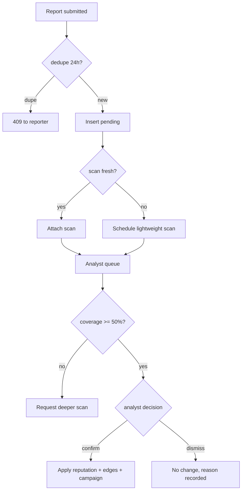

# THREAT_INTELLIGENCE_ENGINE

> **Status:** DECIDED · **Group:** 07-ai-intelligence · **Version:** 1.0 · **Last updated:** 2026-11-07
> **Source of truth for:** data sources, normalisation, reputation, report ingestion, verification, confidence, abuse, expiry.
> **Related:** [`THREAT_GRAPH.md`](THREAT_GRAPH.md) · [`../03-backend/RISK_ENGINE.md`](../03-backend/RISK_ENGINE.md) · [`../03-backend/ORGANISATION_TRUST_PROFILES.md`](../03-backend/ORGANISATION_TRUST_PROFILES.md)

---

## 1. What "intelligence" means here

TrustLens has no commercial threat feed and no scrape of a blocklist we do not own. Our intelligence is
built from four things:

1. **Observations** — what our own scanner saw (DNS, TLS, page, redirects).
2. **Reports** — what users and analysts told us, with evidence.
3. **Relationships** — how those observations connect (shared infrastructure, payees, kits).
4. **Organisation profiles** — the authoritative "should be" against which observations are compared.

Anything we cannot source is `UNAVAILABLE`. We do not invent a reputation score to look complete.

---

## 2. Sources and their status

| Source | Type | MVP status | Notes |
| --- | --- | --- | --- |
| Our scans | Primary | Available | Only source that is always on |
| User/analyst reports | Primary | Available | The core network effect |
| Organisation profiles | Primary | Available | Verification evidence |
| DNS / RDAP / TLS | Observation | Available | Public data |
| Certificate Transparency | Enrichment | **FUTURE** | Interface defined, no poller |
| Public advisories (CA incidents) | Enrichment | Manual + simulated | Real ingestion is FUTURE |
| Commercial reputation feeds | Enrichment | **OPTIONAL** | Adapter interface only; no vendor in MVP |
| Blocklists (own) | Derived | Available | Analyst-curated |

We openly say in the UI: "Reputation is built from scans, reports and verified profiles. We do not
currently ingest third-party feeds."

---

## 3. Normalisation

Every observation becomes an **entity** with a canonical key (see `THREAT_GRAPH.md` §3):

| Input | Canonical key |
| --- | --- |
| URL | `url:<normalised>` (scheme + host + path, query preserved) |
| Domain | `domain:<eTLD+1 or full host>` |
| IP | `ip:<canonical text form>` |
| Nameserver | `nameserver:<lowercase, no trailing dot>` |
| Certificate | `certificate:<sha256>` |
| CA | `ca:<normalised issuer CN>` |
| Payee | `payee:<type>:<normalised value>` |
| Organisation | `organisation:<id>` |
| Report | `report:<id>` |
| Campaign | `campaign:<id>` |
| ASN | `asn:<number>` |

Entity upserts are idempotent and update `last_seen_at`; `first_seen_at` never moves.

---

## 4. Reputation model

### 4.1 Score

`entities.reputation_score` is an integer in **−100…100**, default 0.

Contributions:

| Signal | Delta | Cap |
| --- | --- | --- |
| Confirmed report (per distinct reporter) | −12 | −60 from reports |
| Analyst manual block | −100 (sets floor) | — |
| Analyst dismissal of a confirmed report | +12 (reverses) | — |
| Report confirmed by analyst (their own) | −25 | — |
| Payee linked to a confirmed threat | −20 | — |
| Successful appeal (verified owner) | reset toward 0 by +30/step | 0 |
| Age decay | +2/week toward 0 | 0 |

Score is clamped and **decays**: an entity untouched for 90 days drifts 50% of the way back to 0. This
keeps a single old report from branding a domain forever.

### 4.2 Score → risk contribution

`R-REP-01` fires at ≤ −60 (critical). `R-REP-03` fires on report counts independent of score so a
fresh domain with two reports is still surfaced.

### 4.3 Why counts as well as score

Different reporters on the same URL can be one person with three accounts. We store
`distinct_reporter_count` per entity and require **≥ 2 distinct reporters** or **1 analyst
confirmation** before reputation changes at all (BR-005).

---

## 5. Report ingestion pipeline



Rules:

- A report never changes a verdict directly. It changes **reputation**, which the rule engine reads.
- Confirmation requires coverage ≥ 50% and a reason ≥ 10 chars.
- Confirmation writes `REPORTED_AS` and infrastructure edges with confidence derived from the report
  plus observation.
- Dismissal of a previously confirmed report reverses its contribution exactly once (idempotent).

---

## 6. Verification and confidence

| Claim | Evidence required | Confidence |
| --- | --- | --- |
| "This domain is malicious" | ≥ 2 distinct confirmed reporters **or** analyst confirmation | 0.6–0.95 |
| "This payee is a scam" | ≥ 2 confirmed reports naming it | 0.7 |
| "These two domains share infrastructure" | Observed edge (NS/CA/IP) | 0.2–0.5 |
| "These domains are one campaign" | Weighted overlap ≥ threshold | 0.45–0.9 |
| "This is the organisation's domain" | Completed challenge | 1.0 |
| "This is the organisation's payee" | Attestation by analyst | 0.9 (never 1.0: attestation is human) |

Confidence is stored per edge (not just per node) and is visible in the UI. A campaign's confidence is
the **minimum** of its strongest shared indicators, not an average.

---

## 7. Correlation inputs

Used by `THREAT_GRAPH.md` clustering:

| Shared feature | Base weight | Rationale |
| --- | --- | --- |
| Payment recipient | 0.30 | Strong: scammers reuse collection accounts |
| Nameserver pair | 0.35 | Strong: cheap hosting setups are reused |
| Certificate issuer + validity window | 0.20 | Weak alone, useful in aggregate |
| IP /24 | 0.15 | Shared hosting makes this noisy |
| DOM structure fingerprint | 0.25 | Phishing kits are reused |
| Logo pHash | 0.20 | Brand reuse, but legitimate too |
| Registrar + creation window | 0.10 | Bulk registration |

A single shared CDN or cloud provider is never a relationship (see `THREAT_GRAPH.md` §6.2 deny-list).

---

## 8. Abuse resistance

| Attack | Control |
| --- | --- |
| Mass-reporting a competitor | Distinct-reporter threshold, per-IP/per-user rate limits, analyst gate, reputation decay |
| Sybil accounts | New accounts (< 24 h) cannot contribute to reputation; email verification required |
| Report flooding to hide a real threat | Queue ordered by severity/coverage, not volume; dedupe per reporter+URL |
| Analyst social engineering | Two-person rule for manual blocks is FUTURE; MVP audits every block and shows it in the queue |
| Poisoning the graph | Edges need an observed source; user text never creates edges directly |
| Revenge reporting on a verified org | Owner reports are flagged and cannot lower reputation without analyst review |

Caps: a single entity can gain at most −24 reputation per 24 h from reports; at most −60 from reports
in total until an analyst intervenes.

---

## 9. Expiry and retention

| Data | Expiry |
| --- | --- |
| Report contribution to reputation | Decays 50% over 90 days without reinforcement |
| Pending reports | Auto-close to `dismissed` after 30 days if unreviewed (`reason: stale`) |
| Campaigns | Recomputed on correlation; stale (> 30 days, no new members) hidden from lists |
| Observations (DNS/TLS) | Superseded, not deleted; history retained 1 year |
| Analyst blocks | Permanent until removed; always visible in audit |

---

## 10. Interface (`/intelligence/*`)

| Endpoint | Purpose |
| --- | --- |
| `GET /intelligence/graph/{entityId}` | Neighbourhood with confidences |
| `GET /intelligence/entities` | Search |
| `GET /intelligence/entities/{entityId}` | Detail + reputation basis |
| `GET /campaigns` | Clusters |
| `GET /campaigns/{campaignId}` | Cluster detail |

Reputation basis is returned as structured data so the UI can show *why*:

```json
{
  "reputation_score": -46,
  "basis": [
    { "kind": "confirmed_report", "count": 3, "distinct_reporters": 3, "delta": -36 },
    { "kind": "payee_link", "delta": -20 },
    { "kind": "decay", "delta": 10 }
  ],
  "distinct_reporter_count": 3,
  "last_confirmed_at": "2026-10-28T11:02:00Z"
}
```

---

## 11. Privacy in shared intelligence

- Reports are shared as anonymous evidence: no reporter identity, no email, no IP.
- Justification text is stored but **never** shown to other tenants; only analysts see it.
- Organisation-private data (unverified domains, attestation artefacts) never enters the shared graph.
- Cross-tenant graph queries expose only entities and evidence summaries, never who reported them.

---

## 12. Failure behaviour

| Failure | Result |
| --- | --- |
| Correlation job fails | Campaigns unchanged; scan still completes; `INTELLIGENCE_DEGRADED` logged |
| Reputation store unavailable | `reputation` group `UNAVAILABLE`; coverage drops; decision capped accordingly |
| Report queue DB error | `500` to the reporter with `requestId`; no partial write |
| Duplicate confirmation (race) | `409 REPORT_ALREADY_REVIEWED`; second transaction rolls back |

---

## 13. Acceptance criteria

1. A single report never changes a decision (test with one reporter, assert reputation unchanged).
2. Two distinct confirmed reporters produce `RELATED_THREAT_FOUND` on a related domain.
3. A dismissed report reverses exactly one contribution (idempotency test).
4. Reputation never exceeds ±100 or drops below −100.
5. Decay moves scores toward 0 without ever exceeding it.
6. No shared-intelligence response contains a reporter identity (shape test).
7. Campaign confidence is the minimum of its strongest indicators, not an average (fixture test).
