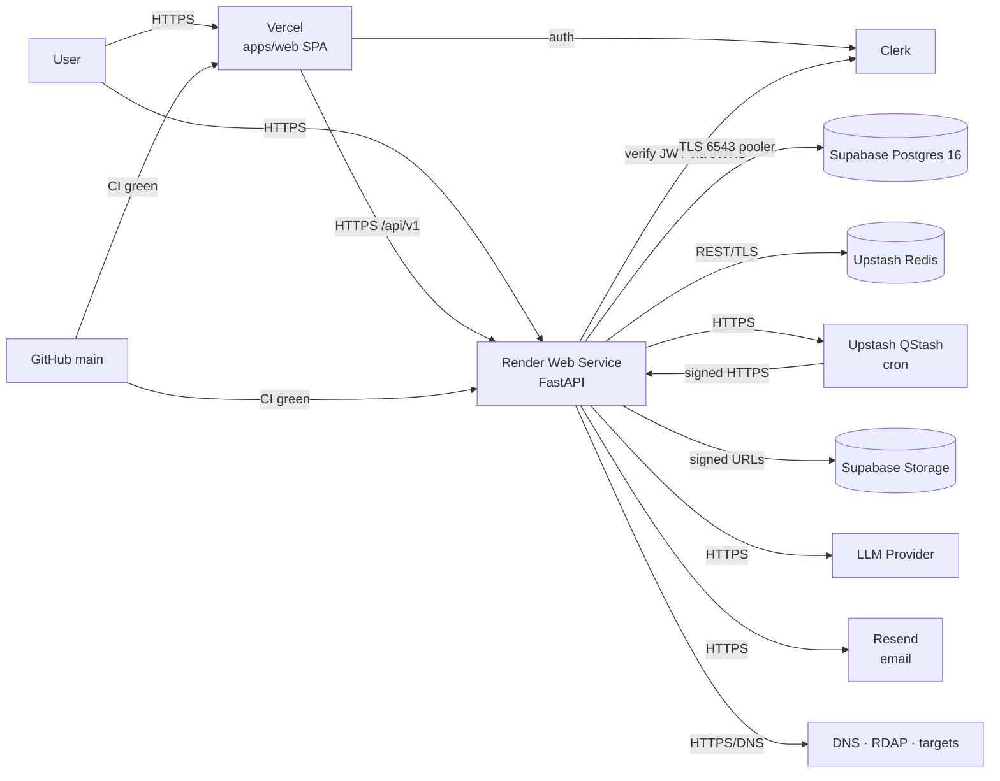

# DEPLOYMENT_ARCHITECTURE

> **Status:** DECIDED · **Group:** 08-infrastructure · **Version:** 1.0 · **Last updated:** 2026-11-07
> **Source of truth for:** hosting topology, build/start commands, deployment sequence, cold starts, rollback, demo readiness.
> **Related:** [`ENVIRONMENT_CONFIGURATION.md`](ENVIRONMENT_CONFIGURATION.md) · [`MONITORING_HEALTHCHECKS.md`](MONITORING_HEALTHCHECKS.md) · [`../10-hackathon-demo/DEMO_RUNBOOK.md`](../10-hackathon-demo/DEMO_RUNBOOK.md)

---

## 1. Topology



| Component | Service | Plan | Notes |
| --- | --- | --- | --- |
| Web | **Vercel** | Free | SPA, per-PR previews, instant rollback |
| API | **Render** Web Service (Python) | Free | Sleeps after ~15 min idle; ~30–60 s cold start |
| DB | **Supabase Postgres 16** | Free | Pooler 6543; pauses after ~7 days idle → weekly keep-alive job |
| Auth | **Clerk** | Free | JWT verified by the API via JWKS |
| Cache/limits | **Upstash Redis** | Free | REST; shared counters across workers |
| Cron | **Upstash QStash** | Free | Signed HTTP calls to internal job endpoints |
| Objects | **Supabase Storage** | Free | Evidence blobs, signed URLs, 30-day lifecycle |
| Email (**OPTIONAL**) | **Resend** | Free | Org invites, report notifications. The demo path sends no email |
| DNS for demo domains | Cloudflare | Free | Needed for the lookalike and verification demo |
| CI | GitHub Actions | Free | Lint, typecheck, tests, OpenAPI drift |

Everything above is deliberately minimal. There is no self-operated database, no self-hosted Redis,
no worker dyno, no container registry, no Kubernetes. Full limit/caveat table:
[`../02-architecture/HOSTED_SERVICES.md`](../02-architecture/HOSTED_SERVICES.md).

---

## 2. Render configuration

```yaml
# infrastructure/render.yaml
services:
  - type: web
    name: trustlens-api
    runtime: python
    plan: free
    region: singapore
    rootDir: apps/api
    buildCommand: pip install -r requirements.txt
    startCommand: uvicorn app.main:app --host 0.0.0.0 --port $PORT --workers 2
    healthCheckPath: /health
    autoDeploy: false
    envVars:
      - key: ENVIRONMENT
        value: production
      - key: DATABASE_URL
        sync: false
      - key: JWT_SECRET
        sync: false
      - key: LLM_API_KEY
        sync: false
      - key: ALLOWED_ORIGINS
        sync: false
      - key: DEMO_MODE
        value: "1"

  - type: web
    name: trustlens-web
    runtime: static
    rootDir: apps/web
    buildCommand: pnpm install && pnpm build
    staticPublishPath: dist
    routes:
      - type: rewrite
        source: /*
        destination: /index.html
    envVars:
      - key: VITE_API_BASE_URL
        sync: false
      - key: VITE_APP_VERSION
        value: "0.4.1"
```

Notes:

- `autoDeploy: false` — we deploy deliberately, after CI, so a broken commit cannot take the demo down
  mid-presentation.
- `--workers 2` is the maximum we allow on 512 MB; each worker holds its own caches, which are
  advisory only (ADR-003).
- `healthCheckPath: /health` keeps Render's own check cheap and independent of the DB.
- `DEMO_MODE=1` on the demo environment enables the simulated CA incident endpoint for operators.
  It is **not** set on any environment holding real reputation.

---

## 3. Build and release

### 3.1 Local

```bash
pnpm install
# apps/api/.env points at the hosted Supabase/Clerk/Upstash services; there is no local app DB
(cd apps/api && python -m app.scripts.online_check && alembic upgrade head)
(cd apps/api && uvicorn app.main:app --reload --port 8000)
pnpm --filter web dev
# integration tests: docker compose --profile test up -d test-db && pwsh scripts/test-api.ps1
```

### 3.2 CI (GitHub Actions, `.github/workflows/ci.yml`)

| Job | Steps |
| --- | --- |
| `web` | install → lint → typecheck → vitest → build (size budget check) |
| `api` | install → ruff → mypy → pytest (coverage gate 80% on services/risk) |
| `contract` | dump OpenAPI → diff check → regenerate `packages/shared-types` → diff check |
| `sdk` | build → tsd type tests → vitest → bundle size |
| `extension` | build → vitest |
| `secrets` | gitleaks on the diff |

Deployment jobs run only on `main` and only after all of the above pass.

### 3.3 Release sequence

```text
1. Merge to develop → CI
2. Merge develop → main (tag vX.Y.Z) → CI
3. Run migrations against the target DB   ← explicit step, never at startup
4. Deploy API (Render deploy hook)
5. Poll /ready until 200 (max 120 s)
6. Deploy static site
7. Smoke test: /health, /ready, one scan of the demo domain, one /assess
8. Tag the deployed commit as demo-YYYY-MM-DD
```

Why migrations before deploy: the new code may depend on a new column; the old code tolerates a new
nullable column. The reverse order causes 500s during the window.

### 3.4 Rollback

| Situation | Action |
| --- | --- |
| API regression | Redeploy the previous image/commit via Render; no migration rollback unless the migration is destructive |
| Migration bug | Run the documented downgrade only if it is reversible; otherwise forward-fix |
| Frontend bug | Redeploy the previous static build (immutable deploys make this a click) |
| DB unavailable | Nothing to roll back; API returns `503` from `/ready`, `/health` stays 200 |

Every migration must state whether it is reversible. Destructive changes use the two-release pattern
(`DATABASE_DESIGN.md` §9).

---

## 4. Cold starts

Render free web services sleep after ~15 minutes without inbound traffic. First request after sleep
takes roughly 30–60 seconds.

What we do:

1. The **frontend is static and always available** — the page renders, the product looks alive.
2. The dashboard detects a `503`/timeout and shows "Waking the analysis engine. This can take up to a
   minute." with a retry that preserves state.
3. The API does as little as possible at startup: no model init, no Playwright import, no warm caches.
4. Before the demo, the presenter runs the warm-up in `DEMO_RUNBOOK.md` §7.
5. We do **not** ping the service every few seconds. That is abusive, wasteful, and Render's own
   health checks are for running instances, not for keeping a sleeping one awake.

Measured expectations (to be recorded after first deploy): cold start p50, warm `/health` latency,
first-scan latency cold vs warm.

---

## 5. Resource limits and responses

| Limit | Response |
| --- | --- |
| 512 MB RAM | Static DOM analysis by default; Playwright behind `DEEP_SCAN_ENABLED` with semaphore 1 |
| Shared CPU | CPU work (`imagehash`) in a 2-slot thread pool |
| Ephemeral disk | No local state; evidence in Postgres/object storage |
| Single instance | No in-memory authoritative state; scan status in DB |
| Connection cap | Pool 5 + overflow 5, `pool_pre_ping` |
| No background workers | Bounded in-process tasks, 60 s budget, no retries |

---

## 6. Environments

| Environment | Purpose | DB | DEMO_MODE | Data |
| --- | --- | --- | --- | --- |
| `development` | Local | Docker Postgres | 1 | Seed allowed |
| `test` | CI | Ephemeral Postgres | 0 | Fixtures only |
| `preview` | Demo/staging | Managed Postgres (separate) | 1 | Seeded demo data |
| `production` | (FUTURE) real users | Managed Postgres | 0 | No simulated data |

The MVP deploys **one** public environment (preview/demo). The production split is documented so the
demo does not accidentally become production with simulated data in it.

---

## 7. Demo environment specifics

- Demo domains are owned by the team and resolve to a controlled host.
- Seed data is applied with `python -m app.scripts.seed_demo` (idempotent).
- `ALLOW_DEMO_SEED=1` is required when `ENVIRONMENT=production`.
- The simulated incident is created through the operator endpoint, never by direct SQL, so the audit
  trail is realistic.
- A reset command (`python -m app.scripts.reset_demo`) removes seeded scans/reports/campaigns and
  re-runs the seed. It refuses to run outside a demo environment.

---

## 8. Cost model

| Item | Monthly |
| --- | --- |
| Vercel (free) | $0 |
| Render web service (free) | $0 |
| Supabase (free: DB + Auth + Storage) | $0 |
| Upstash Redis (free) | $0 |
| Upstash QStash (free) | $0 |
| Resend (free, 3k emails/mo) | $0 |
| Sentry / LangSmith (free, optional) | $0 |
| LLM usage (demo volume, capped) | ~$2–5 |
| Domains (2) | ~$2 |
| **Total** | **≈ $5** |

Free-tier ceilings that would force an upgrade if exceeded: Supabase 500 MB DB, Upstash 10k commands/day,
QStash 500 messages/day, Vercel 100 GB bandwidth, Resend 3k emails/month. Tracked in
`HOSTED_SERVICES.md` §3.

The only real cost risk is LLM usage; capped by per-user/day limits and a monthly budget guard
(`AI_INVESTIGATION_ENGINE.md` §9).

---

## 9. Security in deployment

- Secrets only in host env vars, never in the repo or a build artifact.
- Static build contains no keys (CI greps for `tl_live_`, `sk-`, `JWT_SECRET`).
- CORS allowlist is explicit; the static site origin only.
- HSTS, `X-Content-Type-Options`, `X-Frame-Options: DENY`, `Referrer-Policy: same-origin` on API
  responses; the static host sets a CSP.
- Database user is not a superuser and owns only the app schema.
- Backups: provider daily snapshots (free tier retention noted in the runbook as a risk).
- Audit logs are retained even if a demo reset runs (reset clears demo content, not audit).

---

## 10. Acceptance criteria

1. `render.yaml` deploys both services from a clean repo without manual configuration beyond secrets.
2. `/health` returns 200 within 5 s of process start; `/ready` reflects the DB truthfully.
3. A cold start produces the documented UI state, not an unhandled error.
4. Migrations run before the new API version serves traffic.
5. A rollback of the API to the previous commit restores service without a DB change.
6. No secret appears in the built frontend bundle (CI grep passes).
7. The demo environment can be reseeded from scratch in under 60 seconds.
