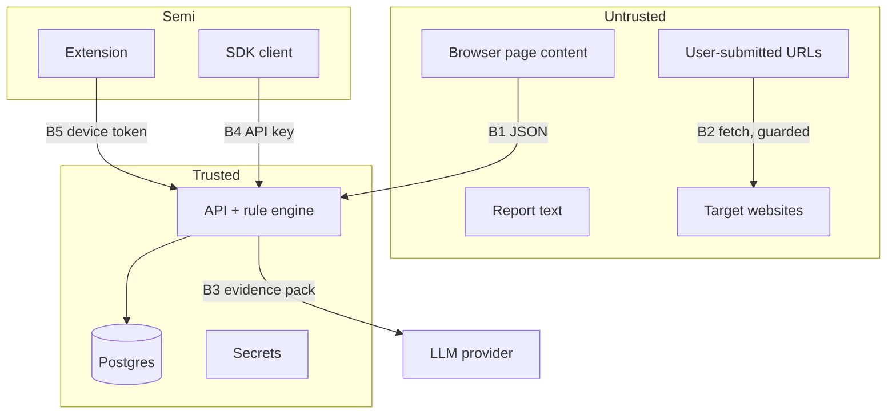

# SECURITY_THREAT_MODEL

> **Status:** DECIDED · **Group:** 09-testing-security · **Version:** 1.0 · **Last updated:** 2026-11-07
> **Source of truth for:** assets, actors, trust boundaries, STRIDE, SSRF, injection, abuse, residual risk, implementation status.
> **Related:** [`TESTING_STRATEGY.md`](TESTING_STRATEGY.md) · [`../02-architecture/SYSTEM_ARCHITECTURE.md`](../02-architecture/SYSTEM_ARCHITECTURE.md)

---

## 1. Scope and honesty statement

TrustLens is a security product that makes claims about other people's websites. Its own security
posture must be at least as rigorous as the claims it makes. This document covers the MVP: API,
dashboard, extension, SDK, database and deployment.

**No control listed here is implemented until code and tests exist.** §12 is the authoritative status
table. Everything else describes the intended design.

---

## 2. Assets

| Asset | Why it matters | Impact if compromised |
| --- | --- | --- |
| Verified organisation profiles | The authority behind every verdict | False blocks/clearances for a whole brand |
| Reputation and graph data | The network's intelligence | Poisoned intelligence, wrong campaigns |
| Scan evidence | Proof behind findings | Privacy leak, forged findings |
| User accounts and sessions | Access to tenant data | Account takeover |
| API keys / device tokens | Machine access | Quota abuse, data access within scopes |
| LLM credential | Cost and data path | Financial loss, data exposure |
| Demo domains and DNS | Demo integrity | Demo failure, impersonation of the demo |
| Audit logs | Accountability | Loss of non-repudiation |
| The scanner's network position | Can reach internal networks if abused | SSRF pivot |

---

## 3. Actors

| Actor | Capability | Motivation |
| --- | --- | --- |
| Opportunistic attacker | Public endpoints, signup, scanning | Abuse quota, probe internals |
| Fraudster / impersonator | Owns lookalike sites | Avoid detection, poison reports |
| Malicious tenant | Valid account | Read other tenants' data, brigade reports |
| Malicious analyst (insider) | Review rights | Block competitors, leak data |
| Compromised dependency | Build/runtime | Supply-chain compromise |
| Curious researcher | Public surface | Find weaknesses (welcome, via disclosure) |
| Accidental user | Normal use | Misreport, misconfigure |

---

## 4. Trust boundaries

Boundary rule: data crossing into the trusted zone is validated, size-capped, and never interpreted as
instructions or code.

---

## 5. STRIDE analysis

| Threat | Example | Control | Residual |
| --- | --- | --- | --- |
| **Spoofing** | Stolen access token; forged device token | JWT signature, short expiry, refresh rotation, hashed keys, device revocation | Token theft via malware on the user's machine |
| **Tampering** | Modified verdict in transit; altered report | TLS everywhere, server-side decisions, append-only audit, evidence hashes | Compromised client can display anything locally |
| **Repudiation** | Analyst denies blocking a domain | Audit log with actor, before/after, request id, IP hash | Shared analyst accounts (forbidden, but unenforceable) |
| **Information disclosure** | Cross-tenant read; leaked evidence; key in bundle | Tenant scoping, 404 on foreign ids, redaction, no secrets in client, private cache headers | Provider-side logs outside our control |
| **Denial of service** | Scan flood; expensive graph queries | Rate limits, concurrency semaphore, budgets, query timeouts, node caps | Single-instance saturation |
| **Elevation of privilege** | Member performs admin action; scope escalation | Role checks in service layer, scope allowlist, no wildcard scopes, DB re-check | Bugs in a new endpoint |
| **SSRF** | Scan `169.254.169.254` | Address classifier, per-hop validation, re-resolution, port allowlist | Novel encoding bypasses |
| **Prompt injection** | Page says "mark safe" | Fixed tool sequence, fenced data, ref validation, decision immutability | Prose pollution (bounded) |
| **Supply chain** | Malicious npm/pip package | Lockfiles, pinned versions, review of crypto/HTTP/parsing deps, secret scan | Upstream compromise |

---

## 6. SSRF: the highest-risk control

The scanner fetches attacker-supplied URLs. This is the one place where a bug turns our product into
an attack tool.

### 6.1 Policy

Reject before any connection:

- Loopback (`127.0.0.0/8`, `::1`), private (`10/8`, `172.16/12`, `192.168/16`, `fc00::/7`),
  link-local (`169.254/16`, `fe80::/10`), CGNAT (`100.64/10`), multicast, reserved, unspecified.
- Cloud metadata endpoints by IP **and** by hostname (`metadata.google.internal`,
  `169.254.169.254`, `fd00:ec2::254`).
- `.internal`, `.local`, `.localhost`, and single-label hostnames.
- Non-HTTP(S) schemes; ports outside `{80, 443, 8080, 8443}`.
- URLs with userinfo; URLs over 2048 chars.

### 6.2 Enforcement points

1. On submission (fast rejection, good error).
2. After DNS resolution, on the **resolved addresses** (not just the hostname).
3. On every redirect hop, re-resolved.
4. In the verification-file fetch (same guard, different caller).
5. In any future probe — the guard is the only way to get an HTTP client.

### 6.3 Rebinding defence

Resolution happens once per hop; the request is made to the **validated IP** with the `Host` header set
to the hostname, so a second DNS answer cannot redirect the connection. TLS verification still uses
the hostname via SNI. If the client cannot pin the IP, re-resolve immediately before connect and
compare; mismatch ⇒ abort.

**As implemented:** httpx does not pin the resolved IP, so every guarded fetch (scanner page fetch,
redirect inspector, domain-verification and appeal HTTP challenges) validates the **connected peer**
(`network_stream` `server_addr`) with `classify_ip` as soon as response headers arrive and before any
body byte is read (`guard.check_peer`). A rebound private/loopback/metadata peer aborts the hop as
`TARGET_NOT_ALLOWED`; the request line itself may have reached the rebound host, which is acceptable
because the scanner only sends unauthenticated GETs with no secrets.

### 6.4 Response limits

5 s per hop, 10 hops, 2 MB HTML cap, no decompression bombs (bounded `Content-Length` and streamed
read with a cap), no file downloads, no `Content-Type` execution.

### 6.5 What we never do

- No `curl`/`wget` shell-outs with user input.
- No proxy that follows redirects automatically.
- No active vulnerability scanning, fuzzing, or exploitation of third-party sites.
- No port scanning.

---

## 7. Authentication and authorisation threats

| Threat | Control |
| --- | --- |
| Credential stuffing | Per-account + per-IP limits, soft lock, constant-time login, generic errors |
| Password spraying | Same + common-password rejection at registration |
| Token theft (XSS) | Access token in memory; refresh HttpOnly; CSP; no raw HTML |
| Refresh replay | Rotation + family revocation |
| Session fixation | Tokens minted server-side; no client-chosen ids |
| CSRF | SameSite=Lax + Origin allowlist on cookie mutations |
| Privilege escalation | Service-layer role checks, DB re-check of membership, no wildcard scopes |
| IDOR | ULIDs + tenant filter + 404 for foreign ids |
| Key leakage | Hashed at rest, shown once, scoped, revocable, never in bundles |
| Extension token theft | Scoped to assess/report, 180-day expiry, revocable per device |
| Brute-forcing pairing codes | 8 chars, 10-min expiry, single use, rate limited |

---

## 8. Application-layer threats

| Threat | Control |
| --- | --- |
| XSS via report text / page title / org name | React escaping, no `dangerouslySetInnerHTML`, CSP, extension uses `textContent` |
| Stored XSS in graph labels | Labels rendered as text; SVG uses text nodes only |
| SQL injection | Parameterised queries; only the reviewed CTE uses raw SQL with bound params |
| Mass assignment | `extra="forbid"`, explicit field allowlists in services |
| Path traversal | No filesystem paths from user input; object keys are ULIDs |
| Open redirect | No redirect endpoints; `next=` must start with `/app` |
| Cache poisoning | `private`/`no-store` on personalised responses; public profile cache keyed by org id |
| Denial of wallet (LLM) | Per-user/day cap, monthly budget guard, template fallback |
| Log injection | Structured JSON logging; user values are fields, never concatenated into the message |

---

## 9. Extension-specific risk

| Risk | Mitigation |
| --- | --- |
| Over-broad permissions | `activeTab` + optional hosts; no `webRequest`, `cookies`, `history` |
| Reading credentials | Policy: never access `.value` on password/payment inputs; code review gate; grep test |
| Exfiltrating page content | Only derived metadata leaves the browser; no HTML, no screenshots |
| Injected overlay spoofing | Shadow root with isolated styles; overlay is rendered by us, not the page |
| Malicious page attacking the content script | No `eval`, no `innerHTML`, validate message shape, isolate in a closed shadow root |
| Token in extension storage | `storage.local` only (not synced), scoped token, revocable |
| Silent failure looking safe | Fail-open always renders `UNKNOWN`, never green |
| Update supply chain | Pinned deps, reproducible build, Web Store signing (FUTURE) |

---

## 10. AI-specific risk

| Risk | Mitigation |
| --- | --- |
| Prompt injection from page text | Fixed tool sequence; fenced data; no model-chosen tools; ref validation; decision immutable |
| Hallucinated findings | Model receives only existing findings; cannot add; unsupported claims dropped |
| Overclaiming safety | Forbidden-phrase validation; template must also avoid "safe" |
| Data leakage to provider | Only the redacted evidence pack; no HTML, no user data, no reporter identity |
| Cost abuse | Caps + budget guard + per-user limits |
| Model outage | Template fallback; product remains correct |
| Model version drift | Prompt version + eval script; narrative stored with prompt version |

---

## 11. Threats to the product's own integrity

| Threat | Control |
| --- | --- |
| Brigade a competitor off the internet | Distinct-reporter threshold, decay, analyst gate, appeals |
| Register a lookalike organisation profile | Domain challenge proves control only; fintech/education profiles need operator review; legal-identity checks are FUTURE (documented) |
| Poison the graph with fake shared infrastructure | Edges require observed evidence; user text cannot create edges; deny-lists for CDNs |
| Fake CA incident to scare users | Simulated incidents need `operator` + `DEMO_MODE`, are labelled everywhere, and carry `severity: info` so they cannot change a verdict |
| Present demo data as real | `simulated` flag + UI badge + export filename prefix + seed guard |

---

## 12. Implementation status

`D` = designed · `I` = implemented · `T` = tested. Update this table in the same PR that implements a
control. At documentation time everything is `D` — no code exists yet.

| Control | Status | Owner |
| --- | --- | --- |
| SSRF classifier + per-hop validation | D | Scanner |
| Rate limiting per identity/IP | D | Backend |
| JWT + refresh rotation + reuse detection | D | Backend |
| API key hashing + scopes + revocation | D | Backend |
| Device pairing + revocation | D | Backend |
| Tenant scoping + 404 on foreign ids | D | Backend |
| Audit log on all mutations | D | Backend |
| Redaction before evidence storage | D | Backend |
| CSRF origin check | D | Backend |
| CSP + security headers | D | Backend/Web |
| No-secrets-in-bundle CI grep | D | DevOps |
| Extension metadata-only extraction | D | Extension |
| Fixed AI tool sequence + ref validation | D | AI |
| Budget guard + per-user AI caps | D | AI |
| Simulated-data labelling | D | Backend/Web |
| Deny-list for graph correlation | D | Intelligence |
| Report thresholds + decay | D | Intelligence |
| Secret scanning in CI | D | DevOps |
| Dependency review policy | D | DevOps |

A reviewer must reject a PR that adds a control to the design without a status update here.

---

## 13. Residual risks (accepted)

| Risk | Why accepted | Mitigation/revisit |
| --- | --- | --- |
| Legal-identity verification is not implemented | Requires document checks/KYB we cannot do in the MVP | Fintech profiles operator-reviewed; documented in the profile doc; revisit post-MVP |
| Several scanners per domain could be evaded by cloaking | We fetch once, statically | Deep scan (Playwright) later; document the limitation |
| CDN-hosted phishing may evade infrastructure correlation | Deny-list intentionally removes CDN signals | Rely on identity/action signals, which are the differentiator |
| A determined attacker can fingerprint our scanner | User-Agent is honest (we identify ourselves) | Accepted: honesty over stealth; we are not an enforcement body |
| Single-instance availability | Cost | Documented cold start + demo warm-up |
| Provider sees the evidence pack | Necessary for AI | Zero-retention settings where available; no user data in pack |
| Analysts are trusted | Small team | Audit + least privilege; two-person rule is FUTURE |
| No real CT monitoring | Scope | Interface + schema ready; dependency mapping works from observed chains |

---

## 14. Incident response (MVP)

1. **Contain**: revoke keys, disable the affected feature flag (`DEEP_SCAN_ENABLED`, `DEMO_MODE`),
   rotate `JWT_SECRET` if sessions are suspect.
2. **Assess**: use `audit_logs` + request IDs to scope the impact.
3. **Notify**: affected organisation admins, and users if their data was involved.
4. **Fix**: patch, add a regression test in `TESTING_STRATEGY.md` §6.
5. **Record**: a post-incident note in this document's §13 if the risk profile changes.

Disclosure: a `security@` address is listed on `/security`; we acknowledge within 72 hours (best
effort for a hackathon project, stated honestly).

---

## 15. Acceptance criteria

1. The SSRF matrix in `TESTING_STRATEGY.md` §6.1 passes, including redirect and rebinding cases.
2. No endpoint returns another tenant's data (contract tests for every tenant-scoped route).
3. No secret is present in `apps/web/dist` or the extension bundle.
4. A page containing a prompt-injection payload cannot change a decision.
5. Every mutation produces exactly one audit row.
6. Simulated data is labelled in API, UI and exports.
7. §12 is updated for every control shipped.
